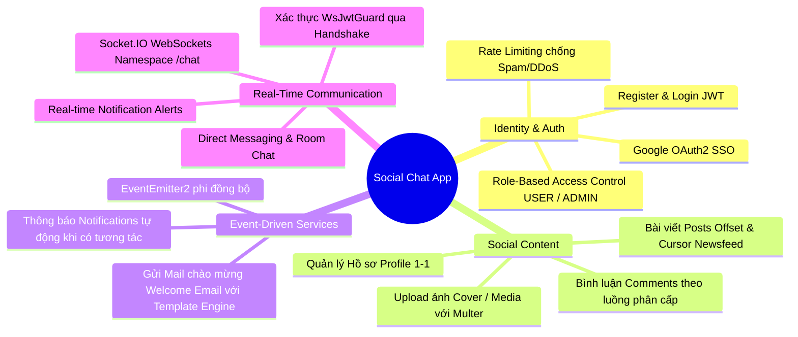
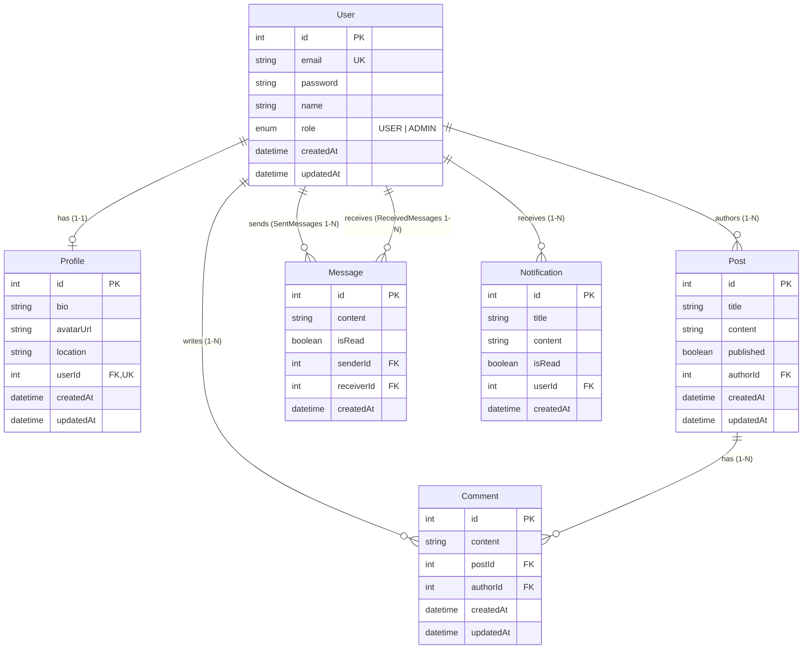
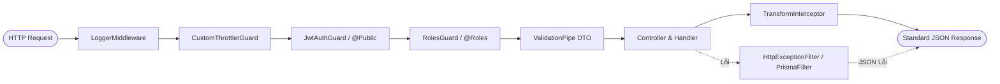
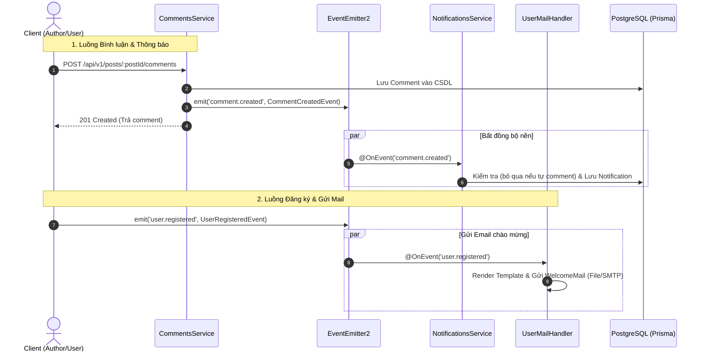

# Project Architecture & Codebase Overview: Social Chat App

> **Project:** `nestjs-basic-course`  
> **Course:** NestJS & TypeScript Thực Chiến: Xây Dựng Real-time Chat App với PostgreSQL, Prisma, WebSockets & Docker  
> **Audience:** AI Agents, Instructors, Code Reviewers & Technical Writers  
> **Purpose:** Cung cấp bức tranh toàn cảnh về nghiệp vụ, công nghệ, kiến trúc mã nguồn và trạng thái dự án thực tế để AI Agent luôn có ngữ cảnh chính xác khi soạn thảo hoặc cập nhật bài giảng.

---

## 1. 🎯 Tổng Quan & Nghiệp Vụ Dự Án (Business Context)

Dự án là một hệ thống backend API hoàn chỉnh cho nền tảng **Mạng xã hội & Chat thời gian thực (Social Network & Real-Time Chat App)**. Toàn bộ khóa học được thiết kế xoay quanh ứng dụng mẫu (Capstone Project) này theo phương pháp học thực chiến (Pragmatic Project-Driven Learning).

Học viên xây dựng hệ thống từ con số 0 qua 7 Modules: từ cấu hình code quality cơ bản, thiết kế CSDL quan hệ chuẩn hóa, xây dựng REST API hoàn chỉnh, xác thực & phân quyền đa chiến lược, đến Event-Driven Architecture, WebSockets song công thời gian thực và Docker/Cloud deployment.

### 1.1 Nghiệp vụ Cốt Lõi (Core Business Domains)



---

## 2. ⚙️ Technology Stack & Dependencies Chuẩn

> [!IMPORTANT]
> Mọi code snippet, hướng dẫn cài đặt và câu lệnh trong bài giảng **bắt buộc tuân thủ đúng phiên bản và package manager dưới đây**. Không tự ý hạ/nâng phiên bản hoặc chuyển sang `npm`/`yarn`.

| Thành phần             | Công nghệ / Thư viện                               | Phiên bản                                                | Ghi chú & Convention                                           |
| :--------------------- | :------------------------------------------------- | :------------------------------------------------------- | :------------------------------------------------------------- |
| **Package Manager**    | `pnpm`                                             | Latest                                                   | Tuyệt đối dùng `pnpm add`, không dùng `npm` hay `yarn`         |
| **Runtime & Language** | Node.js / TypeScript                               | Node 22+ / TS 5.7+                                       | Strict typing, decoratormetadata enabled                       |
| **Core Framework**     | NestJS                                             | `^11.0.1`                                                | Sử dụng platform Express (`@nestjs/platform-express`)          |
| **Database**           | PostgreSQL                                         | 16+                                                      | Chạy qua Docker Compose (`db` service trên port `5432`)        |
| **ORM**                | Prisma ORM                                         | `^7.9.1`                                                 | Sử dụng `@prisma/adapter-pg` + `pg` connection pool            |
| **WebSockets**         | Socket.IO                                          | `11.2.7` / `4.8.4`                                       | `@nestjs/websockets`, `@nestjs/platform-socket.io`             |
| **Authentication**     | Passport.js + JWT                                  | `@nestjs/jwt`, `passport-jwt`, `passport-google-oauth20` | Access Token Bearer Header, Google OAuth2                      |
| **Password Hash**      | `bcrypt`                                           | `^6.0.0`                                                 | Đóng gói trong `HashService` (10 salt rounds)                  |
| **Rate Limiting**      | `@nestjs/throttler`                                | `^6.7.1`                                                 | Multi-tier limits (short: 3/1s, medium: 20/10s, long: 100/60s) |
| **Event System**       | `@nestjs/event-emitter`                            | `^12.0.1`                                                | Wildcard support (`delimiter: '.'`), async listeners           |
| **Email Service**      | `@nestjs/mail`                                     | `^0.0.1`                                                 | FileTemplateEngine, Factory Pattern (`file` & `smtp`)          |
| **Validation**         | `class-validator`, `joi`                           | `0.15.1` / `18.2.5`                                      | Joi cho `.env`, Class Validator cho request DTOs               |
| **Documentation**      | `@nestjs/swagger`                                  | `^12.0.2`                                                | Swagger UI tương tác tại `/api/docs`                           |
| **Code Quality**       | ESLint 9, Prettier, Husky, Lint-staged, Commitlint | Mới nhất                                                 | Conventional Commits, tự động format trước commit              |

---

## 3. 🗄️ Mô Hình Dữ Liệu (Database Schema & Relations)

Hệ thống sử dụng **PostgreSQL** được định nghĩa bằng **Prisma ORM 7** (`prisma/schema.prisma`). Output client được sinh ra tại `src/generated/prisma`.

### 3.1 Sơ Đồ Thực Thể Quan Hệ (ERD)



### 3.2 Quy Tắc Ràng Buộc & Cascade

- **User ↔ Profile (1-1):** `userId` trong `Profile` có thuộc tính `@unique`. Khi User bị xóa, Profile tự động bị xóa (`onDelete: Cascade`).
- **User ↔ Post (1-N):** Khi User bị xóa, tất cả Posts của User đó bị xóa theo (`onDelete: Cascade`).
- **Post ↔ Comment & User ↔ Comment (1-N):** Xóa Post hoặc xóa User tác giả đều cascade xóa Comments tương ứng.
- **Message Direct Chat (1-N có tên):** Phân biệt rõ `senderId` (relation `"SentMessages"`) và `receiverId` (relation `"ReceivedMessages"`).

---

## 4. 🚀 Kiến Trúc Request Pipeline & Cấu Hình Toàn Cục

Mọi HTTP Request gửi tới server đều đi qua một pipeline chặt chẽ được cấu hình tại `src/main.ts` và `src/app.module.ts`:



### 4.1 Cấu Hình Bootstrap (`src/main.ts`)

- **Global Prefix:** `/api`
- **URI API Versioning:** `/v1` (tổng endpoint gốc: `/api/v1/...`)
- **Global ValidationPipe:**
  - `whitelist: true` (tự loại bỏ field không khai báo trong DTO)
  - `forbidNonWhitelisted: true` (báo lỗi 400 nếu truyền field thừa)
  - `transform: true` + `enableImplicitConversion: true` (tự động cast kiểu dữ liệu query/param)
- **Static Asset Serving:** Thư mục `uploads/` mount tới route prefix `/uploads/`.
- **Swagger Documentation:** Mount tại `/api/docs`, tích hợp sẵn Bearer JWT Auth.

### 4.2 Bộ Phận Xử Lý Toàn Cục (Global Providers trong `AppModule`)

1. **`LoggerMiddleware` (`consumer.apply().forRoutes('{*path}')`):** Ghi log IP, HTTP method, URL, status code và thời gian phản hồi (loại trừ endpoint `/health`).
2. **`JwtAuthGuard` (`APP_GUARD`):** Mặc định bảo vệ toàn bộ ứng dụng bằng Bearer JWT, trừ các endpoint hoặc controller được đánh dấu decorator `@Public()`.
3. **`RolesGuard` (`APP_GUARD`):** Kiểm tra vai trò người dùng dựa trên metadata `@Roles(Role.ADMIN)`.
4. **`CustomThrottlerGuard` (`APP_GUARD`):** Áp dụng rate-limiting 3 cấp độ (`short`, `medium`, `long`).
5. **`TransformInterceptor` (`APP_INTERCEPTOR`):** Chuẩn hóa mọi response thành công theo cấu trúc:
   ```json
   {
     "statusCode": 200,
     "message": "Thông điệp tùy biến từ @ResponseMessage()",
     "data": { ... },
     "timestamp": "2026-10-12T08:00:00.000Z"
   }
   ```
   _(Bỏ qua nếu endpoint dùng `@BypassTransform()`)_.
6. **`HttpExceptionFilter` & `PrismaClientExceptionFilter` (`APP_FILTER`):** Bắt và chuẩn hóa các mã lỗi HTTP và mã lỗi database Prisma (ví dụ: `P2002` lỗi Unique Constraint, `P2025` lỗi Not Found).

---

## 5. 📂 Cấu Trúc Thư Mục & Phân Hệ Module (`src/`)

```text
src/
├── app.controller.ts            # Health/Root Controller
├── app.module.ts                # Root Module tích hợp toàn bộ phân hệ
├── app.service.ts
├── main.ts                      # Bootstrap entry point
│
├── config/                      # Quản lý môi trường
│   └── env.validation.ts        # Joi schema kiểm tra biến môi trường
│
├── prisma/                      # Kết nối CSDL
│   ├── prisma.module.ts         # @Global() PrismaModule
│   └── prisma.service.ts        # Quản lý connection lifecycle & adapter-pg
│
├── auth/                        # Xác thực & Phân quyền
│   ├── auth.controller.ts       # Register, Login, Google OAuth routes
│   ├── auth.service.ts          # Logic sinh JWT, đối soát mật khẩu
│   ├── guards/                  # JwtAuthGuard, RolesGuard, GoogleAuthGuard, WsJwtGuard
│   ├── strategies/              # JwtStrategy, GoogleStrategy
│   └── interfaces/              # JwtPayload, UserData
│
├── users/                       # Quản lý Người dùng & Profile
│   ├── users.controller.ts      # Profile, danh sách người dùng
│   ├── users.service.ts         # CRUD user & profile
│   └── events/                  # UserRegisteredEvent
│
├── posts/                       # Quản lý Bài viết & Phân trang
│   ├── posts.controller.ts      # CRUD post, upload ảnh bài viết
│   ├── posts.service.ts         # Offset pagination & Cursor pagination newsfeed
│   └── dto/                     # CreatePostDto, UpdatePostDto, QueryPostDto
│
├── comments/                    # Quản lý Bình luận
│   ├── comments.controller.ts   # CRUD comment dưới post (Cursor pagination)
│   ├── comments.service.ts      # Logic phân quyền xóa (tác giả, chủ post, admin)
│   └── events/                  # CommentCreatedEvent (bắn event thông báo)
│
├── notifications/               # Hệ thống Thông báo (Event-Driven)
│   ├── notifications.controller.ts # Danh sách thông báo, mark as read
│   ├── notifications.service.ts    # @OnEvent('comment.created') tự lưu DB
│   └── dto/                     # QueryNotificationDto (Cursor pagination)
│
├── mail/                        # Hệ thống Gửi Email
│   ├── mail.module.ts           # Tích hợp @nestjs/mail
│   ├── handlers/                # UserMailHandler lắng nghe @OnEvent('user.registered')
│   ├── mails/                   # WelcomeMail template definition
│   ├── templates/               # Handlebars/EJS mail templates
│   └── transports/              # Factory tạo FileTransport hoặc SmtpTransport
│
├── chat/                        # WebSockets Real-time Communication & REST Chat APIs
│   ├── chat.module.ts           # Đóng gói ChatGateway & ChatController
│   ├── chat.controller.ts       # Conversations, Message History & Read status REST APIs
│   ├── chat.gateway.ts          # WebSocketGateway (/chat namespace, WsJwtGuard)
│   ├── chat.service.ts          # Lưu tin nhắn, phòng chat & lịch sử hội thoại
│   └── dto/                     # Chat message payloads
│
└── shared/                      # Các tiện ích & Pipeline dùng chung
    ├── constants/               # Metadata keys, Event names (EVENT.COMMENT.CREATED...)
    ├── decorators/              # @CurrentUser, @Public, @Roles, @ResponseMessage...
    ├── filters/                 # HttpExceptionFilter, PrismaClientExceptionFilter
    ├── guards/                  # CustomThrottlerGuard
    ├── helpers/                 # File upload filters, helpers
    ├── interceptors/            # TransformInterceptor
    ├── middleware/              # LoggerMiddleware
    ├── pipes/                   # image-validation.pipe.ts
    └── services/                # HashService (bcrypt wrapper)
```

---

## 6. 🔄 Cơ Chế Sự Kiện & Bất Đồng Bộ (Event-Driven Architecture)

Dự án áp dụng triệt để mô hình **Decoupled Architecture** thông qua `@nestjs/event-emitter`. Các module nghiệp vụ chính không gọi trực tiếp lẫn nhau mà giao tiếp qua sự kiện:



### Các sự kiện chuẩn hóa (`src/shared/constants/event.constant.ts`):

- `EVENT.USER.REGISTERED`: Kích hoạt gửi Welcome Mail.
- `EVENT.COMMENT.CREATED`: Kích hoạt tạo bản ghi Thông báo cho tác giả bài viết.

---

## 7. ⚡ Phân Hệ WebSockets & Chat Thời Gian Thực

### 7.1 Cấu Hình Gateway & Security (`src/chat/chat.gateway.ts`, `src/auth/guards/ws-jwt.guard.ts`)

- **Decorator:** `@WebSocketGateway({ namespace: '/chat', cors: { origin: '*' } })`
- **Security:** `@UseGuards(WsJwtGuard)`
  - Guard trích xuất Bearer token từ `client.handshake.auth.token` (hoặc `headers.authorization`).
  - Tự động gán thông tin `UserData` vào `client.data.user`.
  - **Tự động Join User Room:** Ngay trong `handleRequest()`, guard thực thi `void client.join(\`user:${client.data.user.userId}\`)`. Cơ chế này loại bỏ hoàn toàn việc phải verify token trùng lặp trong `handleConnection()`, đồng thời đảm bảo socket client luôn lập tức tham gia phòng cá nhân khi reconnect/refresh trang.
  - Hỗ trợ custom param decorator `@CurrentUser()` ngay trong message handler của WebSocket.
- **Quản lý Hằng Số:** Toàn bộ event (`CHAT_EVENTS`) và room prefix (`CHAT_ROOM`) được quản lý tập trung trong `src/chat/constants/chat.constant.ts`.
- **Message Handlers:**
  - `@SubscribeMessage(CHAT_EVENTS.PING)`: Heartbeat check, trả về `'pong'`.
  - `@SubscribeMessage(CHAT_EVENTS.SUBSCRIBE_NOTIFICATIONS)`: Đăng ký phòng thông báo cá nhân (`user:${userId}`).
  - `@SubscribeMessage(CHAT_EVENTS.JOIN_ROOM)` & `LEAVE_ROOM`: Quản lý tham gia / rời phòng chat nhóm và thông báo cho các thành viên còn lại.
  - `@SubscribeMessage(CHAT_EVENTS.SEND_ROOM_MESSAGE)`:
    - **Chat nhóm:** Broadcast sự kiện `CHAT_EVENTS.NEW_ROOM_MESSAGE` tới `targetRoom`.
    - **Chat 1-1 (có `receiverId`):** Broadcast đồng thời tới cả 2 phòng người nhận và người gửi `[receiverUserRoom, senderUserRoom]`.
    - **Payload chuẩn hóa (`ChatBroadcastPayload`):** Đảm bảo có `id`, `receiverId`, `roomId`, và object `sender` (bao gồm `profile: { avatarUrl }`) tương thích hoàn toàn với frontend.
  - `@SubscribeMessage(CHAT_EVENTS.GET_HISTORY)`: Lấy lịch sử hội thoại từ database qua `ChatService`.
- **Inter-Module Communication:**
  - `sendNotificationToUser(userId, payload)`: Cung cấp method public cho `NotificationsService` đẩy thông báo realtime tới phòng `user:${userId}`.

---

## 8. 📊 Trạng Thái Hiện Tại Của Khóa Học (Course Progress Map)

| Module       | Tên Module                                         |  Trạng Thái Codebase   | Các bài đã hoàn thành                                                     |
| :----------- | :------------------------------------------------- | :--------------------: | :------------------------------------------------------------------------ |
| **Module 1** | Khởi tạo dự án, Code Quality & Core Concepts       |   ✅ 100% Hoàn thành   | 1.1 đến 1.10 (Full markdown + slides)                                     |
| **Module 2** | PostgreSQL & Prisma ORM                            |   ✅ 100% Hoàn thành   | 2.1 đến 2.9 (Setup, Relations, Seeds, Filters)                            |
| **Module 3** | Chuẩn hóa REST API & Request Pipeline              |   ✅ 100% Hoàn thành   | 3.1 đến 3.6 (Versioning, DTO, Pipes, Filters, Interceptors)               |
| **Module 4** | Authentication, Security & Rate-Limiting           |   ✅ 100% Hoàn thành   | 4.1 đến 4.8 (JWT, Passport, Google OAuth, Roles, Throttler)               |
| **Module 5** | Swagger, Social Features & Event-Driven            |   ✅ 100% Hoàn thành   | 5.1 đến 5.7 (Posts, Upload, Comments, Events, Mail)                       |
| **Module 6** | Real-Time WebSockets Chat & Full-Stack Integration | ⏳ **Đang triển khai** | **6.1, 6.2, 6.3, 6.4 & 6.5 đã xong.** Chuẩn bị: **6.6 (React UI)**        |
| **Module 7** | Performance Optimization, Testing & Cloud Deploy   | ⏳ Kế hoạch tiếp theo  | 7.1 (Caching), 7.2 (Logging), 7.3 (Terminus), 7.4 (Testing), 7.5 (Deploy) |

---

## 9. 📋 Quy Tắc Bắt Buộc Dành Cho AI Agent Khi Tạo Bài Giảng Mới

Mỗi khi nhận nhiệm vụ tạo hoặc chỉnh sửa bất kỳ bài giảng nào, AI Agent **phải thực hiện các bước sau**:

1. **Đọc lại tài liệu này (`docs/04-project-architecture-and-codebase.md`)**:
   - Đối chiếu vị trí bài học với mục _Trạng Thái Hiện Tại_.
   - Đảm bảo các imports, decorator, tên bảng, quan hệ entity khớp 100% với mã nguồn dự án.
2. **Không bịa đặt thư viện hay cấu hình lạ**:
   - Dùng `pnpm` (không dùng `npm`/`yarn`).
   - Dùng Prisma 7 với `@prisma/adapter-pg` và path import `src/generated/prisma`.
   - Dùng `@nestjs/event-emitter` và `@nestjs/mail` theo đúng convention đã dựng sẵn.
   - Dùng WebSocket namespace `/chat` và `WsJwtGuard` cho các bài về WebSockets.
3. **Bảo toàn tính nhất quán xuyên suốt (Pedagogical Continuity)**:
   - Bài học sau phải kế thừa các artifact và class từ bài học trước.
   - Code thực hành phải runnable (Copy → Paste → Run), có đường dẫn file rõ ràng.
4. **Kiểm tra schema và quan hệ thực tế**:
   - Khảo sát file `prisma/schema.prisma` trước khi viết bất kỳ câu query hay API nào liên quan đến Database.

---

> **Tài liệu được bảo trì tự động và cập nhật theo tiến trình phát triển của `nestjs-basic-course`.**
