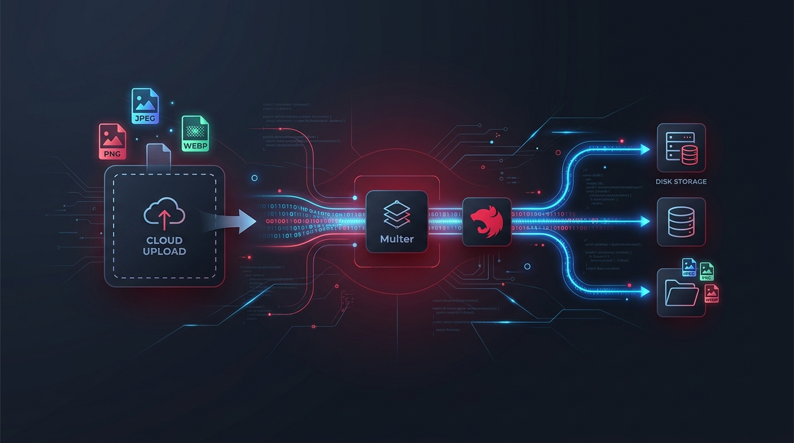
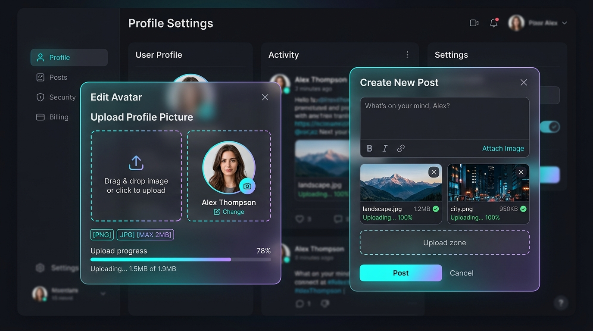
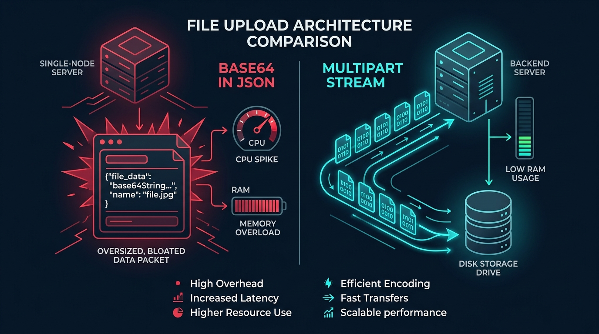
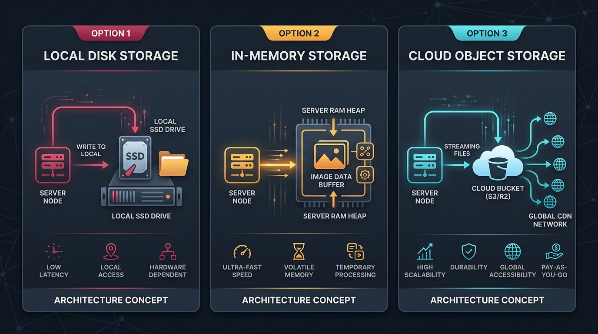
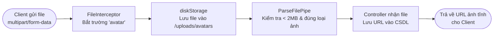

# Lesson 5.3: File Upload — Hướng Dẫn Tải Lên & Lưu Trữ Tệp Tin Trong NestJS

<p align="center">
  
  
  
  
  
</p>

<p align="center">
  
</p>

---

> [!NOTE]
> ⏱️ **Thời lượng dự kiến:** 12 – 15 phút thực chiến  
> 🎯 **Mục tiêu bài học:**
>
> - Giải thích được vì sao **không nên truyền file dưới dạng Base64 qua JSON** và tại sao chuẩn công nghiệp bắt buộc sử dụng **`multipart/form-data`**.
> - So sánh ưu nhược điểm của **3 chiến lược lưu trữ file** phổ biến: Local Disk (`diskStorage`), In-Memory (`memoryStorage`), và Cloud Storage (S3 / R2).
> - Hiểu cách thức NestJS tiếp nhận tệp tin từ Client thông qua **Multer** (`FileInterceptor` & `@UploadedFile()`).
> - Biết cách lưu trữ tệp tin vào ổ đĩa máy chủ (`diskStorage`) với tên file ngẫu nhiên an toàn, tránh bị ghi đè.
> - Biết cách kiểm tra tệp tin cơ bản (dung lượng tối đa 2MB, định dạng ảnh hợp lệ) bằng `ParseFilePipeBuilder`.
> - Kích hoạt cấu hình phục vụ tệp tĩnh trong NestJS (`app.useStaticAssets`) để người dùng có thể xem ảnh trực tiếp qua đường dẫn URL.
> - Áp dụng vào dự án thực tế: Xây dựng API **Upload ảnh đại diện (Avatar)** cho người dùng và lưu đường dẫn vào CSDL.

---

## 1. Đặt Vấn Đề: Upload File & Tại Sao Không Dùng Base64

### 1.1 Trải Nghiệm Người Dùng Thực Tế

Trong hầu hết các ứng dụng web và di động (như mạng xã hội, chat app), việc cho phép người dùng tải lên hình ảnh là tính năng cơ bản:

- Đổi ảnh đại diện cá nhân (Avatar).
- Đăng tải hình ảnh đính kèm bài viết.

<p align="center">
  
</p>

---

### 1.2 Tại Sao Không Truyền File Dưới Dạng Base64 Qua JSON?

Khi mới làm quen với phát triển Web API, nhiều bạn thường đặt câu hỏi:

> _"Tại sao chúng ta không mã hóa file ảnh thành chuỗi Base64 (`data:image/png;base64,iVBORw0KGgo...`) rồi gửi kèm trong body JSON như bình thường, vừa tiện lợi vừa không cần cấu hình thêm thư viện?"_

Hãy quan sát bức tranh so sánh kiến trúc dưới đây để thấy sự khác biệt mang tính sống còn giữa hai cách tiếp cận:

<p align="center">
  
</p>

Mặc dù Base64 có thể chạy được với những icon siêu nhỏ (< 20KB), nhưng trong kỹ thuật backend, đây là một **anti-pattern rất nguy hiểm** bởi 3 nguyên nhân cốt lõi:

- 📈 **1. Phình to dung lượng mạng (~33% Overhead):**  
  Thuật toán Base64 biến mỗi 3 bytes nhị phân thành 4 ký tự ASCII. Một bức ảnh gốc **10MB** khi chuyển sang Base64 sẽ phình to thành **~13.3MB**. Băng thông mạng và thời gian chờ đợi của người dùng bị lãng phí nghiêm trọng.
- 💥 **2. Nghẽn Event Loop & Quá tải CPU / RAM (Memory Spikes):**  
  Node.js là môi trường đơn luồng (Single-threaded). Để xử lý chuỗi Base64 hàng chục triệu ký tự, V8 Engine phải cấp phát RAM lớn để giữ chuỗi text, sau đó dùng CPU để decode ngược về Binary Buffer. Khi có 30–50 người dùng cùng upload ảnh một lúc, Event Loop sẽ bị đóng băng, Garbage Collector quá tải và làm đứng toàn bộ các request API khác của hệ thống!
- 🌊 **3. Mất khả năng truyền theo luồng (No Streaming Support):**  
  Với JSON, máy chủ **bắt buộc phải nhận đủ 100% toàn bộ chuỗi text** thì mới parse được. Trong khi đó, với `multipart/form-data`, dữ liệu nhị phân được chia nhỏ thành từng khối (chunks) và stream trực tiếp xuống ổ cứng, máy chủ không cần giữ toàn bộ file trong bộ nhớ RAM cùng một lúc.

> [!IMPORTANT]
> **Kết luận kiến trúc:**  
> Chuẩn công nghiệp (RFC 7578) luôn sử dụng định dạng **`multipart/form-data`** để gửi file nhị phân. Dữ liệu được truyền dưới dạng luồng (Stream) nguyên bản, giữ nguyên dung lượng gốc và giải phóng hoàn toàn gánh nặng cho bộ nhớ RAM của máy chủ.

---

## 2. Các Chiến Lược Lưu Trữ File Trong Backend (Storage Strategies)

Sau khi nhận file từ Client, hệ thống Backend cần đưa ra quyết định: **File này sẽ được lưu ở đâu?**

Dưới đây là bức tranh toàn cảnh 3 chiến lược lưu trữ file phổ biến nhất trong kỹ thuật phần mềm:

<p align="center">
  
</p>

Hãy cùng phân tích ưu nhược điểm và ứng dụng thực tế của từng phương án:

### 🏠 Option 1: Lưu trữ Ổ Đĩa Cục Bộ (Local Disk Storage — `diskStorage`)

- **Cơ chế:** Server nhận các chunk nhị phân và ghi thẳng vào ổ cứng vật lý (`./uploads/avatars/...`).
- **Ưu điểm:** ⚡ Đơn giản nhất, hoàn toàn miễn phí, không phụ thuộc dịch vụ bên thứ ba, RAM tiêu thụ gần như bằng 0 bất kể file lớn tới đâu.
- **Nhược điểm:** File nằm cục bộ trên một máy chủ duy nhất. Nếu hệ thống mở rộng chạy nhiều container Docker (Multi-instance), các container sẽ không thấy file của nhau (trừ khi cấu hình Shared Network Volume).
- **Phù hợp:** **Môi trường học tập, MVP, ứng dụng Monolith và dự án Capstone của chúng ta.**

### 🧠 Option 2: Lưu trữ Bộ Nhớ Tạm (In-Memory Storage — `memoryStorage`)

- **Cơ chế:** Toàn bộ file được nạp tạm thời vào bộ nhớ RAM của tiến trình Node.js dưới dạng `file.buffer`.
- **Ưu điểm:** 🚀 Tốc độ truy xuất và xử lý cực nhanh (micro-seconds); hoàn hảo để kết hợp với thư viện xử lý ảnh (crop, resize, watermark với `sharp`) trước khi chuyển tiếp.
- **Nhược điểm:** 💥 **Cực kỳ nguy hiểm nếu không giới hạn dung lượng:** Mỗi upload sẽ ngốn một lượng RAM tương ứng. Nhiều user upload cùng lúc sẽ kích hoạt lỗi sập máy chủ Out-Of-Memory (OOM Crash).
- **Phù hợp:** File rất nhỏ (< 500KB) hoặc đóng vai trò **bước đệm xử lý ảnh** trong RAM trước khi đẩy lên đám mây.

### ☁️ Option 3: Lưu trữ Đám Mây (Cloud Object Storage — S3 / Cloudflare R2)

- **Cơ chế:** Server đóng vai trò trung chuyển, stream trực tiếp dữ liệu lên dịch vụ lưu trữ đối tượng đám mây (như AWS S3, Google Cloud Storage, Cloudflare R2) và phân phối qua CDN toàn cầu.
- **Ưu điểm:** 🌐 Dung lượng vô hạn, độ bền dữ liệu 99.999999999%, tốc độ tải cực nhanh qua CDN, hỗ trợ hàng triệu container cùng truy cập mà không lo đồng bộ ổ đĩa.
- **Nhược điểm:** 💳 Cần tài khoản thẻ tín dụng quốc tế, chi phí lưu trữ/băng thông và phải cài đặt cấu hình AWS SDK phức tạp hơn.
- **Phù hợp:** **Môi trường Production thực tế quy mô doanh nghiệp.**

---

### 💡 Bảng So Sánh Quyết Định Thiết Kế

| Tiêu Chí             | 🏠 1. Local Disk (`diskStorage`)                       | 🧠 2. In-Memory (`memoryStorage`)                          | ☁️ 3. Cloud Storage (AWS S3 / Cloudflare R2)            |
| :------------------- | :----------------------------------------------------- | :--------------------------------------------------------- | :------------------------------------------------------ |
| **Vị trí lưu**       | Lưu trực tiếp vào ổ đĩa cứng của server (`./uploads/`) | Lưu tạm thời trong RAM của Node.js process (`file.buffer`) | Lưu trên các dịch vụ Object Storage đám mây chuyên dụng |
| **Mức tiêu hao RAM** | 🟢 Cực thấp (Dữ liệu ghi thẳng xuống đĩa)              | 🔴 Rất cao (Mỗi file chiếm dung lượng tương ứng trong RAM) | 🟡 Vừa phải (Chỉ đệm luồng stream trước khi đẩy lên S3) |
| **Độ phức tạp**      | 🟢 Cực kỳ đơn giản, không cần cấu hình bên ngoài       | 🟢 Tích hợp sẵn trong Multer                               | 🔴 Cần tài khoản AWS, API Keys, Buckets & SDK           |
| **Khả năng mở rộng** | 🟡 Giới hạn trên một máy chủ vật lý / volume           | 🔴 Không lưu trữ lâu dài                                   | 🟢 Vô hạn quy mô (High Scalability + Global CDN)        |
| **Quyết định chọn**  | 🏆 **Lựa chọn cho bài học thực chiến này!**            | Bước đệm khi cần xử lý ảnh với `sharp`                     | Mục tiêu nâng cấp khi lên Production                    |

> [!TIP]
> **Quyết định thiết kế trong khóa học:**  
> Chúng ta lựa chọn chiến lược **Local Disk (`diskStorage`)** — giải pháp kinh điển, an toàn tuyệt đối cho bộ nhớ RAM của máy chủ và dễ dàng tích hợp ngay trong đồ án thực chiến trước khi tiến tới các bài học Cloud Deployment ở Module nâng cao.

---

## 3. Cách Upload & Lưu Trữ File Trong NestJS Hoạt Động Như Thế Nào?

NestJS tích hợp sẵn **Multer** — thư viện xử lý `multipart/form-data` tiêu chuẩn của Node.js/Express thông qua package `@nestjs/platform-express`.

Quy trình xử lý file trong NestJS gồm 4 bước ngắn gọn:



1. **`FileInterceptor('avatar', { storage })`**: Đứng trước Route Handler, lắng nghe trường `avatar` trong form gửi lên và tiến hành lưu file theo cấu hình `storage`.
2. **`diskStorage`**: Chỉ định thư mục lưu trữ (`destination`) và cách đặt tên file (`filename`).
3. **`ParseFilePipe`**: Bộ lọc tự động từ chối nếu file quá nặng hoặc không phải ảnh.
4. **`@UploadedFile()`**: Decorator giúp bạn lấy thông tin file (tên file, kích thước, đường dẫn) trong hàm xử lý.

---

## 4. Thực Hành Từng Bước (Step-by-Step)

### 📌 Bước 1: Cài đặt Type Definitions cho Multer

Multer đã có sẵn bên trong NestJS (`@nestjs/platform-express`), bạn chỉ cần cài đặt thêm gói kiểu dữ liệu TypeScript cho trình biên dịch hiểu kiểu `Express.Multer.File`:

```bash
pnpm add -D @types/multer
```

---

### 📌 Bước 2: Cấu hình nơi lưu trữ file với `diskStorage`

Khi lưu file vào máy chủ, chúng ta cần đảm bảo:

- Thư mục lưu trữ tự động được tạo nếu chưa tồn tại.
- Tên file phải là **duy nhất** (kết hợp `Date.now()` và UUID ngẫu nhiên) để tránh trường hợp hai người dùng upload cùng một tên file (ví dụ `avatar.png`) làm đè mất file của nhau.

Tạo tệp helper gọn nhẹ 📄 **`src/shared/helpers/multer.helper.ts`**:

```typescript
import { diskStorage } from 'multer';
import { existsSync, mkdirSync } from 'node:fs';
import { extname, join } from 'node:path';
import { randomUUID } from 'node:crypto';

/**
 * Cấu hình lưu file vào ổ đĩa cục bộ
 * @param subFolder Tên thư mục con bên trong 'uploads' (ví dụ: 'avatars', 'posts')
 */
export const saveImageToDisk = (subFolder: string) => {
  const uploadPath = join(process.cwd(), 'uploads', subFolder);

  return diskStorage({
    // 1. Chỉ định thư mục lưu file
    destination: (req, file, cb) => {
      if (!existsSync(uploadPath)) {
        mkdirSync(uploadPath, { recursive: true });
      }
      cb(null, uploadPath);
    },
    // 2. Đặt tên file ngẫu nhiên an toàn: [timestamp]-[uuid].[ext]
    filename: (req, file, cb) => {
      const ext = extname(file.originalname).toLowerCase();
      const uniqueName = `${Date.now()}-${randomUUID()}${ext}`;
      cb(null, uniqueName);
    },
  });
};
```

---

### 📌 Bước 3: Cập nhật Service để lưu đường dẫn Avatar vào CSDL

Mở tệp 📄 **`src/users/users.service.ts`**, bổ sung hàm cập nhật `avatarUrl` cho người dùng vào bảng `Profile`:

```typescript
import { ConflictException, Injectable } from '@nestjs/common';
import { CreateUserDto } from './dto/create-user.dto';
import { PrismaService } from '@/prisma/prisma.service';
import { HashService } from '@/shared/services/hash.service';

export interface User {
  id: number;
  name: string;
  email: string;
}

@Injectable()
export class UsersService {
  constructor(
    private readonly prisma: PrismaService,
    private readonly hashService: HashService,
  ) {}

  // ... các hàm findAll(), create() giữ nguyên ...

  /**
   * Lưu đường dẫn ảnh đại diện vào CSDL PostgreSQL (bảng profiles)
   */
  async updateAvatar(userId: number, avatarUrl: string) {
    const updatedProfile = await this.prisma.profile.upsert({
      where: { userId },
      create: {
        userId,
        avatarUrl,
      },
      update: {
        avatarUrl,
      },
    });

    return updatedProfile;
  }
}
```

---

### 📌 Bước 4: Viết API Upload Avatar trong Controller

Mở tệp 📄 **`src/users/users.controller.ts`**, thêm route `POST /users/avatar`:

```typescript
import {
  Body,
  Controller,
  Get,
  HttpStatus,
  ParseFilePipeBuilder,
  Post,
  UploadedFile,
  UseInterceptors,
} from '@nestjs/common';
import { UsersService } from './users.service';
import { CreateUserDto } from './dto/create-user.dto';
import { type UserData } from '@/auth/interfaces/jwt.interface';
import { CurrentUser } from '@/shared/decorators/current-user.decorator';
import { Roles } from '@/shared/decorators/roles.decorator';
import { ResponseMessage } from '@/shared/decorators/response-message.decorator';
import { Role } from '@/generated/prisma/enums';
import { ApiBody, ApiConsumes, ApiOperation, ApiTags } from '@nestjs/swagger';
import { FileInterceptor } from '@nestjs/platform-express';
import { saveImageToDisk } from '@/shared/helpers/multer.helper';

@Controller('users')
@ApiTags('Users')
export class UsersController {
  constructor(private readonly usersService: UsersService) {}

  @Get()
  @Roles(Role.ADMIN)
  findAll() {
    return this.usersService.findAll();
  }

  @Post()
  createUser(@Body() body: CreateUserDto) {
    return this.usersService.create(body);
  }

  @Get('profile')
  getProfile(@CurrentUser() userData: UserData) {
    return {
      message: 'Xác thực tài khoản thành công qua NativeAuthGuard!',
      user: userData,
    };
  }

  /**
   * API Upload ảnh đại diện cá nhân
   */
  @Post('avatar')
  @ApiOperation({ summary: 'Upload và cập nhật ảnh đại diện cá nhân' })
  @ApiConsumes('multipart/form-data')
  @ApiBody({
    schema: {
      type: 'object',
      properties: {
        avatar: {
          type: 'string',
          format: 'binary',
          description: 'Chọn file ảnh đại diện (Tối đa 2MB)',
        },
      },
      required: ['avatar'],
    },
  })
  @UseInterceptors(
    FileInterceptor('avatar', {
      storage: saveImageToDisk('avatars'), // Lưu file vào /uploads/avatars
    }),
  )
  @ResponseMessage('Cập nhật ảnh đại diện thành công!')
  async uploadAvatar(
    @CurrentUser('userId') userId: number,
    @UploadedFile(
      new ParseFilePipeBuilder()
        // Chỉ chấp nhận các định dạng ảnh phổ biến
        .addFileTypeValidator({
          fileType: /(jpg|jpeg|png|webp)$/i,
        })
        // Giới hạn dung lượng tối đa 2MB
        .addMaxSizeValidator({
          maxSize: 2 * 1024 * 1024,
          message: 'Dung lượng ảnh không được vượt quá 2MB!',
        })
        .build({
          errorHttpStatusCode: HttpStatus.BAD_REQUEST,
          fileIsRequired: true,
        }),
    )
    file: Express.Multer.File,
  ) {
    // Tạo đường dẫn tĩnh để xem ảnh
    const avatarUrl = `/uploads/avatars/${file.filename}`;

    // Lưu vào CSDL
    await this.usersService.updateAvatar(userId, avatarUrl);

    return {
      filename: file.filename,
      size: `${(file.size / 1024).toFixed(1)} KB`,
      mimetype: file.mimetype,
      url: avatarUrl,
    };
  }
}
```

---

### 📌 Bước 5: Cấu hình xem ảnh tĩnh qua URL trong `main.ts`

Mặc định, NestJS chỉ xử lý các request API JSON. Nếu muốn truy cập trực tiếp file tĩnh qua trình duyệt (ví dụ: `http://localhost:3000/uploads/avatars/ten-file.png`), chúng ta cần kích hoạt tính năng **Static Assets**.

Mở tệp 📄 **`src/main.ts`**:

```typescript
import { NestFactory } from '@nestjs/core';
import { AppModule } from './app.module';
import { ConfigService } from '@nestjs/config';
import { Logger, ValidationPipe, VersioningType } from '@nestjs/common';
import { DocumentBuilder, SwaggerModule } from '@nestjs/swagger';
import { NestExpressApplication } from '@nestjs/platform-express';
import { join } from 'node:path';

async function bootstrap() {
  // 💡 Ép kiểu NestExpressApplication để dùng hàm useStaticAssets
  const app = await NestFactory.create<NestExpressApplication>(AppModule);
  const configService = app.get(ConfigService);

  const port = configService.get<number>('PORT', 3000);
  const globalPrefix = configService.get<string>('GLOBAL_PREFIX', 'api');
  const versionPrefix = configService.get<string>('VERSION_PREFIX', 'v');
  const versionApi = configService.get<string>('VERSION_API', '1');

  app.setGlobalPrefix(globalPrefix);

  app.enableVersioning({
    type: VersioningType.URI,
    defaultVersion: versionApi,
    prefix: versionPrefix,
  });

  // 📂 Phục vụ thư mục 'uploads' ra ngoài thông qua tiền tố '/uploads/'
  app.useStaticAssets(join(process.cwd(), 'uploads'), {
    prefix: '/uploads/',
  });

  app.useGlobalPipes(
    new ValidationPipe({
      whitelist: true,
      forbidNonWhitelisted: true,
      transform: true,
      transformOptions: {
        enableImplicitConversion: true,
      },
    }),
  );

  const config = new DocumentBuilder()
    .setTitle('Social Chat App API')
    .setDescription(
      'Hệ thống REST API cho ứng dụng Mạng xã hội & Chat Realtime',
    )
    .setVersion(versionApi)
    .addBearerAuth(
      {
        type: 'http',
        scheme: 'bearer',
        bearerFormat: 'JWT',
        name: 'JWT',
        description: 'Nhập JWT Access Token của bạn vào đây',
        in: 'header',
      },
      'JWT-auth',
    )
    .addSecurityRequirements('JWT-auth')
    .build();

  const document = SwaggerModule.createDocument(app, config);
  SwaggerModule.setup(`${globalPrefix}/docs`, app, document, {
    jsonDocumentUrl: `${globalPrefix}/docs-json`,
    yamlDocumentUrl: `${globalPrefix}/docs-yaml`,
    swaggerOptions: {
      persistAuthorization: true,
    },
  });

  await app.listen(port);

  Logger.log(
    `🚀 Server đang chạy tại: http://localhost:${port}/${globalPrefix}/${versionPrefix}${versionApi}`,
  );
  Logger.log(`📚 Swagger UI: http://localhost:${port}/${globalPrefix}/docs`);
  Logger.log(`🖼️ Link xem file tĩnh: http://localhost:${port}/uploads/`);
}
void bootstrap();
```

---

## 5. Kiểm Tra Hoạt Động (Verify)

### Cách 1: Sử dụng Swagger UI (Trực quan nhất)

1. Khởi động server:
   ```bash
   pnpm start:dev
   ```
2. Mở trình duyệt vào trang tài liệu API: **`http://localhost:3000/api/docs`**
3. Bấm nút **Authorize 🔒** ở góc phải và dán JWT Token của bạn vào.
4. Tìm đến endpoint **`POST /api/v1/users/avatar`** ➔ bấm **Try it out**.
5. Bạn sẽ thấy ô **Choose File** (hoặc Duyệt tệp). Chọn một tấm ảnh `.png` hoặc `.jpg` bất kỳ (dung lượng < 2MB).
6. Bấm **Execute**.

**Kết quả trả về thành công (HTTP 201):**

```json
{
  "statusCode": 201,
  "data": {
    "filename": "1728954000000-4b2a8d1e-92c1-4b11.png",
    "size": "345.2 KB",
    "mimetype": "image/png",
    "url": "/uploads/avatars/1728954000000-4b2a8d1e-92c1-4b11.png"
  },
  "message": "Cập nhật ảnh đại diện thành công!"
}
```

7. Mở một tab mới trên trình duyệt và dán link ảnh:  
   `http://localhost:3000/uploads/avatars/1728954000000-4b2a8d1e-92c1-4b11.png`  
   👉 Ảnh của bạn sẽ hiển thị ngay lập tức!

---

### Cách 2: Sử dụng lệnh cURL trong Terminal

```bash
curl -X POST http://localhost:3000/api/v1/users/avatar \
  -H "Authorization: Bearer <TOKEN_CỦA_BẠN>" \
  -F "avatar=@/duong-dan-toi-anh/my-avatar.png"
```

---

### Thử nghiệm tình huống lỗi (Error Validation):

1. **File quá 2MB:** Gửi một file ảnh nặng > 2MB ➔ Nhận ngay lỗi `400 Bad Request`:
   ```json
   {
     "statusCode": 400,
     "message": "Dung lượng ảnh không được vượt quá 2MB!",
     "error": "Bad Request"
   }
   ```
2. **Sai định dạng file:** Thử gửi file `.pdf` hoặc `.txt` ➔ Nhận ngay thông báo từ chối định dạng từ `FileTypeValidator`.

---

## 6. Những Lỗi Thường Gặp & Cách Khắc Phục (Common Mistakes)

| Lỗi Gặp Phải                                                | Nguyên Nhân                                                                                                                                             | Cách Khắc Phục                                                                                         |
| :---------------------------------------------------------- | :------------------------------------------------------------------------------------------------------------------------------------------------------ | :----------------------------------------------------------------------------------------------------- |
| `Cannot find namespace 'Express'` hoặc lỗi type Multer      | Chưa cài đặt type definitions cho Multer.                                                                                                               | Chạy lệnh `pnpm add -D @types/multer`.                                                                 |
| Gửi request nhưng bị báo lỗi `File is required`             | Tên field trong form gửi lên không khớp với tên khai báo trong code (ví dụ: client gửi key `image` nhưng backend khai báo `FileInterceptor('avatar')`). | Đảm bảo tên trường trong cURL / Postman / Swagger khớp 100% với tên trong `FileInterceptor('avatar')`. |
| Upload thành công nhưng truy cập URL ảnh bị `404 Not Found` | Chưa khai báo `app.useStaticAssets()` trong `main.ts` hoặc sai đường dẫn thư mục `uploads`.                                                             | Bổ sung `app.useStaticAssets(join(process.cwd(), 'uploads'), { prefix: '/uploads/' })` vào `main.ts`.  |
| Hai người dùng tải ảnh trùng tên làm đè mất ảnh của nhau    | Dùng trực tiếp `file.originalname` để lưu file.                                                                                                         | Luôn đặt tên file ngẫu nhiên kết hợp `Date.now()` và UUID trong hàm `filename` của `diskStorage`.      |

---

## 7. Tổng Kết Bài Học & Checklist Ghi Nhớ

Trong bài này, bạn đã nắm vững bản chất và cách thức upload cũng như lưu trữ file trong NestJS:

1. **Hiểu bản chất:** Tại sao không dùng Base64 qua JSON (tránh phình 33% dung lượng, quá tải RAM) mà luôn dùng `multipart/form-data`.
2. **Nắm rõ chiến lược lưu trữ:** Phân biệt rõ Local Disk vs In-Memory vs Cloud Object Storage (S3/R2).
3. **`FileInterceptor('tên_trường', { storage })`**: Bắt file gửi lên từ form `multipart/form-data`.
4. **`diskStorage`**: Lưu file trực tiếp vào ổ đĩa máy chủ với tên ngẫu nhiên độc nhất.
5. **`ParseFilePipeBuilder`**: Bộ lọc kiểm tra dung lượng và đuôi file ảnh tự động.
6. **`app.useStaticAssets`**: Mở quyền truy cập file tĩnh qua đường dẫn HTTP URL.

### ✅ Checklist Tự Đánh Giá:

- [x] Giải thích được lý do không truyền file dưới dạng chuỗi Base64 trong JSON.
- [x] Phân biệt được 3 chiến lược lưu trữ file phổ biến trong hệ thống backend.
- [x] Cài đặt được package `@types/multer` bằng `pnpm`.
- [x] Cấu hình được `diskStorage` để lưu file vào thư mục `uploads/avatars` với tên UUID an toàn.
- [x] Áp dụng được `ParseFilePipeBuilder` để giới hạn dung lượng 2MB và chỉ cho phép file ảnh.
- [x] Cấu hình được `app.useStaticAssets` trong `main.ts` để xem được ảnh qua trình duyệt.
- [x] Lưu được đường dẫn `avatarUrl` vào CSDL PostgreSQL qua Prisma ORM.

---

👈 **Bài trước:** [Lesson 5.2: Posts API — CRUD Quản Lý Bài Viết & Phân Trang Cursor/Offset Tối Ưu Với Prisma](../lesson-5.2/lesson-5.2.md)  
👉 **Bài tiếp theo:** [Lesson 5.4: Comments API — Thêm Bình Luận Dưới Bài Viết Trong NestJS](../lesson-5.4/lesson-5.4.md)
