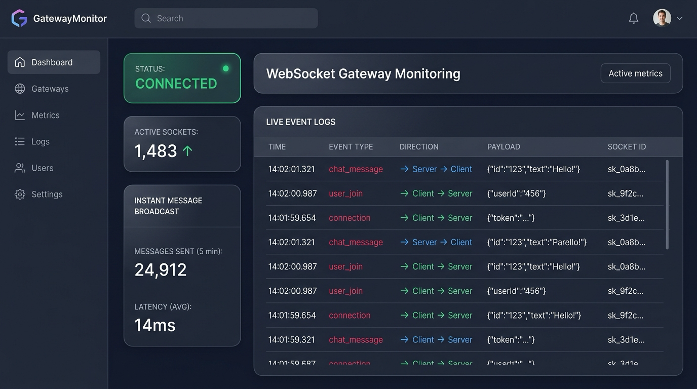
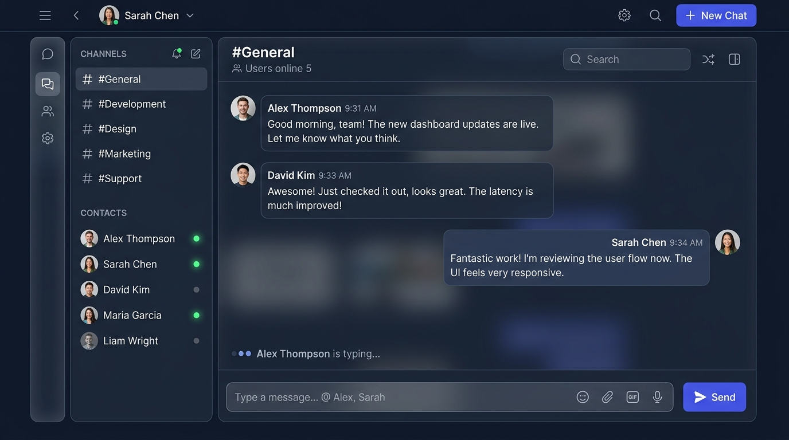
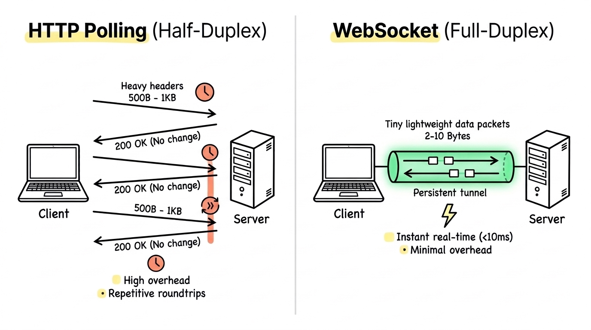
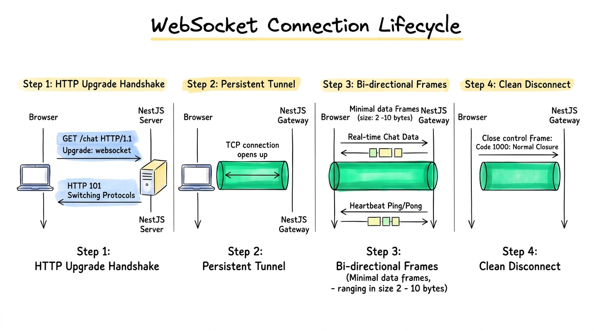
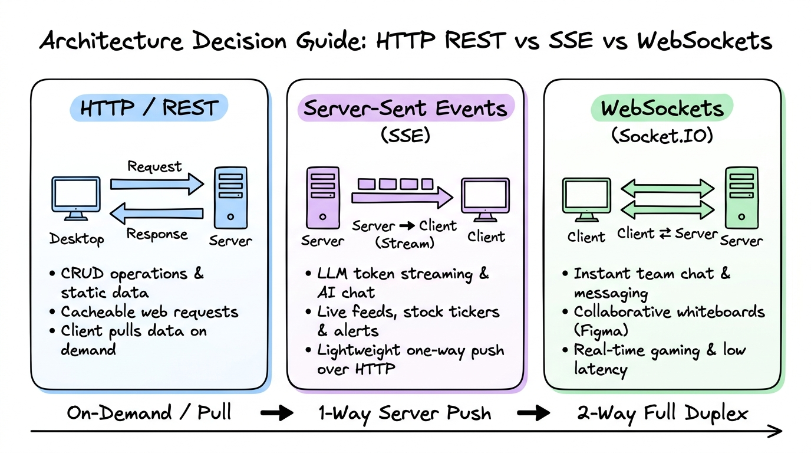

# Lesson 6.1: WebSockets Gateway — Khởi Tạo Kết Nối Real-Time Hai Chiều Với @WebSocketGateway() (Socket.io)

<p align="center">
  
  
  
  
  
</p>

<p align="center">
  
</p>

---

> [!NOTE]
> ⏱️ **Thời lượng:** 20 – 25 phút đọc lý thuyết trực quan & thực hành code  
> 🎯 **Mục tiêu bài học:**
>
> - **Identify:** Chỉ rõ các điểm nghẽn vật lý của mô hình HTTP Request-Response (Half-Duplex) và lý do các giải pháp Polling truyền thống gây quá tải hạ tầng.
> - **Explain:** Giải thích bản chất giao thức WebSocket (RFC 6455), cơ chế bắt tay HTTP Upgrade (`101 Switching Protocols`) và cấu trúc Data Frame siêu nhẹ (2 – 10 bytes).
> - **Evaluate:** Vận dụng cây quyết định kiến trúc để phân biệt chính xác khi nào nên chọn HTTP REST, Server-Sent Events (SSE) hay WebSocket.
> - **Setup:** Cài đặt bộ thư viện `@nestjs/websockets`, `@nestjs/platform-socket.io` và `socket.io` bằng `pnpm`.
> - **Implement:** Xây dựng `ChatGateway` hoàn chỉnh với decorator `@WebSocketGateway()`, quản lý 3 Lifecycle Hooks (`OnGatewayInit`, `OnGatewayConnection`, `OnGatewayDisconnect`).
> - **Multiplexing:** Áp dụng **Namespace (`/chat`)** để phân vùng kênh dữ liệu độc lập trên cùng một cổng TCP.
> - **Handle Events & Broadcast:** Tiếp nhận sự kiện với `@SubscribeMessage()`, `@MessageBody()`, `@ConnectedSocket()` và phát tán tức thời qua `@WebSocketServer()`.
> - **Verify & Debug:** Kiểm thử truyền nhận hai chiều trên 2 trình duyệt độc lập và xử lý dứt điểm các lỗi CORS, lệch Namespace và xung đột Auth Guard.

> [!IMPORTANT]
> **Prerequisites:**
>
> - NestJS Controllers, Providers & Dependency Injection ([Module 1 — Lesson 1.9](../../module-01/lesson-1.9/lesson-1.9.md)).
> - Kiến thức cơ bản về giao thức mạng HTTP & TypeScript.
> - Đã hoàn thành cấu hình Global Pipeline trong ứng dụng Capstone ([docs/04-project-architecture-and-codebase.md](../../../04-project-architecture-and-codebase.md)).

---

## 1. Giới Hạn Của HTTP Trong Ứng Dụng Thời Gian Thực (Why?)

Trong **Social Chat App**, khi Alice gửi tin nhắn _"Chào Bob!"_, Bob phải nhận được ngay tức thì (<10ms) mà không cần tải lại trang:

<p align="center">
  
</p>

Kiến trúc **HTTP REST API** truyền thống bộc lộ **3 giới hạn vật lý** khiến nó bất khả thi cho ứng dụng Chat:

1. **Bán song công (Half-Duplex) & Bị động:** Server hoàn toàn "câm lặng", không thể tự ý đẩy dữ liệu xuống Client nếu Client chưa gửi Request hỏi trước.
2. **Overhead tiêu đề quá lớn:** Mỗi request HTTP cõng theo **500B – 2KB Headers** (Cookie, Token, User-Agent...). Việc hỏi thăm liên tục chỉ để nhận về dữ liệu rỗng (`0 byte`) gây lãng phí băng thông khủng khiếp.
3. **Các kỹ thuật Polling đều bế tắc:**
   - **Short Polling (Hỏi dồn dập 1s/lần):** 10,000 user tạo ra 10,000 req/giây làm nghẽn CPU server và cạn kiệt pin điện thoại.
   - **Long Polling (Treo request 30s):** Đóng kết nối ngay khi có tin nhắn ➔ Gây bão kết nối (_Reconnect Storm_) và tốn RAM giữ connection.
   - **Server-Sent Events (SSE):** Stream tốt nhưng **chỉ là kênh 1 chiều (Server ➔ Client)**, Client muốn gửi tin nhắn lên vẫn phải mở HTTP POST riêng.

<p align="center">
  
</p>

---

## 2. WebSocket Là Gì & Cơ Chế Hoạt Động (What?)

> [!NOTE]
> **WebSocket (RFC 6455)** là giao thức mạng duy trì **1 kết nối TCP bền vững (Persistent Connection)** duy nhất, cho phép truyền dữ liệu **hai chiều song công toàn phần (Full-Duplex)** đồng thời giữa Client và Server với độ trễ cực thấp (< 10ms).

- **Hình dung trực quan:** HTTP giống như **Bộ đàm (Walkie-Talkie)** — một bên nói xong hô _"Over"_ bên kia mới được nói. Còn WebSocket là **Đường dây nóng (Hotline)** — nhấc máy kết nối thông suốt, hai bên tự do nói chuyện qua lại đồng thời.
- **Header siêu nhẹ:** Sau khi kết nối, HTTP Header bị loại bỏ hoàn toàn. Dữ liệu trao đổi qua các **Data Frames** có tiêu đề chỉ từ **2 đến 10 bytes** (tiết kiệm hơn **98%** băng thông so với HTTP).
- **Cổng chuẩn Web:** Chạy trên cổng 80 (`ws://`) và 443 mã hóa TLS (`wss://`), dễ dàng vượt qua mọi Proxy và Firewall mạng.

### 🔄 Vòng Đời Kết Nối & Bắt Tay HTTP Upgrade (101 Switching Protocols)

Thay vì dùng cổng riêng, WebSocket tận dụng cổng HTTP sẵn có và thực hiện nâng cấp giao thức mượt mà qua 4 bước:

<p align="center">
  
</p>

1. **Bước 1 (Handshake):** Client gửi HTTP GET kèm header `Upgrade: websocket` và `Sec-WebSocket-Key`. Server xác nhận và phản hồi mã **`101 Switching Protocols`**.
2. **Bước 2 (Persistent Tunnel):** Kết nối TCP chuyển sang chế độ đường hầm bền vững, giữ mở 24/7.
3. **Bước 3 (Frame Exchange):** Hai bên tự do gửi nhận các Data Frames siêu nhẹ và gửi gói tin nhịp tim **Ping / Pong (Heartbeat)** định kỳ để tránh timeout.
4. **Bước 4 (Clean Disconnect):** Khi người dùng thoát, Client gửi gói tin điều khiển `Close (Code 1000: Normal Closure)` để giải phóng tài nguyên server an toàn.

---

## 3. Khi Nào Nên Dùng WebSocket? (When & Trade-offs)

> [!WARNING]
> **Cảnh báo kiến trúc:** WebSocket là kết nối **Có trạng thái (Stateful)**, mỗi socket chiếm giữ bộ nhớ RAM trên server và việc scale ngang (cần Redis Adapter, Sticky Session) phức tạp hơn nhiều so với **HTTP REST (Stateless)**. Đừng lạm dụng WebSocket cho toàn bộ hệ thống!

<p align="center">
  
</p>

### 🎯 Quy Tắc Lựa Chọn Công Nghệ Nhanh:

| Công nghệ                       | Kênh truyền           | Khi nào nên dùng?                                                                    | Ví dụ tiêu biểu                                                                |
| :------------------------------ | :-------------------- | :----------------------------------------------------------------------------------- | :----------------------------------------------------------------------------- |
| 🌐 **HTTP REST**                | Đơn công (Pull)       | Dữ liệu tĩnh, CRUD, cần bộ nhớ đệm (Browser Cache, CDN), Stateless dễ scale.         | Đăng nhập, xem Profile, danh sách Posts, upload file.                          |
| 📡 **SSE (Server-Sent Events)** | 1 chiều (Push)        | Server đẩy dữ liệu dạng luồng liên tục xuống Client, Client không cần gửi ngược lại. | Stream token AI (ChatGPT), cập nhật tỷ số thể thao, thông báo đẩy.             |
| ⚡ **WebSocket**                | 2 chiều (Full-Duplex) | Yêu cầu tương tác hai chiều tức thời (< 10ms), tần suất trao đổi liên tục.           | **Chat 1-1 / Nhóm**, Game multiplayer, Bảng vẽ Figma, Sàn giao dịch tài chính. |

---

## 4. Kiến Trúc Gateway Trong NestJS

Trong NestJS, thành phần tiếp nhận và điều phối WebSocket được gọi là **Gateway** (đóng vai trò tương tự như Controller trong HTTP REST):

| HTTP REST (Controller)   | WebSocket (Gateway)                         | Ý nghĩa                                                |
| :----------------------- | :------------------------------------------ | :----------------------------------------------------- |
| `@Controller('posts')`   | `@WebSocketGateway({ namespace: '/chat' })` | Khai báo điểm tiếp nhận yêu cầu                        |
| `@Get(':id')`, `@Post()` | `@SubscribeMessage('chat_message')`         | Lắng nghe route / sự kiện cụ thể                       |
| `@Body() payload`        | `@MessageBody() payload`                    | Trích xuất dữ liệu gửi lên                             |
| `@Req() req: Request`    | `@ConnectedSocket() client: Socket`         | Tham chiếu tới đối tượng gọi (ngắn hạn vs socket sống) |
| `return response`        | `this.server.emit('event', data)`           | Trả về (chỉ người gọi vs broadcast toàn bộ phòng)      |

### 🧩 2 Khái Niệm Quan Trọng:

1. **Namespace (`/chat`):** Kỹ thuật ghép kênh (**Multiplexing**) giúp phân vùng logic độc lập trên **cùng 1 cổng TCP (port 3000)**. Ví dụ: `/chat` quản lý tin nhắn, `/notifications` quản lý thông báo, tránh xung đột sự kiện.
2. **3 Lifecycle Hooks:**
   - `afterInit(server)`: Chạy 1 lần duy nhất khi Gateway khởi tạo xong.
   - `handleConnection(client)`: Chạy ngay khi có 1 socket client kết nối thành công.
   - `handleDisconnect(client)`: Chạy ngay khi 1 socket client ngắt kết nối (tắt tab, mất mạng).

---

## 5. Thực Hành Từng Bước (How — Step-by-Step)

### Trạng Thái Dự Án (Project State Tracking)

#### Trước bài học (Before):

```text
src/
├── app.module.ts              # Chỉ có các module REST API & Event (Module 1 - 5)
├── auth/
├── comments/
├── mail/
├── notifications/
└── posts/
```

#### Sau bài học (After):

```text
src/
├── app.module.ts              # Đăng ký ChatModule vào imports
├── chat/                      # THƯ MỤC MỚI
│   ├── chat.gateway.ts        # WebSocket Gateway namespace /chat
│   └── chat.module.ts         # Module đóng gói ChatGateway
test-client.html               # Web Client test real-time ở thư mục gốc
```

---

### Bước 1: Cài Đặt Thư Viện WebSocket

Chạy lệnh `pnpm` trong thư mục gốc dự án:

```bash
pnpm add @nestjs/websockets@^11.0.1 @nestjs/platform-socket.io@^11.0.1 socket.io@^4.8.1
```

---

### Bước 2: Tạo `ChatGateway` Với Lifecycle & Event Handlers

Tạo file `src/chat/chat.gateway.ts` với namespace `/chat`, mở quyền CORS và tạo 2 sự kiện: `ping` và `chat_message`:

📄 **`src/chat/chat.gateway.ts`**

```typescript
import {
  WebSocketGateway,
  WebSocketServer,
  SubscribeMessage,
  MessageBody,
  ConnectedSocket,
  OnGatewayInit,
  OnGatewayConnection,
  OnGatewayDisconnect,
} from '@nestjs/websockets';
import { Logger } from '@nestjs/common';
import { Namespace, Socket } from 'socket.io';
import { Public } from '@/shared/decorators/public.decorator';

@WebSocketGateway({
  namespace: '/chat', // Phân vùng namespace riêng cho Chat
  cors: {
    origin: '*', // Cho phép kết nối từ mọi client (tránh lỗi CORS)
  },
})
@Public() // Bỏ qua JwtAuthGuard toàn cục trong bài làm quen này (Lesson 6.2 sẽ cấu hình Guard riêng)
export class ChatGateway
  implements OnGatewayInit, OnGatewayConnection, OnGatewayDisconnect
{
  private readonly logger = new Logger(ChatGateway.name);

  // Khi Gateway có namespace, @WebSocketServer() sẽ inject đối tượng Namespace của Socket.IO
  @WebSocketServer()
  server: Namespace;

  afterInit(server: Namespace) {
    this.logger.log(`🚀 ChatGateway [${server.name}] đã khởi tạo thành công!`);
  }

  handleConnection(client: Socket) {
    this.logger.log(`🟢 Client kết nối thành công: [ID: ${client.id}]`);
  }

  handleDisconnect(client: Socket) {
    this.logger.warn(`🔴 Client ngắt kết nối: [ID: ${client.id}]`);
  }

  // 1. Event Ping - Pong (Heartbeat check)
  @SubscribeMessage('ping')
  handlePing(@ConnectedSocket() client: Socket): string {
    this.logger.debug(`Nhận ping từ [${client.id}]`);
    return 'pong'; // Trả về acknowledgment trực tiếp cho client
  }

  // 2. Event Tiếp nhận tin nhắn và Broadcast toàn bộ phòng
  @SubscribeMessage('chat_message')
  handleChatMessage(
    @MessageBody() payload: { sender: string; content: string },
    @ConnectedSocket() client: Socket,
  ) {
    this.logger.log(`💬 [${payload.sender || 'Ẩn danh'}]: ${payload.content}`);

    const broadcastData = {
      sender: payload.sender || 'Ẩn danh',
      content: payload.content,
      senderSocketId: client.id,
      timestamp: new Date().toISOString(),
    };

    // Broadcast phát tán tới TẤT CẢ mọi client đang kết nối vào /chat
    this.server.emit('new_message', broadcastData);

    // Trả về xác nhận (Acknowledgment) cho RIÊNG người gửi
    return {
      status: 'success',
      deliveredAt: broadcastData.timestamp,
    };
  }
}
```

> [!NOTE]
> **Tại sao cần `@Public()`?**  
> Trong Module 4, hệ thống đã cài đặt `JwtAuthGuard` toàn cục (`APP_GUARD`). Nếu không có `@Public()`, NestJS sẽ cố bóc tách Header Bearer HTTP và chặn kết nối WebSocket. Trong [Lesson 6.2](../lesson-6.2/lesson-6.2.md), chúng ta sẽ xây dựng Guard chuyên biệt `WsJwtGuard` cho WebSockets.

---

### Bước 3: Đóng Gói Phân Hệ Với `ChatModule`

Tạo file `src/chat/chat.module.ts`:

📄 **`src/chat/chat.module.ts`**

```typescript
import { Module } from '@nestjs/common';
import { ChatGateway } from './chat.gateway';

@Module({
  providers: [ChatGateway],
  exports: [ChatGateway],
})
export class ChatModule {}
```

---

### Bước 4: Đăng Ký `ChatModule` Vào `AppModule`

Mở file [`src/app.module.ts`](file:///Users/thanhdo/Documents/Project/nestjs-basic-course/src/app.module.ts), thêm `ChatModule` vào danh sách `imports`:

📄 **`src/app.module.ts`**

```typescript
import { MiddlewareConsumer, Module, RequestMethod } from '@nestjs/common';
import { AppController } from './app.controller';
import { AppService } from './app.service';
import { ConfigModule, ConfigService } from '@nestjs/config';
import { envValidationSchema } from './config/env.validation';
import { PrismaModule } from './prisma/prisma.module';
import { UsersModule } from './users/users.module';
import { PostsModule } from './posts/posts.module';
import { APP_FILTER, APP_GUARD, APP_INTERCEPTOR } from '@nestjs/core';
import { PrismaClientExceptionFilter } from './shared/filters/prisma-client-exception.filter';
import { LoggerMiddleware } from './shared/middleware/logger.middleware';
import { HttpExceptionFilter } from './shared/filters/http-exception.filter';
import { TransformInterceptor } from './shared/interceptors/transform.interceptor';
import { SharedServiceModule } from './shared/services/shared-service.module';
import { AuthModule } from './auth/auth.module';
import { JwtAuthGuard } from './auth/guards/jwt-auth.guard';
import { RolesGuard } from './auth/guards/roles-guard';
import { ThrottlerModule } from '@nestjs/throttler';
import { CustomThrottlerGuard } from './shared/guards/custom-throttler.guard';
import { CommentsModule } from './comments/comments.module';
import { EventEmitterModule } from '@nestjs/event-emitter';
import { NotificationsModule } from './notifications/notifications.module';
import { FileTemplateEngine, MailModule } from '@nestjs/mail';
import { join } from 'path';
import { AppMailModule } from './mail/mail.module';
import { createMailTransport } from './mail/transports/mail-transport.factory';
import { ChatModule } from './chat/chat.module'; // <-- 1. Import ChatModule

@Module({
  imports: [
    ConfigModule.forRoot({
      validationSchema: envValidationSchema,
      isGlobal: true,
    }),
    EventEmitterModule.forRoot({
      wildcard: true,
      delimiter: '.',
      maxListeners: 20,
      ignoreErrors: false,
    }),
    ThrottlerModule.forRoot([
      { name: 'short', ttl: 1000, limit: 30 },
      { name: 'medium', ttl: 10000, limit: 2000 },
      { name: 'long', ttl: 60000, limit: 10000 },
    ]),
    MailModule.forRootAsync({
      inject: [ConfigService],
      imports: [ConfigModule],
      useFactory: (configService: ConfigService) => ({
        transport: createMailTransport(configService),
        templates: new FileTemplateEngine({
          dir: join(__dirname, 'mail/templates'),
          layout: 'layout',
          cache: configService.get<string>('NODE_ENV') === 'production',
        }),
        from: configService.get<string>(
          'MAIL_FROM',
          'Social Chat App <noreply@socialchat.example.com>',
        ),
      }),
    }),

    PrismaModule,
    SharedServiceModule,
    UsersModule,
    PostsModule,
    AuthModule,
    CommentsModule,
    NotificationsModule,
    AppMailModule,
    ChatModule, // <-- 2. Đăng ký ChatModule
  ],
  controllers: [AppController],
  providers: [
    AppService,
    { provide: APP_FILTER, useClass: PrismaClientExceptionFilter },
    { provide: APP_FILTER, useClass: HttpExceptionFilter },
    { provide: APP_INTERCEPTOR, useClass: TransformInterceptor },
    { provide: APP_GUARD, useClass: JwtAuthGuard },
    { provide: APP_GUARD, useClass: RolesGuard },
    { provide: APP_GUARD, useClass: CustomThrottlerGuard },
  ],
})
export class AppModule {
  configure(consumer: MiddlewareConsumer) {
    consumer
      .apply(LoggerMiddleware)
      .exclude({ path: 'health', method: RequestMethod.GET })
      .forRoutes('{*path}');
  }
}
```

---

### Bước 5: Khởi Động Server & Kiểm Tra

Chạy server NestJS ở chế độ phát triển:

```bash
pnpm start:dev
```

Màn hình terminal sẽ xuất hiện log khởi tạo:

```text
[Nest] LOG [ChatGateway] 🚀 ChatGateway [/chat] đã khởi tạo thành công!
[Nest] LOG [NestApplication] Nest application successfully started
```

---

## 6. Kiểm Thử Trực Quan (Verification)

Tạo file `test-client.html` ở thư mục gốc của dự án để kiểm thử trực tiếp trên trình duyệt:

📄 **`test-client.html`**

```html
<!DOCTYPE html>
<html lang="vi">
  <head>
    <meta charset="UTF-8" />
    <meta name="viewport" content="width=device-width, initial-scale=1.0" />
    <title>NestJS WebSocket Test Client</title>
    <script src="https://cdn.socket.io/4.8.1/socket.io.min.js"></script>
    <style>
      * {
        box-sizing: border-box;
        margin: 0;
        padding: 0;
      }
      body {
        font-family:
          -apple-system, BlinkMacSystemFont, 'Segoe UI', Roboto, sans-serif;
        background: #f8fafc;
        color: #1e293b;
        padding: 24px;
        display: flex;
        justify-content: center;
      }
      .card {
        background: #ffffff;
        border: 1px solid #e2e8f0;
        border-radius: 12px;
        box-shadow: 0 4px 6px -1px rgba(0, 0, 0, 0.05);
        width: 100%;
        max-width: 600px;
        padding: 20px;
      }
      .status-bar {
        display: flex;
        justify-content: space-between;
        align-items: center;
        padding: 10px 14px;
        background: #f1f5f9;
        border-radius: 8px;
        margin-bottom: 12px;
        font-size: 13px;
      }
      .badge {
        padding: 4px 10px;
        border-radius: 9999px;
        font-weight: 600;
        font-size: 12px;
      }
      .badge-on {
        background: #dcfce7;
        color: #166534;
      }
      .badge-off {
        background: #fee2e2;
        color: #991b1b;
      }
      .chat-box {
        border: 1px solid #e2e8f0;
        border-radius: 8px;
        height: 300px;
        overflow-y: auto;
        padding: 12px;
        background: #fafafa;
        margin-bottom: 14px;
        display: flex;
        flex-direction: column;
        gap: 8px;
      }
      .msg {
        padding: 8px 12px;
        border-radius: 8px;
        max-width: 80%;
        font-size: 14px;
      }
      .msg-in {
        background: #ffffff;
        border: 1px solid #e2e8f0;
        align-self: flex-start;
      }
      .msg-out {
        background: #e0e7ff;
        border: 1px solid #c7d2fe;
        color: #1e1b4b;
        align-self: flex-end;
      }
      .msg-meta {
        font-size: 11px;
        color: #64748b;
        margin-top: 4px;
        display: block;
      }
      .row {
        display: flex;
        gap: 8px;
      }
      input {
        padding: 10px 12px;
        border: 1px solid #cbd5e1;
        border-radius: 6px;
        font-size: 14px;
        outline: none;
      }
      input:focus {
        border-color: #6366f1;
      }
      button {
        padding: 10px 16px;
        border: none;
        border-radius: 6px;
        font-weight: 600;
        cursor: pointer;
        transition: background 0.15s;
      }
      .btn-send {
        background: #4f46e5;
        color: white;
      }
      .btn-send:hover {
        background: #4338ca;
      }
      .btn-ping {
        background: #e2e8f0;
        font-size: 13px;
        margin-bottom: 12px;
      }
    </style>
  </head>
  <body>
    <div class="card">
      <h2 style="margin-bottom: 12px;">⚡ NestJS WebSocket Chat</h2>

      <div class="status-bar">
        <span>Namespace: <code>/chat</code></span>
        <span id="badge" class="badge badge-off">Đang kết nối...</span>
      </div>

      <div style="display: flex; gap: 8px; align-items: center;">
        <button class="btn-ping" onclick="ping()">Heartbeat Ping</button>
        <span
          id="latency"
          style="font-size: 13px; color: #64748b; margin-bottom: 12px;"
        ></span>
      </div>

      <div id="box" class="chat-box"></div>

      <div class="row">
        <input
          id="sender"
          placeholder="Tên của bạn"
          value="Học viên"
          style="width: 130px;"
        />
        <input
          id="msg"
          placeholder="Nhập tin nhắn..."
          style="flex: 1;"
          onkeypress="if(event.key==='Enter') send()"
        />
        <button class="btn-send" onclick="send()">Gửi</button>
      </div>
    </div>

    <script>
      // 1. Kết nối tới Namespace /chat trên cổng 3000
      const socket = io('http://localhost:3000/chat');
      const box = document.getElementById('box');
      const badge = document.getElementById('badge');
      const latency = document.getElementById('latency');

      socket.on('connect', () => {
        badge.textContent = `🟢 Online (ID: ${socket.id})`;
        badge.className = 'badge badge-on';
      });

      socket.on('disconnect', () => {
        badge.textContent = '🔴 Offline';
        badge.className = 'badge badge-off';
      });

      // 2. Nhận tin nhắn broadcast từ Server
      socket.on('new_message', (data) => {
        const isMine = data.senderSocketId === socket.id;
        const el = document.createElement('div');
        el.className = `msg ${isMine ? 'msg-out' : 'msg-in'}`;
        el.innerHTML = `<strong>${data.sender}</strong>: ${data.content} <span class="msg-meta">${new Date(data.timestamp).toLocaleTimeString()}</span>`;
        box.appendChild(el);
        box.scrollTop = box.scrollHeight;
      });

      // 3. Gửi tin nhắn qua sự kiện 'chat_message'
      function send() {
        const input = document.getElementById('msg');
        const content = input.value.trim();
        const sender =
          document.getElementById('sender').value.trim() || 'Ẩn danh';
        if (!content) return;

        socket.emit('chat_message', { sender, content }, (ack) => {
          console.log('✅ Server đã nhận tin (Acknowledgment):', ack);
        });

        input.value = '';
        input.focus();
      }

      // 4. Đo độ trễ khứ hồi (RTT Latency)
      function ping() {
        const start = Date.now();
        socket.emit('ping', (res) => {
          latency.textContent = `Phản hồi: "${res}" — Độ trễ: ${Date.now() - start}ms`;
        });
      }
    </script>
  </body>
</html>
```

### 🟢 Kịch Bản Kiểm Thử Thành Công (Success Flow)

1. Mở song song `test-client.html` trên **2 tab trình duyệt cạnh nhau** (Tab A: _"Alice"_, Tab B: _"Bob"_).
2. Cả 2 tab đều chuyển badge sang `🟢 Online`.
3. Nhập tin nhắn trên Tab Alice ➔ Bấm **Gửi**.
4. **Kết quả:** Ngay lập tức cả 2 tab đều hiển thị tin nhắn mà **không cần tải lại trang (Zero Reload)**. Console của Tab Alice hiển thị Acknowledgment xác nhận từ Server.

---

## 7. Xử Lý Lỗi Phổ Biến & Debugging (Debug)

### 🔴 3 Kịch Bản Lỗi Thường Gặp

#### 1. Lỗi CORS Policy Blocking

- **Hiện tượng:** Trình duyệt báo đỏ `Access to XMLHttpRequest ... blocked by CORS policy`.
- **Nguyên nhân:** Mở file HTML cục bộ khiến `origin: null` bị server từ chối.
- **Khắc phục:** Thêm `cors: { origin: '*' }` vào metadata của `@WebSocketGateway()`.

#### 2. Lệch Namespace Giữa Client Và Server

- **Hiện tượng:** Server đã bật nhưng client mãi ở trạng thái `Đang kết nối...`, `handleConnection` không chạy.
- **Nguyên nhân:** Gateway cấu hình `namespace: '/chat'` nhưng Client lại kết nối vào `io('http://localhost:3000')`.
- **Khắc phục:** Chỉ định đúng namespace phía client: `io('http://localhost:3000/chat')`.

#### 3. Bị Chặn Bởi Global `JwtAuthGuard`

- **Hiện tượng:** Client vừa kết nối thì lập tức bị disconnect, server báo `UnauthorizedException`.
- **Nguyên nhân:** `JwtAuthGuard` trong `AppModule` cố đọc Header Authorization của HTTP nhưng socket handshake không có.
- **Khắc phục:** Thêm decorator `@Public()` lên class `ChatGateway`.

---

### ⚠️ Bảng Tra Cứu Lỗi Nhanh

| Lỗi gặp phải                                              | Nguyên nhân                                         | Cách xử lý                                                  |
| :-------------------------------------------------------- | :-------------------------------------------------- | :---------------------------------------------------------- |
| **Quên import `ChatModule`**                              | NestJS không nạp Gateway vào IoC                    | Khai báo `ChatModule` trong `imports` của `AppModule`       |
| **Dùng `client.emit` thay vì `this.server.emit`**         | `client.emit` chỉ gửi cho chính người gửi           | Dùng `this.server.emit()` để broadcast cho toàn bộ phòng    |
| **Khai báo `server: Server` thay vì `server: Namespace`** | Khi có namespace, instance là Socket.IO `Namespace` | Khai báo đúng kiểu: `@WebSocketServer() server: Namespace;` |

---

## 8. Bài Tập Thực Hành (Challenges)

### 🧩 Thử Thách 1 (Dễ): Đo Độ Trễ Ping - Pong

- **Yêu cầu:** Mở DevTools Console, bấm nút **Heartbeat Ping** trên giao diện và quan sát số mili-giây độ trễ khứ hồi (RTT) được hiển thị.

### 🧩 Thử Thách 2 (Vừa): Chỉ Báo "Đang Gõ Phím..." (User Typing Indicator)

- **Yêu cầu:**
  1. Khi người dùng nhập ký tự vào ô chat, gửi event `socket.emit('typing', { sender: ... })`.
  2. Tại Gateway, dùng `client.broadcast.emit('user_typing', payload)` để báo cho **tất cả mọi người TRỪ người đang gõ**.
  3. Giao diện của đối phương hiển thị dòng chữ: _"Alice đang gõ tin nhắn..."_ và tự ẩn sau 2 giây.

---

<details>
<summary>💡 <b>Xem Code Mẫu Cho Thử Thách 2 (Typing Indicator)</b></summary>

📄 **Bổ sung vào `src/chat/chat.gateway.ts`:**

```typescript
@SubscribeMessage('typing')
handleTyping(
  @MessageBody() payload: { sender: string },
  @ConnectedSocket() client: Socket,
) {
  // Gửi cho tất cả client trong namespace TRỪ client đang gọi
  client.broadcast.emit('user_typing', { sender: payload.sender });
}
```

📄 **Bổ sung vào `test-client.html`:**

```javascript
let typingTimeout;
document.getElementById('msg').addEventListener('input', () => {
  socket.emit('typing', {
    sender: document.getElementById('sender').value.trim(),
  });
});

socket.on('user_typing', (data) => {
  latency.textContent = `✍️ ${data.sender} đang nhập tin nhắn...`;
  clearTimeout(typingTimeout);
  typingTimeout = setTimeout(() => {
    latency.textContent = '';
  }, 2000);
});
```

</details>

---

## 9. Tóm Tắt & Checklist (Summary)

### 📋 Kiến Thức Cốt Lõi

```text
1. Giới hạn HTTP      ──► Half-Duplex (bán song công), Client phải hỏi trước, Header nặng (500B-2KB), Polling gây bão kết nối.
2. Bản chất WebSocket ──► Chuẩn RFC 6455, Full-Duplex trên 1 kết nối TCP bền vững, Frame siêu nhẹ (2-10 bytes, tiết kiệm >98%).
3. Bắt tay Handshake  ──► Bắt đầu từ HTTP GET với Upgrade header, nâng cấp thành công với mã phản hồi 101 Switching Protocols.
4. Khi nào nên dùng   ──► WebSocket cho tương tác 2 chiều tần suất cao (Chat, Game, Figma); SSE cho stream 1 chiều; REST cho CRUD & Caching.
5. @WebSocketGateway  ──► Class điều phối sự kiện Socket.IO trong NestJS, hoạt động như một Provider IoC dùng chung cổng 3000.
6. Namespace (/chat)  ──► Ghép kênh (Multiplexing) phân vùng logic độc lập trên cùng một kết nối TCP duy nhất.
7. Lifecycle Hooks    ──► afterInit, handleConnection, handleDisconnect quản lý vòng đời trọn vẹn của từng Socket Client.
```

---

### ✅ Checklist Tự Đánh Giá

- [x] Phân tích được các hạn chế vật lý của HTTP Request-Response và vì sao Short/Long Polling gây quá tải server.
- [x] Hiểu rõ bản chất song công (Full-Duplex), mã trạng thái `101 Switching Protocols` và cấu trúc Frame siêu nhẹ của WebSocket.
- [x] Vận dụng được cây quyết định kiến trúc để chọn lựa chính xác giữa HTTP REST, SSE và WebSocket.
- [x] Cài đặt đúng các package `@nestjs/websockets`, `@nestjs/platform-socket.io` và `socket.io` bằng `pnpm`.
- [x] Tạo được `ChatGateway` với namespace `/chat` và quản lý đủ 3 Lifecycle hooks (`afterInit`, `handleConnection`, `handleDisconnect`).
- [x] Lắng nghe sự kiện với `@SubscribeMessage()`, trích xuất payload với `@MessageBody()`, và broadcast với `@WebSocketServer()`.
- [x] Kiểm thử truyền nhận hai chiều thành công trên 2 cửa sổ trình duyệt độc lập bằng `test-client.html`.

---

👉 **Bài tiếp theo:** [Lesson 6.2: WebSocket Authentication — Chuẩn Hóa Xác Thực WebSockets Trong NestJS](../lesson-6.2/lesson-6.2.md)
