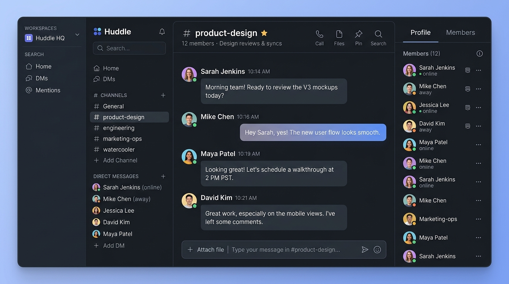
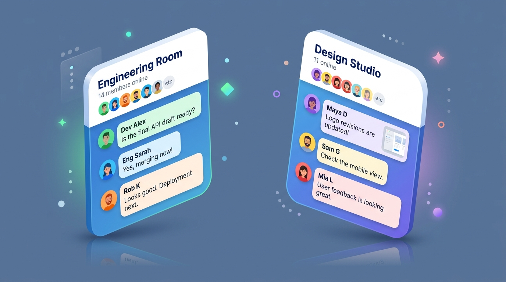
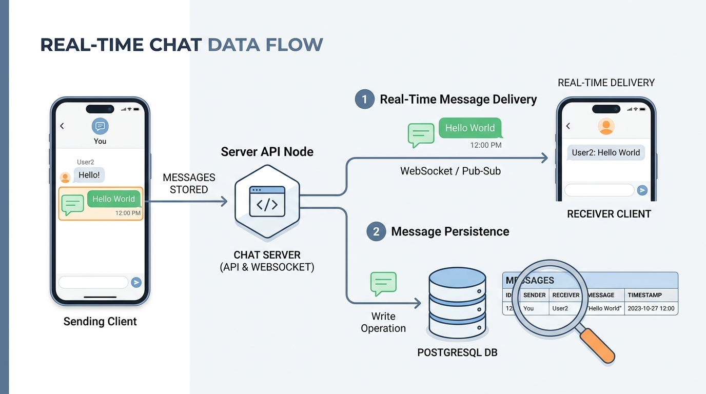
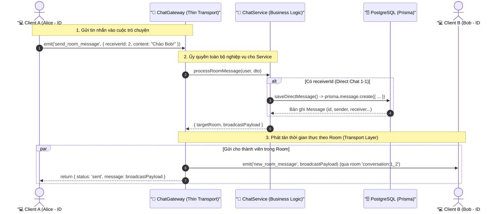

# Lesson 6.3: WebSockets Chat Rooms & Message Persistence — Quản Lý Phòng Chat & Lưu Trữ Tin Nhắn Với Prisma ORM

<p align="center">
  
  
  
  
  
  
</p>

<p align="center">
  
</p>

---

> [!NOTE]
> ⏱️ **Thời lượng:** 20 – 25 phút thực hành chuyên sâu  
> 🎯 **Mục tiêu bài học:**
>
> - **Explain & Mental Model:** Giải thích bản chất của **Socket.IO Rooms** (kênh phân nhóm ảo trên bộ nhớ RAM server) và phân biệt rõ ràng giữa `this.server.to().emit()` (gửi tất cả kể cả người gửi) và `client.to().emit()` (gửi tất cả trừ người gửi).
> - **Room Lifecycle:** Xây dựng tính năng tham gia phòng (`join_room`), rời phòng (`leave_room`) và cơ chế tự động dọn dẹp khi socket client ngắt kết nối.
> - **Targeted Broadcast:** Triển khai cơ chế phát tán thông điệp có chọn lọc chỉ đến đúng các client trong cùng một cuộc trò chuyện, ngăn chặn hoàn toàn rò rỉ tin nhắn ra toàn hệ thống.
> - **Architecture & Separation of Concerns:** Xây dựng `ChatService` độc lập để tách biệt logic cơ sở dữ liệu khỏi Gateway điều phối sự kiện thời gian thực.
> - **Message Persistence:** Lưu trữ tin nhắn bền vững vào bảng `messages` trong PostgreSQL thông qua `PrismaService` theo đúng quan hệ thực thể `senderId` và `receiverId`.
> - **History Query:** Truy vấn danh sách lịch sử tin nhắn gần nhất khi người dùng mới tham gia phòng trò chuyện.
> - **Verify & Debug:** Kiểm thử truyền nhận tin nhắn giữa nhiều client trong các phòng khác nhau bằng Web Client test script và xử lý triệt để các lỗi bất đồng bộ thường gặp.

> [!IMPORTANT]
> **Prerequisites:**
>
> - Đã khởi tạo `ChatGateway` với Namespace `/chat` ([Lesson 6.1](../lesson-6.1/lesson-6.1.md)).
> - Đã bảo vệ Gateway bằng `WsJwtGuard` và decorator `@CurrentUser()` ([Lesson 6.2](../lesson-6.2/lesson-6.2.md)).
> - Nắm vững mô hình dữ liệu Prisma Client & quan hệ thực thể `User` - `Message` ([Module 2](../../module-02/lesson-2.3/lesson-2.3.md)).

---

## 1. Vấn Đề Thực Tế: Broadcast Toàn Cục & Nỗi Đau Mất Dữ Liệu Khi F5 (Why?)

Ở hai bài học trước, chúng ta đã khởi tạo thành công kết nối WebSocket và bảo mật bằng JWT. Tuy nhiên, luồng gửi tin nhắn hiện tại đang mắc phải **hai vấn đề nghiêm trọng**:

```typescript
// ❌ CÁCH LÀM HIỆN TẠI TRONG LESSON 6.2:
@SubscribeMessage('chat_message')
handleChatMessage(@MessageBody() payload: { content: string }) {
  // 1. Bắn cho TẤT CẢ mọi người kết nối vào /chat!
  this.server.emit('new_message', { content: payload.content });
  // 2. Không lưu vào đâu cả, dữ liệu chỉ bay trên RAM!
}
```

```text
❌ TRẢI NGHIỆM THỰC TẾ CỦA NGƯỜI DÙNG:

    Alice (User #1)                     Bob (User #2)                  Charlie (User #3)
          │                                   │                                │
          ├─── [chat_message: "Chào Bob"] ───►│ (Server)                       │
          │                                   ├─── [new_message: "Chào Bob"] ─►│ (Nhận được!)
          │                                   └─── [new_message: "Chào Bob"] ──┼───────────────► 💥 Charlie cũng nhận được!
          │                                                                    │    (Rò rỉ dữ liệu riêng tư)
          │                                                                    │
          ├─── [Alice ấn F5 Reload trang] ────────────────────────────────────►│
          │                                                                    │
          ▼                                                                    ▼
   MÀN HÌNH TRẮNG TINH! Toàn bộ lịch sử cuộc trò chuyện biến mất hoàn toàn!
```

### ⚠️ Hệ quả kỹ thuật:

1. **Rò rỉ quyền riêng tư (Privacy Leak):** Khi User A nhắn tin cho User B, toàn bộ User C, D, E đang online đều nhận được thông báo tin nhắn này.
2. **Spam băng thông mạng (Network Choke):** Nếu có 10,000 người kết nối, một tin nhắn bất kỳ sẽ được nhân bản thành 10,000 gói tin gửi xuống tất cả mọi người.
3. **Mất mát dữ liệu (Data Loss - Ephemerality):** Socket.io chỉ truyền tải gói tin qua TCP. Nếu không có lớp lưu trữ bền vững (Persistence Layer), mọi tin nhắn sẽ biến mất vĩnh viễn ngay khi socket ngắt kết nối.

👉 **Giải pháp kiến trúc:**

- Áp dụng **Socket.IO Rooms** để tạo không gian phòng chat cô lập.
- Tích hợp **Prisma ORM** lưu trữ tin nhắn vào PostgreSQL và tải lịch sử cuộc trò chuyện.

---

## 2. Bản Chất Socket.IO Rooms & Mô Hình Lưu Trữ Tin Nhắn (What?)

### 2.1 Mental Model: Socket.IO Rooms Là Gì?

Trong Socket.IO, **Room** là một **kênh ảo (Virtual Channel)** được quản lý hoàn toàn phía Server nhằm nhóm các socket connections lại với nhau.

<p align="center">
  
</p>

> [!TIP]
> **Room không đòi hỏi một bảng `Room` trong Database!**  
> Bản chất của Room ở tầng Socket.IO chỉ là một cấu trúc dữ liệu `Map<string, Set<string>>` nằm trong bộ nhớ RAM của Node.js:
>
> ```typescript
> // Mô hình trong RAM của Socket.io Adapter:
> rooms = {
>   room_frontend: Set(['socket_id_1', 'socket_id_2']),
>   room_backend: Set(['socket_id_3']),
>   conversation_1_2: Set(['socket_id_1', 'socket_id_4']),
> };
> ```

Mỗi khi một client gọi `client.join('room_frontend')`, Socket.IO chỉ đơn giản là thêm `client.id` vào Set của phòng đó.

### 2.2 Phân Biệt Các Kiểu Phát Tán (Broadcast Cheat Sheet)

| Cú pháp Socket.io                          | Đối tượng nhận                                   | Trường hợp sử dụng thực tế                                  |
| :----------------------------------------- | :----------------------------------------------- | :---------------------------------------------------------- |
| `this.server.emit('event', data)`          | **Tất cả mọi client** trong namespace            | Thông báo bảo trì toàn hệ thống, tin tức chung.             |
| `this.server.to(room).emit('event', data)` | **Tất cả client trong room** (bao gồm người gửi) | Tin nhắn mới trong phòng chat, thông báo phòng.             |
| `client.to(room).emit('event', data)`      | **Tất cả client trong room TRỪ người gửi**       | Thông báo: _"Alice đang gõ phím..."_, _"Bob đã vào phòng"_. |
| `client.emit('event', data)`               | **Chỉ riêng người gửi**                          | Phản hồi lỗi riêng tư, xác nhận thao tác.                   |

---

### 2.3 Luồng Xử Lý Kép: Real-Time Broadcast & Database Persistence

<p align="center">
  
</p>

Khi một tin nhắn được gửi lên Server, hệ thống triển khai một luồng xử lý đồng thời (Forked Execution):



---

## 3. Chuẩn Hóa Hằng Số (Constants) & Khởi Tạo DTOs (How - Step 1)

Trước khi viết code logic, chúng ta cần tuân thủ **2 nguyên tắc Clean Code cốt lõi**:

1. **Loại bỏ hoàn toàn Magic Strings:** Mọi tên sự kiện Socket.io và định dạng tên phòng phải được quy tụ về một nơi duy nhất. Tuyệt đối không gõ trực tiếp chuỗi ký tự `'join_room'`, `'send_room_message'`... rải rác trong code.
2. **Type Safety & Data Validation:** Mọi payload nhận từ client phải được validate chặt chẽ qua DTO class.

### 3.1 Định Nghĩa Hằng Số WebSocket Sự Kiện & Phòng Chat

Tạo file constants mới trong module chat:

📄 **`src/chat/constants/chat.constant.ts`**

```typescript
export const CHAT_EVENTS = {
  // Client to Server
  PING: 'ping',
  JOIN_ROOM: 'join_room',
  LEAVE_ROOM: 'leave_room',
  SEND_ROOM_MESSAGE: 'send_room_message',
  GET_HISTORY: 'get_history',

  // Server to Client
  USER_JOINED: 'user_joined',
  USER_LEFT: 'user_left',
  NEW_ROOM_MESSAGE: 'new_room_message',
} as const;

export const CHAT_ROOM = {
  CONVERSATION_PREFIX: 'conversation:',
} as const;
```

> [!TIP]
> **Lợi ích của `as const` và Hằng số tập trung:**
>
> - IDE tự động gợi ý code (IntelliSense), ngăn chặn 100% lỗi gõ nhầm chính tả (typo).
> - Khi cần đổi tên event, bạn chỉ cần sửa ở đúng 1 dòng trong file constant thay vì phải đi tìm và thay thế hàng chục file.
> - Có thể export và tái sử dụng trực tiếp sang dự án Frontend Client (Next.js/React/Vue).

---

### 3.2 Quy Ước Định Danh Phòng (Room Naming Convention)

Hệ thống hỗ trợ 2 loại phòng chat:

1. **Phòng thảo luận theo chủ đề / Nhóm (Group Room):**  
   Định dạng: `room:<topic_name>` (ví dụ: `room:general`, `room:nestjs`).
2. **Cuộc trò chuyện trực tiếp 1-1 (Direct Message):**  
   Để đảm bảo dù Alice nhắn cho Bob hay Bob nhắn cho Alice thì cả hai đều tham gia chung một phòng, chúng ta sắp xếp `userId` tăng dần kết hợp với tiền tố `CHAT_ROOM.CONVERSATION_PREFIX`:  
   Định dạng: `conversation:${Math.min(user1, user2)}_${Math.max(user1, user2)}`  
   _(Ví dụ: User #1 và User #5 luôn trò chuyện trong room `conversation:1_5`)_.

---

### 3.3 Khởi Tạo Data Transfer Objects (DTO)

Tạo thư mục DTO cho chat:

📄 **`src/chat/dto/join-room.dto.ts`**

```typescript
import { IsNotEmpty, IsString } from 'class-validator';

export class JoinRoomDto {
  @IsString({ message: 'Tên phòng phải là một chuỗi ký tự' })
  @IsNotEmpty({ message: 'Tên phòng không được để trống' })
  roomId: string;
}
```

📄 **`src/chat/dto/send-message.dto.ts`**

```typescript
import {
  IsNotEmpty,
  IsNumber,
  IsOptional,
  IsString,
  MaxLength,
} from 'class-validator';

export class SendMessageDto {
  @IsString({ message: 'Nội dung tin nhắn phải là chuỗi ký tự' })
  @IsNotEmpty({ message: 'Nội dung tin nhắn không được để trống' })
  @MaxLength(1000, { message: 'Tin nhắn không được vượt quá 1000 ký tự' })
  content: string;

  @IsOptional()
  @IsString({ message: 'Mã phòng phải là chuỗi ký tự' })
  roomId?: string;

  @IsOptional()
  @IsNumber({}, { message: 'ID người nhận phải là một số nguyên' })
  receiverId?: number;
}
```

📄 **`src/chat/dto/get-history.dto.ts`**

```typescript
import { Type } from 'class-transformer';
import { IsInt, IsOptional, Max, Min } from 'class-validator';

export class GetHistoryDto {
  @Type(() => Number)
  @IsInt({ message: 'ID người nhận phải là một số nguyên' })
  receiverId: number;

  @IsOptional()
  @Type(() => Number)
  @IsInt({ message: 'Số lượng tin nhắn phải là một số nguyên' })
  @Min(1, { message: 'Số lượng tin nhắn tối thiểu là 1' })
  @Max(100, { message: 'Số lượng tin nhắn tối đa là 100' })
  limit?: number = 20;
}
```

---

## 4. Xây Dựng `ChatService` Kết Nối Prisma ORM & Đóng Gói Nghiệp Vụ (How - Step 2)

> [!IMPORTANT]
> **Nguyên tắc Kiến Trúc: Đưa Business Logic vào Service!**  
> Gateway chỉ là **Network Transport (Tầng truyền dẫn)**. Toàn bộ logic kiểm tra hợp lệ, truy vấn CSDL, sinh mã phòng, và định dạng dữ liệu phát tán (`broadcastPayload`) **bắt buộc phải nằm trong `ChatService`**.

Tạo và hoàn thiện `ChatService`:

📄 **`src/chat/chat.service.ts`**

```typescript
import {
  BadRequestException,
  Injectable,
  Logger,
  NotFoundException,
} from '@nestjs/common';
import { PrismaService } from '@/prisma/prisma.service';
import type { UserData } from '@/auth/interfaces/jwt.interface';
import { CHAT_ROOM } from './constants/chat.constant';
import { SendMessageDto } from './dto/send-message.dto';

export interface ChatBroadcastPayload {
  id: number;
  messageId: number | null;
  senderId: number;
  receiverId?: number | null;
  senderEmail: string;
  senderName: string;
  content: string;
  roomId?: string | null;
  createdAt: string;
  sender?: {
    id: number;
    name: string;
    email: string;
    avatarUrl?: string | null;
    profile?: {
      avatarUrl?: string | null;
    } | null;
  };
}

export interface UserRoomEventPayload {
  userId: number;
  email: string;
  timestamp: string;
}

export interface ProcessedMessageResult {
  targetRoom: string;
  broadcastPayload: ChatBroadcastPayload;
}

@Injectable()
export class ChatService {
  private readonly logger = new Logger(ChatService.name);

  constructor(private readonly prisma: PrismaService) {}

  /**
   * Sinh mã phòng chuẩn hóa cho cuộc trò chuyện trực tiếp 1-1
   */
  getConversationRoomId(user1Id: number, user2Id: number): string {
    const sortedIds = [user1Id, user2Id].sort((a, b) => a - b);
    return `${CHAT_ROOM.CONVERSATION_PREFIX}${sortedIds[0]}_${sortedIds[1]}`;
  }

  /**
   * Xử lý toàn bộ logic gửi tin nhắn (Direct chat 1-1 lưu DB hoặc Room chat)
   */
  async processRoomMessage(
    sender: UserData,
    dto: SendMessageDto,
  ): Promise<ProcessedMessageResult> {
    let targetRoom = dto.roomId;
    let savedMessage: Awaited<
      ReturnType<ChatService['saveDirectMessage']>
    > | null = null;

    // 1. Nếu có receiverId -> Đây là Direct Chat 1-1: Lưu DB và lấy mã phòng 1-1
    if (dto.receiverId) {
      savedMessage = await this.saveDirectMessage(
        sender.userId,
        dto.receiverId,
        dto.content,
      );

      targetRoom = this.getConversationRoomId(sender.userId, dto.receiverId);
    }

    // 2. Bảo vệ: Nếu không có cả roomId lẫn receiverId -> Ném lỗi nghiệp vụ
    if (!targetRoom) {
      throw new BadRequestException(
        'Vui lòng cung cấp roomId (phòng chat) hoặc receiverId (người nhận)!',
      );
    }

    // 3. Lấy thông tin hồ sơ của người gửi để đính kèm Avatar và Tên hiển thị (Dùng ?? để short-circuit không query thừa khi chat 1-1)
    const senderUser =
      savedMessage?.sender ??
      (await this.prisma.user.findUnique({
        where: { id: sender.userId },
        select: {
          id: true,
          name: true,
          email: true,
          profile: { select: { avatarUrl: true } },
        },
      }));

    const resolvedId = savedMessage?.id || Date.now();
    const resolvedName = senderUser?.name || sender.email;
    const resolvedAvatar = senderUser?.profile?.avatarUrl || null;

    // 4. Đóng gói payload broadcast chuẩn hóa đồng bộ với Frontend
    const broadcastPayload: ChatBroadcastPayload = {
      id: resolvedId,
      messageId: savedMessage?.id || resolvedId,
      senderId: sender.userId,
      receiverId: dto.receiverId || null,
      senderEmail: sender.email,
      senderName: resolvedName,
      content: dto.content,
      roomId: dto.roomId || null,
      createdAt: savedMessage?.createdAt
        ? savedMessage.createdAt.toISOString()
        : new Date().toISOString(),
      sender: {
        id: sender.userId,
        name: resolvedName,
        email: sender.email,
        avatarUrl: resolvedAvatar,
        profile: {
          avatarUrl: resolvedAvatar,
        },
      },
    };

    return {
      targetRoom,
      broadcastPayload,
    };
  }

  /**
   * Đóng gói payload sự kiện thành viên vào/rời phòng
   */
  createUserRoomEventPayload(user: UserData): UserRoomEventPayload {
    return {
      userId: user.userId,
      email: user.email,
      timestamp: new Date().toISOString(),
    };
  }

  /**
   * Lưu trữ tin nhắn trực tiếp vào PostgreSQL thông qua Prisma ORM
   */
  async saveDirectMessage(
    senderId: number,
    receiverId: number,
    content: string,
  ) {
    const receiver = await this.prisma.user.findUnique({
      where: { id: receiverId },
      select: { id: true, name: true, email: true },
    });

    if (!receiver) {
      throw new NotFoundException(
        `Người nhận với ID #${receiverId} không tồn tại trong hệ thống!`,
      );
    }

    const message = await this.prisma.message.create({
      data: {
        senderId,
        receiverId,
        content,
      },
      include: {
        sender: {
          select: {
            id: true,
            name: true,
            email: true,
            profile: {
              select: { avatarUrl: true },
            },
          },
        },
        receiver: {
          select: {
            id: true,
            name: true,
            email: true,
          },
        },
      },
    });

    this.logger.log(
      `💾 Đã lưu tin nhắn #${message.id} từ User #${senderId} tới User #${receiverId}`,
    );

    return message;
  }

  /**
   * Lấy lịch sử tin nhắn gần nhất giữa 2 người dùng
   */
  async getConversationHistory(
    user1Id: number,
    user2Id: number,
    limit: number = 20,
  ) {
    const messages = await this.prisma.message.findMany({
      where: {
        OR: [
          { senderId: user1Id, receiverId: user2Id },
          { senderId: user2Id, receiverId: user1Id },
        ],
      },
      orderBy: { createdAt: 'desc' },
      take: limit,
      include: {
        sender: {
          select: {
            id: true,
            name: true,
            email: true,
            profile: {
              select: { avatarUrl: true },
            },
          },
        },
      },
    });

    return messages.reverse();
  }
}
```

---

## 5. Cập Nhật `ChatGateway` — Tầng Truyền Dẫn Mạng Tinh Gọn (How - Step 3)

Nhờ chuyển toàn bộ business logic sang `ChatService` và sử dụng hằng số `CHAT_EVENTS`, file Gateway giờ đây cực kỳ gọn gàng, trong sáng và chỉ đóng vai trò **Bộ điều hướng mạng (Network Dispatcher)**:

📄 **`src/chat/chat.gateway.ts`**

```typescript
import { Logger, UseGuards } from '@nestjs/common';
import {
  WebSocketGateway,
  WebSocketServer,
  SubscribeMessage,
  MessageBody,
  ConnectedSocket,
  OnGatewayInit,
  OnGatewayConnection,
  OnGatewayDisconnect,
} from '@nestjs/websockets';
import { Namespace, Socket } from 'socket.io';
import { WsJwtGuard } from '@/auth/guards/ws-jwt.guard';
import type { UserData } from '@/auth/interfaces/jwt.interface';
import { CurrentUser } from '@/shared/decorators/current-user.decorator';
import { CHAT_EVENTS } from './constants/chat.constant';
import { ChatService } from './chat.service';
import { GetHistoryDto } from './dto/get-history.dto';
import { JoinRoomDto } from './dto/join-room.dto';
import { SendMessageDto } from './dto/send-message.dto';

@UseGuards(WsJwtGuard)
@WebSocketGateway({
  namespace: '/chat',
  cors: {
    origin: '*',
  },
})
export class ChatGateway
  implements OnGatewayInit, OnGatewayConnection, OnGatewayDisconnect
{
  private readonly logger = new Logger(ChatGateway.name);

  constructor(private readonly chatService: ChatService) {}

  @WebSocketServer()
  server: Namespace;

  afterInit(server: Namespace) {
    this.logger.log(
      `🚀 WebSocket Chat Gateway ${server.name} đã sẵn sàng hoạt động!`,
    );
  }

  handleConnection(client: Socket) {
    this.logger.log(`🟢 Client kết nối vào ${this.server.name}: ${client.id}`);
  }

  handleDisconnect(client: Socket) {
    this.logger.warn(
      `🔴 Client ngắt kết nối khỏi ${this.server.name}: ${client.id}`,
    );
  }

  @SubscribeMessage(CHAT_EVENTS.PING)
  handlePing(@ConnectedSocket() client: Socket): string {
    this.logger.debug(`Ping nhận được từ [${client.id}]`);
    return 'pong';
  }

  // =================================================================
  // 1. THAM GIA PHÒNG CHAT (JOIN ROOM)
  // =================================================================
  @SubscribeMessage(CHAT_EVENTS.JOIN_ROOM)
  async handleJoinRoom(
    @MessageBody() dto: JoinRoomDto,
    @ConnectedSocket() client: Socket,
    @CurrentUser() user: UserData,
  ) {
    const { roomId } = dto;

    await client.join(roomId);

    this.logger.log(
      `📥 [${user.email}] (${client.id}) đã tham gia phòng: ${roomId}`,
    );

    // Gửi sự kiện thông báo cho các client KHÁC trong phòng
    client
      .to(roomId)
      .emit(
        CHAT_EVENTS.USER_JOINED,
        this.chatService.createUserRoomEventPayload(user),
      );

    return {
      status: 'success',
      message: `Bạn đã tham gia phòng ${roomId} thành công`,
      roomId,
    };
  }

  // =================================================================
  // 2. RỜI PHÒNG CHAT (LEAVE ROOM)
  // =================================================================
  @SubscribeMessage(CHAT_EVENTS.LEAVE_ROOM)
  async handleLeaveRoom(
    @MessageBody() dto: JoinRoomDto,
    @ConnectedSocket() client: Socket,
    @CurrentUser() user: UserData,
  ) {
    const { roomId } = dto;

    await client.leave(roomId);

    this.logger.log(
      `📤 [${user.email}] (${client.id}) đã rời khỏi phòng: ${roomId}`,
    );

    client
      .to(roomId)
      .emit(
        CHAT_EVENTS.USER_LEFT,
        this.chatService.createUserRoomEventPayload(user),
      );

    return {
      status: 'success',
      message: `Bạn đã rời phòng ${roomId}`,
      roomId,
    };
  }

  // =================================================================
  // 3. GỬI TIN NHẮN THEO PHÒNG (SEND ROOM MESSAGE)
  // =================================================================
  @SubscribeMessage(CHAT_EVENTS.SEND_ROOM_MESSAGE)
  async handleSendRoomMessage(
    @MessageBody() dto: SendMessageDto,
    @CurrentUser() user: UserData,
  ) {
    // Ủy quyền toàn bộ nghiệp vụ xử lý tin nhắn & lưu DB cho Service
    const { targetRoom, broadcastPayload } =
      await this.chatService.processRoomMessage(user, dto);

    // Socket.io hỗ trợ to(string | string[]): 1-1 thì phát tán 2 user room, nhóm thì phát tán targetRoom
    const targetRooms = dto.receiverId
      ? [
          `${CHAT_ROOM.USER_PREFIX}${dto.receiverId}`,
          `${CHAT_ROOM.USER_PREFIX}${user.userId}`,
        ]
      : targetRoom;

    this.server
      .to(targetRooms)
      .emit(CHAT_EVENTS.NEW_ROOM_MESSAGE, broadcastPayload);

    this.logger.log(
      dto.receiverId
        ? `💬 [Direct Chat] [${user.email}] (#${user.userId}) -> User #${dto.receiverId}: ${dto.content}`
        : `💬 [Room: ${targetRoom}] [${user.email}]: ${dto.content}`,
    );

    return {
      status: 'sent',
      message: broadcastPayload,
    };
  }

  // =================================================================
  // 4. LẤY LỊCH SỬ TIN NHẮN (CONVERSATION HISTORY)
  // =================================================================
  @SubscribeMessage(CHAT_EVENTS.GET_HISTORY)
  async handleGetHistory(
    @MessageBody() dto: GetHistoryDto,
    @CurrentUser() user: UserData,
  ) {
    const history = await this.chatService.getConversationHistory(
      user.userId,
      dto.receiverId,
      dto.limit,
    );

    return {
      status: 'success',
      data: history,
    };
  }
}
```

---

## 6. Đăng Ký `ChatService` Vào `ChatModule` (How - Step 4)

Vì `PrismaModule` đã được cấu hình `@Global()` ở Module 2, chúng ta chỉ cần khai báo `ChatService` vào mảng `providers` của `ChatModule`:

📄 **`src/chat/chat.module.ts`**

```typescript
import { Module } from '@nestjs/common';
import { ChatGateway } from './chat.gateway';
import { ChatService } from './chat.service';
import { AuthModule } from '@/auth/auth.module';

@Module({
  imports: [AuthModule],
  providers: [ChatGateway, ChatService],
  exports: [ChatGateway, ChatService],
})
export class ChatModule {}
```

---

## 7. Kiểm Thử Trực Quan: Web Client Đa Phòng (Verify)

Tạo một trang web test nhỏ để giả lập 2 người dùng trò chuyện độc lập trong phòng:

📄 **`test-chat-room.html`** _(Tạo ở thư mục gốc dự án)_

```html
<!DOCTYPE html>
<html lang="vi">
  <head>
    <meta charset="UTF-8" />
    <title>Test NestJS WebSockets Chat Rooms</title>
    <script src="https://cdn.socket.io/4.8.1/socket.io.min.js"></script>
    <style>
      body {
        font-family:
          -apple-system, BlinkMacSystemFont, 'Segoe UI', Roboto, sans-serif;
        background: #0f172a;
        color: #f8fafc;
        margin: 20px;
      }
      .card {
        background: #1e293b;
        border-radius: 8px;
        padding: 16px;
        margin-bottom: 16px;
        border: 1px solid #334155;
      }
      input,
      button {
        padding: 8px 12px;
        border-radius: 4px;
        border: 1px solid #475569;
        background: #0f172a;
        color: white;
        margin-right: 8px;
      }
      button {
        background: #e0234e;
        border-color: #e0234e;
        cursor: pointer;
        font-weight: bold;
      }
      button:hover {
        background: #b81c3e;
      }
      #messages {
        height: 260px;
        overflow-y: auto;
        background: #0f172a;
        padding: 12px;
        border-radius: 6px;
        border: 1px solid #334155;
        list-style: none;
      }
      #messages li {
        margin-bottom: 8px;
        padding: 6px 10px;
        border-radius: 4px;
        background: #1e293b;
      }
      .system {
        color: #38bdf8;
        font-style: italic;
      }
    </style>
  </head>
  <body>
    <h2>🚀 NestJS Socket.IO Rooms & Persistence Tester</h2>

    <div class="card">
      <label>Access Token (Bearer): </label>
      <input
        type="text"
        id="token"
        placeholder="Dán JWT Access Token vào đây"
        style="width: 50%;"
      />
      <button onclick="connectSocket()">Kết Nối Gateway</button>
      <span id="connStatus" style="color: #ef4444; font-weight: bold;"
        >Chưa kết nối</span
      >
    </div>

    <div class="card">
      <input
        type="text"
        id="roomName"
        placeholder="Tên phòng (ví dụ: room:general)"
        value="room:general"
      />
      <button onclick="joinRoom()">Tham Gia Phòng</button>
      <button onclick="leaveRoom()">Rời Phòng</button>
    </div>

    <div class="card">
      <input
        type="number"
        id="receiverId"
        placeholder="Receiver ID (để trống nếu chat phòng)"
        style="width: 140px;"
      />
      <input
        type="text"
        id="msgContent"
        placeholder="Nhập nội dung tin nhắn..."
        style="width: 40%;"
      />
      <button onclick="sendMessage()">Gửi Tin Nhắn</button>
    </div>

    <div class="card">
      <h3>Lịch Sử Tin Nhắn:</h3>
      <ul id="messages"></ul>
    </div>

    <script>
      let socket = null;

      function connectSocket() {
        const token = document.getElementById('token').value.trim();
        if (!token) return alert('Vui lòng nhập Access Token!');

        socket = io('http://localhost:3000/chat', {
          auth: { token },
        });

        socket.on('connect', () => {
          document.getElementById('connStatus').innerText =
            `Đã kết nối (Socket ID: ${socket.id})`;
          document.getElementById('connStatus').style.color = '#22c55e';
        });

        socket.on('connect_error', (err) => {
          document.getElementById('connStatus').innerText =
            `Lỗi: ${err.message}`;
          document.getElementById('connStatus').style.color = '#ef4444';
        });

        // Nhận tin nhắn trong phòng
        socket.on('new_room_message', (msg) => {
          const li = document.createElement('li');
          li.innerHTML = `<strong>[${msg.senderEmail}]:</strong> ${msg.content} <small style="color:#64748b;">(${msg.createdAt})</small>`;
          document.getElementById('messages').appendChild(li);
        });

        // Thông báo thành viên vào phòng
        socket.on('user_joined', (data) => {
          const li = document.createElement('li');
          li.className = 'system';
          li.innerText = `👋 Thành viên ${data.email} vừa tham gia phòng.`;
          document.getElementById('messages').appendChild(li);
        });
      }

      function joinRoom() {
        const roomId = document.getElementById('roomName').value;
        socket.emit('join_room', { roomId }, (ack) => {
          alert(ack.message);
        });
      }

      function leaveRoom() {
        const roomId = document.getElementById('roomName').value;
        socket.emit('leave_room', { roomId }, (ack) => {
          alert(ack.message);
        });
      }

      function sendMessage() {
        const content = document.getElementById('msgContent').value;
        const roomId = document.getElementById('roomName').value;
        const receiverIdVal = document.getElementById('receiverId').value;
        const receiverId = receiverIdVal ? Number(receiverIdVal) : undefined;

        socket.emit(
          'send_room_message',
          { content, roomId, receiverId },
          (ack) => {
            console.log('Ack server:', ack);
            document.getElementById('msgContent').value = '';
          },
        );
      }
    </script>
  </body>
</html>
```

### 🔬 Các Bước Kiểm Thử:

1. Mở 2 cửa sổ trình duyệt (Tab 1 đăng nhập tài khoản User A, Tab 2 đăng nhập tài khoản User B).
2. Cả 2 Tab cùng nhập `room:general` và bấm **Tham Gia Phòng**.
3. Tab 1 gửi tin nhắn -> Ngay lập tức Tab 2 nhận được thông điệp mà không cần reload trang.
4. Tab 1 đổi sang phòng `room:private` và gửi tin -> Tab 2 (vẫn ở `room:general`) hoàn toàn **KHÔNG nhận được**, chứng minh tính cô lập của Room.
5. Tab 1 điền `Receiver ID: 2` (ID của User B) và gửi tin -> Mở terminal kiểm tra cơ sở dữ liệu:
   ```bash
   pnpm prisma studio
   ```
   Bảng `messages` trong PostgreSQL đã xuất hiện bản ghi mới với đầy đủ `senderId: 1`, `receiverId: 2` và `content`!

---

## 8. Những Lỗi Thường Gặp & Cách Khắc Phục (Common Mistakes & Debugging)

### ❌ Lỗi 1: Nhầm lẫn giữa `socket.to()` và `server.to()`

- **Triệu chứng:** Người gửi tin nhắn thấy bạn mình nhận được nhưng chính bản thân mình lại không thấy tin nhắn hiển thị trên khung chat.
- **Nguyên nhân:** Dùng `client.to(room).emit()`. Phương thức này phát tán tới tất cả socket trong room **ngoại trừ chính socket đang gọi**.
- **Cách sửa:** Dùng `this.server.to(room).emit()` nếu muốn cả người gửi cũng nhận được sự kiện, hoặc phía người gửi cập nhật UI tức thì bằng callback/ack.

### ❌ Lỗi 2: Quên `await` khi thao tác CSDL trong WebSocket Handler

- **Triệu chứng:** Tin nhắn bay đi rất nhanh nhưng trong CSDL không có gì, hoặc thi thoảng server log ra lỗi `UnhandledPromiseRejection`.
- **Nguyên nhân:** Khác với HTTP Controller có Exception Filter bắt lỗi request, trong WebSocket handler nếu không `await` hàm async thì lỗi ném ra từ Prisma có thể làm crash socket connection.
- **Cách sửa:** Luôn gắn `await` khi gọi `chatService.saveDirectMessage(...)`.

### ❌ Lỗi 3: Tạo Room Name không nhất quán giữa 2 người dùng

- **Triệu chứng:** Alice nhắn cho Bob thì dùng room `conversation:1_2`, nhưng Bob nhắn cho Alice lại dùng room `conversation:2_1`. Kết quả là 2 người ở 2 phòng khác nhau và không ai thấy tin nhắn của ai!
- **Cách sửa:** Luôn sắp xếp ID tăng dần thông qua hàm chuẩn hóa kết hợp hằng số:
  ```typescript
  getConversationRoomId(id1: number, id2: number) {
    const [min, max] = [id1, id2].sort((a, b) => a - b);
    return `${CHAT_ROOM.CONVERSATION_PREFIX}${min}_${max}`;
  }
  ```

### ❌ Lỗi 4: Rải rác Magic Strings & Nhồi nhét Business Logic vào Gateway (Fat Gateway)

- **Triệu chứng:**
  - Viết chuỗi sự kiện tự do `'join_room'`, `'send_room_message'`, gõ nhầm một ký tự khiến client không bao giờ nhận được phản hồi mà compiler không hề cảnh báo.
  - Gateway chứa hàng chục dòng query Prisma, validate logic người nhận, format payload dẫn đến code phình to, khó bảo trì và không thể viết unit test.
- **Nguyên nhân:** Vi phạm nguyên tắc **Clean Code** và **Single Responsibility Principle (SRP)**.
- **Cách sửa:**
  - Quy tụ toàn bộ chuỗi sự kiện vào file hằng số `src/chat/constants/chat.constant.ts`.
  - Gateway chỉ đóng vai trò bộ chuyển tiếp mạng (Thin Gateway); toàn bộ nghiệp vụ kiểm tra, lưu trữ CSDL và đóng gói dữ liệu phải được ủy quyền cho `ChatService`.

---

## 9. 🧩 Hands-on Lab & Thử Thách Mở Rộng (Hands-on Challenge)

### 🟢 Level 1: Follow Along

Thực hiện tạo `CHAT_EVENTS`, `ChatService`, tích hợp `PrismaService`, cấu hình event `join_room` và `send_room_message` trong `ChatGateway` theo hướng dẫn trên. Kiểm tra bằng `test-chat-room.html`.

### 🟡 Level 2: Debugging Challenge

Giả sử bạn muốn khi một client ngắt kết nối (`handleDisconnect`), server tự động thông báo cho tất cả các phòng mà client đó đang tham gia.  
_Gợi ý:_ Khảo sát `client.rooms` trong sự kiện `disconnecting` của Socket.io trước khi kết nối bị hủy hoàn toàn.

### 🔴 Level 3: Advanced Challenge

Xây dựng tính năng **Typing Indicator** (Thông báo người dùng đang soạn tin nhắn):

1. Bổ sung `TYPING: 'typing'` và `STOP_TYPING: 'stop_typing'` vào `CHAT_EVENTS`.
2. Lắng nghe sự kiện `@SubscribeMessage(CHAT_EVENTS.TYPING)`.
3. Dùng `client.to(roomId).emit(CHAT_EVENTS.USER_TYPING, { userId: user.userId })` để báo cho đối phương.
4. Khi người dùng dừng gõ, lắng nghe `@SubscribeMessage(CHAT_EVENTS.STOP_TYPING)` và thông báo `USER_STOP_TYPING`.

---

## 10. Tổng Kết

### 🎯 Điểm Cốt Lõi Cần Nhớ

- **Socket.IO Room** là cơ chế nhóm socket logic trên bộ nhớ RAM, là chìa khóa để triển khai chat nhóm và chat 1-1 mà không gây lãng phí tài nguyên mạng.
- **Clean Architecture & Thin Gateway:** Gateway chỉ đóng vai trò tầng truyền dẫn (Transport Dispatcher), toàn bộ nghiệp vụ lưu trữ CSDL, validate và đóng gói payload thuộc về `ChatService`.
- **Eliminate Magic Strings:** Tuyệt đối không hardcode chuỗi sự kiện; luôn sử dụng hằng số tập trung `CHAT_EVENTS` và `CHAT_ROOM` để đảm bảo an toàn kiểu và khả năng refactor.
- Sử dụng `this.server.to(room).emit()` để gửi cho mọi người trong phòng; dùng `client.to(room).emit()` để loại trừ người gửi.
- Kết hợp Socket.io và Prisma ORM biến ứng dụng từ giao tiếp tạm thời (ephemeral) thành một hệ sinh thái mạng xã hội hoàn chỉnh có lưu trữ lịch sử tin nhắn.

### ✅ Checklist Hoàn Thành Bài Học

- [x] Hiểu bản chất Socket.IO Room và cấu trúc dữ liệu lưu trữ phía server.
- [x] Loại bỏ Magic Strings bằng file hằng số `chat.constant.ts`.
- [x] Tạo `JoinRoomDto`, `SendMessageDto` và `GetHistoryDto` với `class-validator`.
- [x] Đóng gói toàn bộ nghiệp vụ tin nhắn vào `ChatService.processRoomMessage()`.
- [x] Xây dựng `ChatGateway` tinh gọn theo chuẩn SRP kết hợp `CHAT_EVENTS`.
- [x] Kiểm thử gửi nhận tin nhắn đa phòng và kiểm tra dữ liệu trong bảng `messages`.

---

👉 **Bài tiếp theo:** Lesson 6.4: WebSockets + Event-Driven — Đẩy Thông Báo Thời Gian Thực Khi Có Bình Luận Mới
