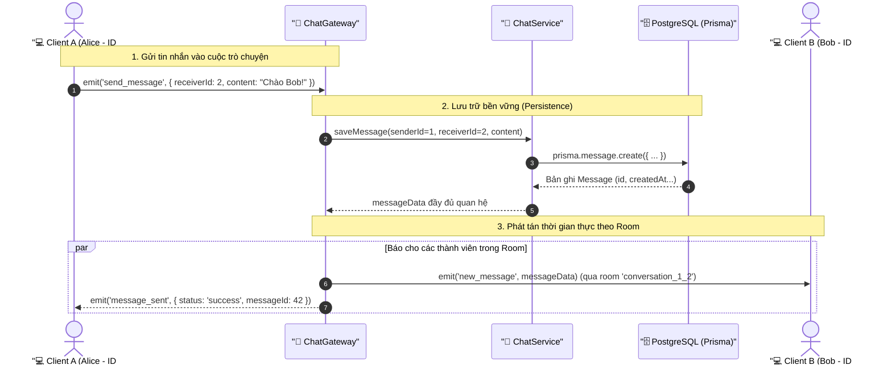

# Lesson 6.3: WebSockets Chat Rooms & Message Persistence — Quản Lý Phòng Chat & Lưu Trữ Tin Nhắn Với Prisma ORM

<p align="center">
  
  
  
  
  
  
</p>

<p align="center">
  
</p>

---

> [!NOTE]
> ⏱️ **Thời lượng:** 20 – 25 phút thực hành chuyên sâu  
> 🎯 **Mục tiêu bài học:**
>
> - **Explain & Mental Model:** Giải thích bản chất của **Socket.IO Rooms** (kênh phân nhóm ảo trên bộ nhớ RAM server) và phân biệt rõ ràng giữa `this.server.to().emit()` (gửi tất cả kể cả người gửi) và `client.to().emit()` (gửi tất cả trừ người gửi).
> - **Room Lifecycle:** Xây dựng tính năng tham gia phòng (`join_room`), rời phòng (`leave_room`) và cơ chế tự động dọn dẹp khi socket client ngắt kết nối.
> - **Targeted Broadcast:** Triển khai cơ chế phát tán thông điệp có chọn lọc chỉ đến đúng các client trong cùng một cuộc trò chuyện, ngăn chặn hoàn toàn rò rỉ tin nhắn ra toàn hệ thống.
> - **Architecture & Separation of Concerns:** Xây dựng `ChatService` độc lập để tách biệt logic cơ sở dữ liệu khỏi Gateway điều phối sự kiện thời gian thực.
> - **Message Persistence:** Lưu trữ tin nhắn bền vững vào bảng `messages` trong PostgreSQL thông qua `PrismaService` theo đúng quan hệ thực thể `senderId` và `receiverId`.
> - **History Query:** Truy vấn danh sách lịch sử tin nhắn gần nhất khi người dùng mới tham gia phòng trò chuyện.
> - **Verify & Debug:** Kiểm thử truyền nhận tin nhắn giữa nhiều client trong các phòng khác nhau bằng Web Client test script và xử lý triệt để các lỗi bất đồng bộ thường gặp.

> [!IMPORTANT]
> **Prerequisites:**
>
> - Đã khởi tạo `ChatGateway` với Namespace `/chat` ([Lesson 6.1](../lesson-6.1/lesson-6.1.md)).
> - Đã bảo vệ Gateway bằng `WsJwtGuard` và decorator `@CurrentUser()` ([Lesson 6.2](../lesson-6.2/lesson-6.2.md)).
> - Nắm vững mô hình dữ liệu Prisma Client & quan hệ thực thể `User` - `Message` ([Module 2](../../module-02/lesson-2.3/lesson-2.3.md)).

---

## 1. Vấn Đề Thực Tế: Broadcast Toàn Cục & Nỗi Đau Mất Dữ Liệu Khi F5 (Why?)

Ở hai bài học trước, chúng ta đã khởi tạo thành công kết nối WebSocket và bảo mật bằng JWT. Tuy nhiên, luồng gửi tin nhắn hiện tại đang mắc phải **hai vấn đề nghiêm trọng**:

```typescript
// ❌ CÁCH LÀM HIỆN TẠI TRONG LESSON 6.2:
@SubscribeMessage('chat_message')
handleChatMessage(@MessageBody() payload: { content: string }) {
  // 1. Bắn cho TẤT CẢ mọi người kết nối vào /chat!
  this.server.emit('new_message', { content: payload.content });
  // 2. Không lưu vào đâu cả, dữ liệu chỉ bay trên RAM!
}
```

```text
❌ TRẢI NGHIỆM THỰC TẾ CỦA NGƯỜI DÙNG:

    Alice (User #1)                     Bob (User #2)                  Charlie (User #3)
          │                                   │                                │
          ├─── [chat_message: "Chào Bob"] ───►│ (Server)                       │
          │                                   ├─── [new_message: "Chào Bob"] ─►│ (Nhận được!)
          │                                   └─── [new_message: "Chào Bob"] ──┼───────────────► 💥 Charlie cũng nhận được!
          │                                                                    │    (Rò rỉ dữ liệu riêng tư)
          │                                                                    │
          ├─── [Alice ấn F5 Reload trang] ────────────────────────────────────►│
          │                                                                    │
          ▼                                                                    ▼
   MÀN HÌNH TRẮNG TINH! Toàn bộ lịch sử cuộc trò chuyện biến mất hoàn toàn!
```

### ⚠️ Hệ quả kỹ thuật:

1. **Rò rỉ quyền riêng tư (Privacy Leak):** Khi User A nhắn tin cho User B, toàn bộ User C, D, E đang online đều nhận được thông báo tin nhắn này.
2. **Spam băng thông mạng (Network Choke):** Nếu có 10,000 người kết nối, một tin nhắn bất kỳ sẽ được nhân bản thành 10,000 gói tin gửi xuống tất cả mọi người.
3. **Mất mát dữ liệu (Data Loss - Ephemerality):** Socket.io chỉ truyền tải gói tin qua TCP. Nếu không có lớp lưu trữ bền vững (Persistence Layer), mọi tin nhắn sẽ biến mất vĩnh viễn ngay khi socket ngắt kết nối.

👉 **Giải pháp kiến trúc:**

- Áp dụng **Socket.IO Rooms** để tạo không gian phòng chat cô lập.
- Tích hợp **Prisma ORM** lưu trữ tin nhắn vào PostgreSQL và tải lịch sử cuộc trò chuyện.

---

## 2. Bản Chất Socket.IO Rooms & Mô Hình Lưu Trữ Tin Nhắn (What?)

### 2.1 Mental Model: Socket.IO Rooms Là Gì?

Trong Socket.IO, **Room** là một **kênh ảo (Virtual Channel)** được quản lý hoàn toàn phía Server nhằm nhóm các socket connections lại với nhau.

<p align="center">
  
</p>

> [!TIP]
> **Room không đòi hỏi một bảng `Room` trong Database!**  
> Bản chất của Room ở tầng Socket.IO chỉ là một cấu trúc dữ liệu `Map<string, Set<string>>` nằm trong bộ nhớ RAM của Node.js:
>
> ```typescript
> // Mô hình trong RAM của Socket.io Adapter:
> rooms = {
>   room_frontend: Set(['socket_id_1', 'socket_id_2']),
>   room_backend: Set(['socket_id_3']),
>   conversation_1_2: Set(['socket_id_1', 'socket_id_4']),
> };
> ```

Mỗi khi một client gọi `client.join('room_frontend')`, Socket.IO chỉ đơn giản là thêm `client.id` vào Set của phòng đó.

### 2.2 Phân Biệt Các Kiểu Phát Tán (Broadcast Cheat Sheet)

| Cú pháp Socket.io                          | Đối tượng nhận                                   | Trường hợp sử dụng thực tế                                  |
| :----------------------------------------- | :----------------------------------------------- | :---------------------------------------------------------- |
| `this.server.emit('event', data)`          | **Tất cả mọi client** trong namespace            | Thông báo bảo trì toàn hệ thống, tin tức chung.             |
| `this.server.to(room).emit('event', data)` | **Tất cả client trong room** (bao gồm người gửi) | Tin nhắn mới trong phòng chat, thông báo phòng.             |
| `client.to(room).emit('event', data)`      | **Tất cả client trong room TRỪ người gửi**       | Thông báo: _"Alice đang gõ phím..."_, _"Bob đã vào phòng"_. |
| `client.emit('event', data)`               | **Chỉ riêng người gửi**                          | Phản hồi lỗi riêng tư, xác nhận thao tác.                   |

---

### 2.3 Luồng Xử Lý Kép: Real-Time Broadcast & Database Persistence

<p align="center">
  
</p>

Khi một tin nhắn được gửi lên Server, hệ thống triển khai một luồng xử lý đồng thời (Forked Execution):



---

## 3. Thiết Kế Quy Ước Đặt Tên Room & DTOs (How - Step 1)

### 3.1 Quy Ước Định Danh Phòng (Room Naming Convention)

Hệ thống của chúng ta hỗ trợ 2 loại phòng chat:

1. **Phòng thảo luận theo chủ đề / Nhóm (Group Room):**  
   Định dạng: `room:<topic_name>` (ví dụ: `room:general`, `room:nestjs`).
2. **Cuộc trò chuyện trực tiếp 1-1 (Direct Message):**  
   Để đảm bảo dù Alice nhắn cho Bob hay Bob nhắn cho Alice thì cả hai đều tham gia chung một phòng, chúng ta sắp xếp `userId` tăng dần:  
   Định dạng: `conversation:${Math.min(user1, user2)}_${Math.max(user1, user2)}`  
   _(Ví dụ: User #1 và User #5 luôn trò chuyện trong room `conversation:1_5`)_.

---

### 3.2 Khởi Tạo Data Transfer Objects (DTO)

Tạo thư mục DTO cho chat:

📄 **`src/chat/dto/join-room.dto.ts`**

```typescript
import { IsNotEmpty, IsString } from 'class-validator';

export class JoinRoomDto {
  @IsString({ message: 'Tên phòng phải là một chuỗi ký tự' })
  @IsNotEmpty({ message: 'Tên phòng không được để trống' })
  roomId: string;
}
```

📄 **`src/chat/dto/send-message.dto.ts`**

```typescript
import {
  IsNotEmpty,
  IsNumber,
  IsOptional,
  IsString,
  MaxLength,
} from 'class-validator';

export class SendMessageDto {
  @IsString({ message: 'Nội dung tin nhắn phải là chuỗi ký tự' })
  @IsNotEmpty({ message: 'Nội dung tin nhắn không được để trống' })
  @MaxLength(1000, { message: 'Tin nhắn không được vượt quá 1000 ký tự' })
  content: string;

  @IsOptional()
  @IsString({ message: 'Mã phòng phải là chuỗi ký tự' })
  roomId?: string;

  @IsOptional()
  @IsNumber({}, { message: 'ID người nhận phải là một số nguyên' })
  receiverId?: number;
}
```

---

## 4. Xây Dựng `ChatService` Kết Nối Prisma ORM (How - Step 2)

Theo kiến trúc phân tầng NestJS, Gateway chỉ chịu trách nhiệm nhận/bắn gói tin Socket. Toàn bộ thao tác truy vấn CSDL PostgreSQL phải được đóng gói bên trong **`ChatService`**.

Tạo file mới:

📄 **`src/chat/chat.service.ts`**

```typescript
import { Injectable, Logger, NotFoundException } from '@nestjs/common';
import { PrismaService } from '@/prisma/prisma.service';

@Injectable()
export class ChatService {
  private readonly logger = new Logger(ChatService.name);

  constructor(private readonly prisma: PrismaService) {}

  /**
   * Sinh mã phòng chuẩn hóa cho cuộc trò chuyện trực tiếp 1-1
   */
  getConversationRoomId(user1Id: number, user2Id: number): string {
    const sortedIds = [user1Id, user2Id].sort((a, b) => a - b);
    return `conversation:${sortedIds[0]}_${sortedIds[1]}`;
  }

  /**
   * Lưu trữ tin nhắn trực tiếp vào PostgreSQL
   */
  async saveDirectMessage(
    senderId: number,
    receiverId: number,
    content: string,
  ) {
    // 1. Kiểm tra sự tồn tại của người nhận
    const receiver = await this.prisma.user.findUnique({
      where: { id: receiverId },
      select: { id: true, name: true, email: true },
    });

    if (!receiver) {
      throw new NotFoundException(
        `Người nhận với ID #${receiverId} không tồn tại trong hệ thống!`,
      );
    }

    // 2. Lưu bản ghi tin nhắn vào bảng 'messages'
    const message = await this.prisma.message.create({
      data: {
        senderId,
        receiverId,
        content,
      },
      include: {
        sender: {
          select: {
            id: true,
            name: true,
            email: true,
            profile: {
              select: { avatarUrl: true },
            },
          },
        },
        receiver: {
          select: {
            id: true,
            name: true,
            email: true,
          },
        },
      },
    });

    this.logger.log(
      `💾 Đã lưu tin nhắn #${message.id} từ User #${senderId} tới User #${receiverId}`,
    );

    return message;
  }

  /**
   * Lấy lịch sử tin nhắn gần nhất giữa 2 người dùng (phục vụ khi mới vào phòng)
   */
  async getConversationHistory(
    user1Id: number,
    user2Id: number,
    limit: number = 20,
  ) {
    const messages = await this.prisma.message.findMany({
      where: {
        OR: [
          { senderId: user1Id, receiverId: user2Id },
          { senderId: user2Id, receiverId: user1Id },
        ],
      },
      orderBy: { createdAt: 'desc' },
      take: limit,
      include: {
        sender: {
          select: {
            id: true,
            name: true,
            email: true,
            profile: {
              select: { avatarUrl: true },
            },
          },
        },
      },
    });

    // Đảo ngược danh sách để hiển thị theo thứ tự thời gian tự nhiên (cũ -> mới)
    return messages.reverse();
  }
}
```

---

## 5. Cập Nhật `ChatGateway` Quản Lý Rooms & Persistence (How - Step 3)

Mở file Gateway và bổ sung các Message Handlers cho phòng chat:

📄 **`src/chat/chat.gateway.ts`**

```typescript
import { Logger, UseGuards } from '@nestjs/common';
import {
  WebSocketGateway,
  WebSocketServer,
  SubscribeMessage,
  MessageBody,
  ConnectedSocket,
  OnGatewayInit,
  OnGatewayConnection,
  OnGatewayDisconnect,
} from '@nestjs/websockets';
import { Namespace, Socket } from 'socket.io';
import { WsJwtGuard } from '@/auth/guards/ws-jwt.guard';
import type { UserData } from '@/auth/interfaces/jwt.interface';
import { CurrentUser } from '@/shared/decorators/current-user.decorator';
import { ChatService } from './chat.service';
import { JoinRoomDto } from './dto/join-room.dto';
import { SendMessageDto } from './dto/send-message.dto';

@UseGuards(WsJwtGuard)
@WebSocketGateway({
  namespace: '/chat',
  cors: {
    origin: '*',
  },
})
export class ChatGateway
  implements OnGatewayInit, OnGatewayConnection, OnGatewayDisconnect
{
  private readonly logger = new Logger(ChatGateway.name);

  constructor(private readonly chatService: ChatService) {}

  @WebSocketServer()
  server: Namespace;

  afterInit(server: Namespace) {
    this.logger.log(
      `🚀 ChatGateway đã khởi động trên namespace ${server.name}`,
    );
  }

  handleConnection(client: Socket) {
    this.logger.log(`🟢 Client kết nối: ${client.id}`);
  }

  handleDisconnect(client: Socket) {
    this.logger.warn(`🔴 Client ngắt kết nối: ${client.id}`);
  }

  // =================================================================
  // 1. THAM GIA PHÒNG CHAT (JOIN ROOM)
  // =================================================================
  @SubscribeMessage('join_room')
  async handleJoinRoom(
    @MessageBody() dto: JoinRoomDto,
    @ConnectedSocket() client: Socket,
    @CurrentUser() user: UserData,
  ) {
    const { roomId } = dto;

    // Đưa Socket Client vào Room của Socket.io
    await client.join(roomId);

    this.logger.log(
      `📥 [${user.email}] (${client.id}) đã tham gia phòng: ${roomId}`,
    );

    // Báo cho những người KHÁC trong phòng biết có người mới vào
    client.to(roomId).emit('user_joined', {
      userId: user.userId,
      email: user.email,
      joinedAt: new Date().toISOString(),
    });

    return {
      status: 'success',
      message: `Bạn đã tham gia phòng ${roomId} thành công`,
      roomId,
    };
  }

  // =================================================================
  // 2. RỜI PHÒNG CHAT (LEAVE ROOM)
  // =================================================================
  @SubscribeMessage('leave_room')
  async handleLeaveRoom(
    @MessageBody() dto: JoinRoomDto,
    @ConnectedSocket() client: Socket,
    @CurrentUser() user: UserData,
  ) {
    const { roomId } = dto;

    await client.leave(roomId);

    this.logger.log(
      `📤 [${user.email}] (${client.id}) đã rời khỏi phòng: ${roomId}`,
    );

    // Báo cho các thành viên còn lại
    client.to(roomId).emit('user_left', {
      userId: user.userId,
      email: user.email,
      leftAt: new Date().toISOString(),
    });

    return {
      status: 'success',
      message: `Bạn đã rời phòng ${roomId}`,
      roomId,
    };
  }

  // =================================================================
  // 3. GỬI TIN NHẮN THEO PHÒNG & LƯU CSDL (SEND MESSAGE)
  // =================================================================
  @SubscribeMessage('send_room_message')
  async handleSendRoomMessage(
    @MessageBody() dto: SendMessageDto,
    @ConnectedSocket() client: Socket,
    @CurrentUser() user: UserData,
  ) {
    let targetRoom = dto.roomId;
    let savedMessage = null;

    // A. Nếu có receiverId -> Đây là Direct Chat 1-1
    if (dto.receiverId) {
      // 1. Lưu tin nhắn bền vững vào bảng messages
      savedMessage = await this.chatService.saveDirectMessage(
        user.userId,
        dto.receiverId,
        dto.content,
      );

      // 2. Tự động sinh tên phòng 1-1 và đảm bảo client đã join phòng
      targetRoom = this.chatService.getConversationRoomId(
        user.userId,
        dto.receiverId,
      );
      await client.join(targetRoom);
    }

    // Đóng gói gói tin broadcast
    const broadcastPayload = {
      messageId: savedMessage?.id || null,
      senderId: user.userId,
      senderEmail: user.email,
      senderName: savedMessage?.sender?.name || user.email,
      content: dto.content,
      roomId: targetRoom,
      createdAt: savedMessage?.createdAt || new Date().toISOString(),
    };

    // B. Phát tán ĐỘC QUYỀN vào targetRoom (Gửi cho TẤT CẢ client trong room)
    if (targetRoom) {
      this.server.to(targetRoom).emit('new_room_message', broadcastPayload);
      this.logger.log(
        `💬 [Room: ${targetRoom}] Tin nhắn từ [${user.email}]: ${dto.content}`,
      );
    } else {
      // Nếu không có room, fallback về gửi toàn namespace
      this.server.emit('new_room_message', broadcastPayload);
    }

    // Trả về xác nhận cho người gửi
    return {
      status: 'sent',
      message: broadcastPayload,
    };
  }

  // =================================================================
  // 4. LẤY LỊCH SỬ TIN NHẮN (CONVERSATION HISTORY)
  // =================================================================
  @SubscribeMessage('get_history')
  async handleGetHistory(
    @MessageBody() payload: { receiverId: number; limit?: number },
    @CurrentUser() user: UserData,
  ) {
    const history = await this.chatService.getConversationHistory(
      user.userId,
      payload.receiverId,
      payload.limit || 20,
    );

    return {
      status: 'success',
      data: history,
    };
  }
}
```

---

## 6. Đăng Ký `ChatService` Vào `ChatModule` (How - Step 4)

Vì `PrismaModule` đã được cấu hình `@Global()` ở Module 2, chúng ta chỉ cần khai báo `ChatService` vào mảng `providers` của `ChatModule`:

📄 **`src/chat/chat.module.ts`**

```typescript
import { Module } from '@nestjs/common';
import { ChatGateway } from './chat.gateway';
import { ChatService } from './chat.service';
import { AuthModule } from '@/auth/auth.module';

@Module({
  imports: [AuthModule],
  providers: [ChatGateway, ChatService],
  exports: [ChatGateway, ChatService],
})
export class ChatModule {}
```

---

## 7. Kiểm Thử Trực Quan: Web Client Đa Phòng (Verify)

Tạo một trang web test nhỏ để giả lập 2 người dùng trò chuyện độc lập trong phòng:

📄 **`test-chat-room.html`** _(Tạo ở thư mục gốc dự án)_

```html
<!DOCTYPE html>
<html lang="vi">
  <head>
    <meta charset="UTF-8" />
    <title>Test NestJS WebSockets Chat Rooms</title>
    <script src="https://cdn.socket.io/4.8.1/socket.io.min.js"></script>
    <style>
      body {
        font-family:
          -apple-system, BlinkMacSystemFont, 'Segoe UI', Roboto, sans-serif;
        background: #0f172a;
        color: #f8fafc;
        margin: 20px;
      }
      .card {
        background: #1e293b;
        border-radius: 8px;
        padding: 16px;
        margin-bottom: 16px;
        border: 1px solid #334155;
      }
      input,
      button {
        padding: 8px 12px;
        border-radius: 4px;
        border: 1px solid #475569;
        background: #0f172a;
        color: white;
        margin-right: 8px;
      }
      button {
        background: #e0234e;
        border-color: #e0234e;
        cursor: pointer;
        font-weight: bold;
      }
      button:hover {
        background: #b81c3e;
      }
      #messages {
        height: 260px;
        overflow-y: auto;
        background: #0f172a;
        padding: 12px;
        border-radius: 6px;
        border: 1px solid #334155;
        list-style: none;
      }
      #messages li {
        margin-bottom: 8px;
        padding: 6px 10px;
        border-radius: 4px;
        background: #1e293b;
      }
      .system {
        color: #38bdf8;
        font-style: italic;
      }
    </style>
  </head>
  <body>
    <h2>🚀 NestJS Socket.IO Rooms & Persistence Tester</h2>

    <div class="card">
      <label>Access Token (Bearer): </label>
      <input
        type="text"
        id="token"
        placeholder="Dán JWT Access Token vào đây"
        style="width: 50%;"
      />
      <button onclick="connectSocket()">Kết Nối Gateway</button>
      <span id="connStatus" style="color: #ef4444; font-weight: bold;"
        >Chưa kết nối</span
      >
    </div>

    <div class="card">
      <input
        type="text"
        id="roomName"
        placeholder="Tên phòng (ví dụ: room:general)"
        value="room:general"
      />
      <button onclick="joinRoom()">Tham Gia Phòng</button>
      <button onclick="leaveRoom()">Rời Phòng</button>
    </div>

    <div class="card">
      <input
        type="number"
        id="receiverId"
        placeholder="Receiver ID (để trống nếu chat phòng)"
        style="width: 140px;"
      />
      <input
        type="text"
        id="msgContent"
        placeholder="Nhập nội dung tin nhắn..."
        style="width: 40%;"
      />
      <button onclick="sendMessage()">Gửi Tin Nhắn</button>
    </div>

    <div class="card">
      <h3>Lịch Sử Tin Nhắn:</h3>
      <ul id="messages"></ul>
    </div>

    <script>
      let socket = null;

      function connectSocket() {
        const token = document.getElementById('token').value.trim();
        if (!token) return alert('Vui lòng nhập Access Token!');

        socket = io('http://localhost:3000/chat', {
          auth: { token },
        });

        socket.on('connect', () => {
          document.getElementById('connStatus').innerText =
            `Đã kết nối (Socket ID: ${socket.id})`;
          document.getElementById('connStatus').style.color = '#22c55e';
        });

        socket.on('connect_error', (err) => {
          document.getElementById('connStatus').innerText =
            `Lỗi: ${err.message}`;
          document.getElementById('connStatus').style.color = '#ef4444';
        });

        // Nhận tin nhắn trong phòng
        socket.on('new_room_message', (msg) => {
          const li = document.createElement('li');
          li.innerHTML = `<strong>[${msg.senderEmail}]:</strong> ${msg.content} <small style="color:#64748b;">(${msg.createdAt})</small>`;
          document.getElementById('messages').appendChild(li);
        });

        // Thông báo thành viên vào phòng
        socket.on('user_joined', (data) => {
          const li = document.createElement('li');
          li.className = 'system';
          li.innerText = `👋 Thành viên ${data.email} vừa tham gia phòng.`;
          document.getElementById('messages').appendChild(li);
        });
      }

      function joinRoom() {
        const roomId = document.getElementById('roomName').value;
        socket.emit('join_room', { roomId }, (ack) => {
          alert(ack.message);
        });
      }

      function leaveRoom() {
        const roomId = document.getElementById('roomName').value;
        socket.emit('leave_room', { roomId }, (ack) => {
          alert(ack.message);
        });
      }

      function sendMessage() {
        const content = document.getElementById('msgContent').value;
        const roomId = document.getElementById('roomName').value;
        const receiverIdVal = document.getElementById('receiverId').value;
        const receiverId = receiverIdVal ? Number(receiverIdVal) : undefined;

        socket.emit(
          'send_room_message',
          { content, roomId, receiverId },
          (ack) => {
            console.log('Ack server:', ack);
            document.getElementById('msgContent').value = '';
          },
        );
      }
    </script>
  </body>
</html>
```

### 🔬 Các Bước Kiểm Thử:

1. Mở 2 cửa sổ trình duyệt (Tab 1 đăng nhập tài khoản User A, Tab 2 đăng nhập tài khoản User B).
2. Cả 2 Tab cùng nhập `room:general` và bấm **Tham Gia Phòng**.
3. Tab 1 gửi tin nhắn -> Ngay lập tức Tab 2 nhận được thông điệp mà không cần reload trang.
4. Tab 1 đổi sang phòng `room:private` và gửi tin -> Tab 2 (vẫn ở `room:general`) hoàn toàn **KHÔNG nhận được**, chứng minh tính cô lập của Room.
5. Tab 1 điền `Receiver ID: 2` (ID của User B) và gửi tin -> Mở terminal kiểm tra cơ sở dữ liệu:
   ```bash
   pnpm prisma studio
   ```
   Bảng `messages` trong PostgreSQL đã xuất hiện bản ghi mới với đầy đủ `senderId: 1`, `receiverId: 2` và `content`!

---

## 8. Những Lỗi Thường Gặp & Cách Khắc Phục (Common Mistakes & Debugging)

### ❌ Lỗi 1: Nhầm lẫn giữa `socket.to()` và `server.to()`

- **Triệu chứng:** Người gửi tin nhắn thấy bạn mình nhận được nhưng chính bản thân mình lại không thấy tin nhắn hiển thị trên khung chat.
- **Nguyên nhân:** Dùng `client.to(room).emit()`. Phương thức này phát tán tới tất cả socket trong room **ngoại trừ chính socket đang gọi**.
- **Cách sửa:** Dùng `this.server.to(room).emit()` nếu muốn cả người gửi cũng nhận được sự kiện, hoặc phía người gửi cập nhật UI tức thì bằng callback/ack.

### ❌ Lỗi 2: Quên `await` khi thao tác CSDL trong WebSocket Handler

- **Triệu chứng:** Tin nhắn bay đi rất nhanh nhưng trong CSDL không có gì, hoặc thi thoảng server log ra lỗi `UnhandledPromiseRejection`.
- **Nguyên nhân:** Khác với HTTP Controller có Exception Filter bắt lỗi request, trong WebSocket handler nếu không `await` hàm async thì lỗi ném ra từ Prisma có thể làm crash socket connection.
- **Cách sửa:** Luôn gắn `await` khi gọi `chatService.saveDirectMessage(...)`.

### ❌ Lỗi 3: Tạo Room Name không nhất quán giữa 2 người dùng

- **Triệu chứng:** Alice nhắn cho Bob thì dùng room `conversation:1_2`, nhưng Bob nhắn cho Alice lại dùng room `conversation:2_1`. Kết quả là 2 người ở 2 phòng khác nhau và không ai thấy tin nhắn của ai!
- **Cách sửa:** Luôn sắp xếp ID tăng dần thông qua hàm chuẩn hóa:
  ```typescript
  getConversationRoomId(id1: number, id2: number) {
    const [min, max] = [id1, id2].sort((a, b) => a - b);
    return `conversation:${min}_${max}`;
  }
  ```

---

## 9. 🧩 Hands-on Lab & Thử Thách Mở Rộng (Hands-on Challenge)

### 🟢 Level 1: Follow Along

Thực hiện tạo `ChatService`, tích hợp `PrismaService`, cấu hình event `join_room` và `send_room_message` trong `ChatGateway` theo hướng dẫn trên. Kiểm tra bằng `test-chat-room.html`.

### 🟡 Level 2: Debugging Challenge

Giả sử bạn muốn khi một client ngắt kết nối (`handleDisconnect`), server tự động thông báo cho tất cả các phòng mà client đó đang tham gia.  
_Gợi ý:_ Khảo sát `client.rooms` trong sự kiện `disconnecting` của Socket.io trước khi kết nối bị hủy hoàn toàn.

### 🔴 Level 3: Advanced Challenge

Xây dựng tính năng **Typing Indicator** (Thông báo người dùng đang soạn tin nhắn):

1. Lắng nghe sự kiện `@SubscribeMessage('typing')`.
2. Dùng `client.to(roomId).emit('user_typing', { userId: user.userId })` để báo cho đối phương.
3. Khi người dùng dừng gõ, lắng nghe `@SubscribeMessage('stop_typing')` và thông báo `user_stop_typing`.

---

## 10. Tổng Kết

### 🎯 Điểm Cốt Lõi Cần Nhớ

- **Socket.IO Room** là cơ chế nhóm socket logic trên bộ nhớ RAM, là chìa khóa để triển khai chat nhóm và chat 1-1 mà không gây lãng phí tài nguyên mạng.
- Sử dụng `this.server.to(room).emit()` để gửi cho mọi người trong phòng; dùng `client.to(room).emit()` để loại trừ người gửi.
- Tách bạch rõ rệt giữa **Tầng truyền dẫn (ChatGateway)** và **Tầng nghiệp vụ & Lưu trữ (ChatService + Prisma)**.
- Kết hợp Socket.io và Prisma ORM biến ứng dụng từ giao tiếp tạm thời (ephemeral) thành một hệ sinh thái mạng xã hội hoàn chỉnh có lưu trữ lịch sử tin nhắn.

### ✅ Checklist Hoàn Thành Bài Học

- [x] Hiểu bản chất Socket.IO Room và cấu trúc dữ liệu lưu trữ phía server.
- [x] Tạo `JoinRoomDto` và `SendMessageDto` với `class-validator`.
- [x] Xây dựng `ChatService` lưu trữ tin nhắn vào PostgreSQL và truy vấn lịch sử với `PrismaService`.
- [x] Triển khai `join_room`, `leave_room`, `send_room_message` trong `ChatGateway`.
- [x] Kiểm thử gửi nhận tin nhắn đa phòng và kiểm tra dữ liệu trong bảng `messages`.

---

👉 **Bài tiếp theo:** Lesson 6.4: WebSockets + Event-Driven — Đẩy Thông Báo Thời Gian Thực Khi Có Bình Luận Mới
