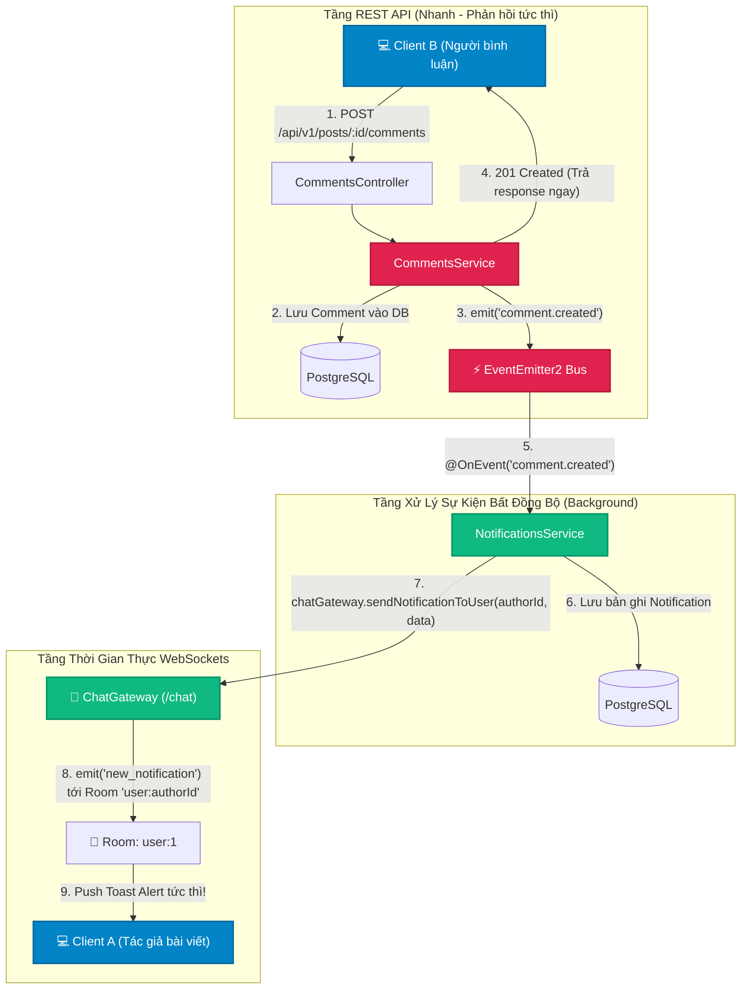

# Lesson 6.4: WebSockets + Event-Driven Architecture — Đẩy Thông Báo Thời Gian Thực Khi Có Bình Luận Mới (Real-Time Notification Alerts)

<p align="center">
  
  
  
  
  
  
</p>

<p align="center">
  
</p>

---

> [!NOTE]
> ⏱️ **Thời lượng:** 20 – 25 phút thực hành chuyên sâu  
> 🎯 **Mục tiêu bài học:**
>
> - **Explain & Mental Model:** Nắm vững kiến trúc cầu nối (**Event Bridge Architecture**) giữa sự kiện nội bộ Server (`EventEmitter2`) và kết nối hướng Client (`Socket.io WebSockets`).
> - **Architectural Decoupling:** Giải thích tại sao `CommentsService` tuyệt đối không được gọi trực tiếp `ChatGateway`, duy trì nguyên tắc tách rời trách nhiệm và bảo toàn hiệu năng API.
> - **Targeted User-Specific Room Pattern:** Thiết lập cơ chế phòng cá nhân (`user:${userId}`) trên Socket.io để định tuyến chính xác thông báo đến đúng người nhận mà không gây rò rỉ dữ liệu sang người dùng khác.
> - **Cross-Module Integration:** Tích hợp `ChatGateway` vào `NotificationsService`, tự động phát tán gói tin WebSocket ngay sau khi bản ghi thông báo được lưu bền vững vào PostgreSQL.
> - **Clean Code Conventions:** Loại bỏ hoàn toàn Magic Strings bằng việc quản lý các sự kiện thông báo thông qua hằng số tập trung `CHAT_EVENTS` và `CHAT_ROOM`.
> - **Verify & Hands-on:** Xây dựng trang Web Client mô phỏng Notification Bell với Toast Popup tự động nổ chuông và hiển thị thông báo thời gian thực khi có người bình luận bài viết.
> - **Error Handling & Debugging:** Nhận diện và xử lý triệt để lỗi Circular Dependency giữa các module và rủi ro race condition khi client chưa kịp đăng ký User Room.

> [!IMPORTANT]
> **Prerequisites:**
>
> - Đã hoàn thành kiến trúc Event-Driven với `@nestjs/event-emitter` và sự kiện `comment.created` ([Lesson 5.5](../../module-05/lesson-5.5/lesson-5.5.md)).
> - Đã bảo vệ WebSocket Gateway bằng `WsJwtGuard` ([Lesson 6.2](../lesson-6.2/lesson-6.2.md)).
> - Đã hiểu bản chất cơ chế Rooms trong Socket.IO ([Lesson 6.3](../lesson-6.3/lesson-6.3.md)).

---

## 1. Vấn Đề Thực Tế: Khoảng Cách Giữa Lưu CSDL & Trải Nghiệm Thời Gian Thực (Why?)

Ở [Lesson 5.5](../../module-05/lesson-5.5/lesson-5.5.md), chúng ta đã xây dựng thành công luồng xử lý sự kiện bất đồng bộ: Khi User B đăng bình luận, `CommentsService` phát ra sự kiện `comment.created` và `NotificationsService` tự động lưu bản ghi thông báo vào PostgreSQL:

```text
User B bình luận ───► CommentsService ───► EventEmitter2 ───► NotificationsService ───► DB (Bảng notifications)
```

Tuy nhiên, **trải nghiệm phía người dùng tác giả (User A)** hiện tại vẫn bị gián đoạn:

```text
❌ HIỆN TRẠNG:
User A đang online đọc bài viết...
User B vừa bình luận: "Bài viết này rất tuyệt vời!"
Database đã có thông báo mới... NHƯNG màn hình của User A vẫn im lìm!

👉 User A CHỈ biết có thông báo mới khi:
   1. User A bấm F5 reload lại toàn bộ trang web.
   2. Hoặc Frontend phải chạy cơ chế Polling (liên tục gọi GET /api/v1/notifications mỗi 3 giây).
```

### ⚠️ Hạn chế của Polling truyền thống:

1. **Lãng phí tài nguyên máy chủ:** 10,000 người dùng online sẽ tạo ra hơn 3,300 requests/giây chỉ để kiểm tra "có gì mới không", trong khi 99% các request đó trả về mảng rỗng.
2. **Độ trễ thông tin (Latency):** Người dùng phải đợi đến chu kỳ fetch tiếp theo mới nhận được tin.
3. **Trải nghiệm rời rạc:** Thiếu đi cảm giác tương tác sống động (như quả chuông đỏ nổ số và thông báo Toast góc màn hình của Facebook, GitHub hay YouTube).

👉 **Giải pháp kiến trúc:** Biến sự kiện `comment.created` bên trong NestJS Server thành một **thông báo đẩy thời gian thực (Push Notification)** gửi thẳng tới trình duyệt của tác giả thông qua **Socket.IO Room cá nhân**.

---

## 2. Kiến Trúc Cầu Nối: Event-Driven Kết Hợp WebSockets (What?)

### 2.1 Mental Model: Sự Kết Hợp Hai Tầng Bất Đồng Bộ

Chúng ta kết hợp hai cơ chế truyền thông mạnh mẽ nhất trong hệ sinh thái NestJS:

1. **Internal Event Bus (`EventEmitter2`):** Giao tiếp bất đồng bộ, tách rời hoàn toàn giữa các Service bên trong máy chủ (In-process Decoupling).
2. **External Push Channel (`Socket.IO Gateway`):** Kênh truyền thông song công thời gian thực giữa máy chủ và trình duyệt người dùng (Client-Server Transport).



---

### 2.2 Tại Sao `CommentsService` Không Gọi Trực Tiếp `ChatGateway`?

Một câu hỏi phỏng vấn Senior Backend rất phổ biến:

> _"Tại sao không inject trực tiếp `ChatGateway` vào `CommentsService` để gửi thông báo luôn cho gọn?"_

| Tiêu chí                           | ❌ Inject ChatGateway Trực Tiếp Vào CommentsService                                                                   | ✅ Sử dụng Event-Driven (Cầu Nối Khuyên Dùng)                                                             |
| :--------------------------------- | :-------------------------------------------------------------------------------------------------------------------- | :-------------------------------------------------------------------------------------------------------- |
| **Tính liên kết (Coupling)**       | **Tightly Coupled (Ràng buộc chặt):** `CommentsService` vừa phải biết về CSDL, vừa phải biết về WebSockets.           | **Loosely Coupled (Tách rời):** `CommentsService` chỉ làm đúng 1 việc: lưu comment và bắn event.          |
| **Nguyên tắc SRP**                 | **Vi phạm Single Responsibility:** Logic comment bị trộn lẫn với logic truyền dẫn mạng.                               | **Tuân thủ SRP:** Tầng Comment không quan tâm ai nghe và xử lý thông báo bằng cách nào.                   |
| **Khả năng mở rộng (Scalability)** | Muốn gửi thêm Email chào mừng, ghi audit log, cập nhật bảng xếp hạng -> Phải vào sửa tiếp code của `CommentsService`. | Dễ dàng thêm `MailHandler`, `AnalyticsHandler` lắng nghe cùng một sự kiện mà không chạm vào code comment. |
| **Khả năng chịu lỗi (Resilience)** | Nếu Socket.io bị lỗi mạng hoặc crash, API bình luận có thể bị ảnh hưởng hoặc chậm lại.                                | Tách rời hoàn toàn, API bình luận trả về 201 cho client ngay lập tức trong vài mili-giây.                 |

---

### 2.3 Cơ Chế Phòng Cá Nhân: User-Specific Room Pattern

Trong [Lesson 6.3](../lesson-6.3/lesson-6.3.md), chúng ta đã biết Room là cơ chế gom nhóm socket trên RAM. Để gửi thông báo riêng tư cho một người dùng bất kỳ, giải pháp chuẩn hóa trong ngành là:

> Mỗi khi người dùng kết nối vào hệ thống với tài khoản User ID `#123`, họ sẽ tự động tham gia vào phòng có tên:  
> **`user:123`**

Khi cần gửi thông báo cho User `#123`, Server chỉ cần phát tán tới phòng đó:

```typescript
this.server.to(`user:${userId}`).emit(CHAT_EVENTS.NEW_NOTIFICATION, payload);
```

```text
                    ┌────────────────────────────────────────┐
                    │      Socket.IO Namespace: /chat        │
                    ├────────────────────────────────────────┤
                    │                                        │
                    │   Room "user:1"                        │
                    │   ├── Socket Client (Laptop của Alice) │
                    │   └── Socket Client (Mobile của Alice) │ ──► Cả 2 thiết bị của Alice đều nhận thông báo!
                    │                                        │
                    │   Room "user:2"                        │
                    │   └── Socket Client (Bob)              │
                    │                                        │
                    │   Room "conversation:1_2"              │
                    │   ├── Socket Client (Alice)            │
                    │   └── Socket Client (Bob)              │
                    │                                        │
                    └────────────────────────────────────────┘
```

---

## 3. Chuẩn Hóa Hằng Số Thông Báo (How - Step 1)

Tuân thủ nguyên tắc **Clean Code & Không hardcode string**, chúng ta bổ sung các hằng số sự kiện thông báo vào file constant đã tạo ở bài trước:

📄 **`src/chat/constants/chat.constant.ts`**

```typescript
export const CHAT_EVENTS = {
  // Client to Server
  PING: 'ping',
  JOIN_ROOM: 'join_room',
  LEAVE_ROOM: 'leave_room',
  SEND_ROOM_MESSAGE: 'send_room_message',
  GET_HISTORY: 'get_history',
  SUBSCRIBE_NOTIFICATIONS: 'subscribe_notifications', // Đăng ký nhận thông báo cá nhân

  // Server to Client
  USER_JOINED: 'user_joined',
  USER_LEFT: 'user_left',
  NEW_ROOM_MESSAGE: 'new_room_message',
  NEW_NOTIFICATION: 'new_notification', // Đẩy thông báo thời gian thực xuống Client
} as const;

export const CHAT_ROOM = {
  CONVERSATION_PREFIX: 'conversation:',
  USER_PREFIX: 'user:', // Tiền tố định danh User Room (user:1, user:2...)
} as const;
```

---

## 4. Nâng Cấp `ChatGateway` Quản Lý User Room & Đẩy Thông Báo (How - Step 2)

Chúng ta mở file Gateway và bổ sung:

1. Handler `@SubscribeMessage(CHAT_EVENTS.SUBSCRIBE_NOTIFICATIONS)` để Socket Client tham gia vào Room cá nhân của mình.
2. Phương thức `sendNotificationToUser(userId, payload)` để các Service khác trong hệ thống có thể gọi và gửi thông báo trực tiếp.

📄 **`src/chat/chat.gateway.ts`**

```typescript
import { Logger, UseGuards } from '@nestjs/common';
import {
  WebSocketGateway,
  WebSocketServer,
  SubscribeMessage,
  MessageBody,
  ConnectedSocket,
  OnGatewayInit,
  OnGatewayConnection,
  OnGatewayDisconnect,
} from '@nestjs/websockets';
import { Namespace, Socket } from 'socket.io';
import { WsJwtGuard } from '@/auth/guards/ws-jwt.guard';
import type { UserData } from '@/auth/interfaces/jwt.interface';
import { CurrentUser } from '@/shared/decorators/current-user.decorator';
import { CHAT_EVENTS, CHAT_ROOM } from './constants/chat.constant';
import { ChatService } from './chat.service';
import { GetHistoryDto } from './dto/get-history.dto';
import { JoinRoomDto } from './dto/join-room.dto';
import { SendMessageDto } from './dto/send-message.dto';

@UseGuards(WsJwtGuard)
@WebSocketGateway({
  namespace: '/chat',
  cors: {
    origin: '*',
  },
})
export class ChatGateway
  implements OnGatewayInit, OnGatewayConnection, OnGatewayDisconnect
{
  private readonly logger = new Logger(ChatGateway.name);

  constructor(private readonly chatService: ChatService) {}

  @WebSocketServer()
  server: Namespace;

  afterInit(server: Namespace) {
    this.logger.log(
      `🚀 WebSocket Chat Gateway ${server.name} đã sẵn sàng hoạt động!`,
    );
  }

  handleConnection(client: Socket) {
    this.logger.log(`🟢 Client kết nối vào ${this.server.name}: ${client.id}`);
  }

  handleDisconnect(client: Socket) {
    this.logger.warn(
      `🔴 Client ngắt kết nối khỏi ${this.server.name}: ${client.id}`,
    );
  }

  @SubscribeMessage(CHAT_EVENTS.PING)
  handlePing(@ConnectedSocket() client: Socket): string {
    this.logger.debug(`Ping nhận được từ [${client.id}]`);
    return 'pong';
  }

  // =================================================================
  // 1. ĐĂNG KÝ PHÒNG THÔNG BÁO CÁ NHÂN (USER NOTIFICATION ROOM)
  // =================================================================
  @SubscribeMessage(CHAT_EVENTS.SUBSCRIBE_NOTIFICATIONS)
  async handleSubscribeNotifications(
    @ConnectedSocket() client: Socket,
    @CurrentUser() user: UserData,
  ) {
    const userRoom = `${CHAT_ROOM.USER_PREFIX}${user.userId}`;
    await client.join(userRoom);

    this.logger.log(
      `🔔 [${user.email}] (${client.id}) đã tham gia phòng thông báo: ${userRoom}`,
    );

    return {
      status: 'subscribed',
      room: userRoom,
    };
  }

  // =================================================================
  // 2. THAM GIA PHÒNG CHAT (JOIN ROOM)
  // =================================================================
  @SubscribeMessage(CHAT_EVENTS.JOIN_ROOM)
  async handleJoinRoom(
    @MessageBody() dto: JoinRoomDto,
    @ConnectedSocket() client: Socket,
    @CurrentUser() user: UserData,
  ) {
    const { roomId } = dto;
    await client.join(roomId);

    this.logger.log(
      `📥 [${user.email}] (${client.id}) đã tham gia phòng: ${roomId}`,
    );

    client
      .to(roomId)
      .emit(
        CHAT_EVENTS.USER_JOINED,
        this.chatService.createUserRoomEventPayload(user),
      );

    return {
      status: 'success',
      message: `Bạn đã tham gia phòng ${roomId} thành công`,
      roomId,
    };
  }

  // =================================================================
  // 3. RỜI PHÒNG CHAT (LEAVE ROOM)
  // =================================================================
  @SubscribeMessage(CHAT_EVENTS.LEAVE_ROOM)
  async handleLeaveRoom(
    @MessageBody() dto: JoinRoomDto,
    @ConnectedSocket() client: Socket,
    @CurrentUser() user: UserData,
  ) {
    const { roomId } = dto;
    await client.leave(roomId);

    this.logger.log(
      `📤 [${user.email}] (${client.id}) đã rời khỏi phòng: ${roomId}`,
    );

    client
      .to(roomId)
      .emit(
        CHAT_EVENTS.USER_LEFT,
        this.chatService.createUserRoomEventPayload(user),
      );

    return {
      status: 'success',
      message: `Bạn đã rời phòng ${roomId}`,
      roomId,
    };
  }

  // =================================================================
  // 4. GỬI TIN NHẮN THEO PHÒNG (SEND ROOM MESSAGE)
  // =================================================================
  @SubscribeMessage(CHAT_EVENTS.SEND_ROOM_MESSAGE)
  async handleSendRoomMessage(
    @MessageBody() dto: SendMessageDto,
    @CurrentUser() user: UserData,
  ) {
    const { targetRoom, broadcastPayload } =
      await this.chatService.processRoomMessage(user, dto);

    // Socket.io hỗ trợ to(string | string[]): 1-1 thì phát tán 2 user room, nhóm thì phát tán targetRoom
    const targetRooms = dto.receiverId
      ? [
          `${CHAT_ROOM.USER_PREFIX}${dto.receiverId}`,
          `${CHAT_ROOM.USER_PREFIX}${user.userId}`,
        ]
      : targetRoom;

    this.server
      .to(targetRooms)
      .emit(CHAT_EVENTS.NEW_ROOM_MESSAGE, broadcastPayload);

    this.logger.log(
      dto.receiverId
        ? `💬 [Direct Chat] [${user.email}] (#${user.userId}) -> User #${dto.receiverId}: ${dto.content}`
        : `💬 [Room: ${targetRoom}] [${user.email}]: ${dto.content}`,
    );

    return {
      status: 'sent',
      message: broadcastPayload,
    };
  }

  // =================================================================
  // 5. LẤY LỊCH SỬ TIN NHẮN (CONVERSATION HISTORY)
  // =================================================================
  @SubscribeMessage(CHAT_EVENTS.GET_HISTORY)
  async handleGetHistory(
    @MessageBody() dto: GetHistoryDto,
    @CurrentUser() user: UserData,
  ) {
    const history = await this.chatService.getConversationHistory(
      user.userId,
      dto.receiverId,
      dto.limit,
    );

    return {
      status: 'success',
      data: history,
    };
  }

  // =================================================================
  // 6. PHƯƠNG THỨC PUBLIC: ĐẨY THÔNG BÁO TỚI USER CỤ THỂ
  // =================================================================
  /**
   * Phát tán thông báo thời gian thực tới một người dùng cụ thể thông qua User Room
   */
  sendNotificationToUser(userId: number, payload: unknown) {
    const userRoom = `${CHAT_ROOM.USER_PREFIX}${userId}`;
    this.server.to(userRoom).emit(CHAT_EVENTS.NEW_NOTIFICATION, payload);
    this.logger.log(`🔔 Đã đẩy thông báo tới phòng người dùng [${userRoom}]`);
  }
}
```

---

## 5. Kết Nối `NotificationsModule` Với `ChatGateway` (How - Step 3)

### 5.1 Import `ChatModule` Vào `NotificationsModule`

Để `NotificationsService` có thể sử dụng được `ChatGateway`, chúng ta import `ChatModule` vào `NotificationsModule`. Lưu ý rằng trong `chat.module.ts`, `ChatGateway` đã được khai báo trong mảng `exports`:

📄 **`src/notifications/notifications.module.ts`**

```typescript
import { Module } from '@nestjs/common';
import { NotificationsController } from './notifications.controller';
import { NotificationsService } from './notifications.service';
import { ChatModule } from '@/chat/chat.module';

@Module({
  imports: [ChatModule], // Tích hợp ChatModule để có thể inject ChatGateway
  controllers: [NotificationsController],
  providers: [NotificationsService],
  exports: [NotificationsService],
})
export class NotificationsModule {}
```

---

### 5.2 Inject `ChatGateway` Vào `NotificationsService`

Trong hàm lắng nghe sự kiện `@OnEvent(EVENT.COMMENT.CREATED)`, ngay sau khi lưu bản ghi thông báo thành công vào bảng `notifications`, chúng ta gọi ngay `this.chatGateway.sendNotificationToUser(...)`:

📄 **`src/notifications/notifications.service.ts`**

```typescript
import { CommentCreatedEvent } from '@/comments/events/comment-created.event';
import { PrismaService } from '@/prisma/prisma.service';
import { EVENT } from '@/shared/constants/event.constant';
import {
  ForbiddenException,
  Injectable,
  Logger,
  NotFoundException,
} from '@nestjs/common';
import { OnEvent } from '@nestjs/event-emitter';
import { QueryNotificationDto } from './dto/query-notification.dto';
import { Prisma } from '@/generated/prisma/client';
import { ChatGateway } from '@/chat/chat.gateway';

@Injectable()
export class NotificationsService {
  private readonly logger = new Logger(NotificationsService.name);

  constructor(
    private readonly prisma: PrismaService,
    private readonly chatGateway: ChatGateway, // Inject ChatGateway
  ) {}

  @OnEvent(EVENT.COMMENT.CREATED, { async: true })
  async handleCommentCreated(event: CommentCreatedEvent) {
    this.logger.log(
      `📥 Nhận sự kiện 'comment.created' cho bài viết #${event.postId} (Tác giả bài: #${event.postAuthorId}, Người bình luận: #${event.commentAuthorId})`,
    );

    // Không gửi thông báo nếu tác giả tự bình luận vào bài của chính mình
    if (event.postAuthorId === event.commentAuthorId) {
      this.logger.log(
        `⏭️ Bỏ qua tạo thông báo: Người dùng #${event.commentAuthorId} tự bình luận vào bài viết của chính mình.`,
      );
      return;
    }

    const previewContent =
      event.content.length > 60
        ? `${event.content.substring(0, 57)}...`
        : event.content;

    try {
      // 1. Lưu bản ghi thông báo vào PostgreSQL
      const notification = await this.prisma.notification.create({
        data: {
          userId: event.postAuthorId,
          title: 'Bình luận mới trên bài viết của bạn',
          content: `${event.commentAuthorName} đã bình luận: "${previewContent}"`,
        },
      });

      this.logger.log(
        `🔔 Đã tạo thông báo #${notification.id} thành công cho người dùng #${event.postAuthorId}`,
      );

      // 2. ĐẨY THÔNG BÁO THỜI GIAN THỰC QUA WEBSOCKETS!
      this.chatGateway.sendNotificationToUser(event.postAuthorId, {
        id: notification.id,
        title: notification.title,
        content: notification.content,
        postId: event.postId,
        commentAuthorId: event.commentAuthorId,
        commentAuthorName: event.commentAuthorName,
        createdAt: notification.createdAt.toISOString(),
      });
    } catch (error) {
      const err = error instanceof Error ? error : new Error(String(error));
      this.logger.error(
        `❌ Lỗi khi xử lý thông báo sự kiện comment.created: ${err.message}`,
        err.stack,
      );
    }
  }

  async getUserNotifications(userId: number, query: QueryNotificationDto) {
    const { cursor, limit = 10, isRead } = query;

    const where: Prisma.NotificationWhereInput = { userId };
    if (typeof isRead === 'boolean') {
      where.isRead = isRead;
    }

    const [items, unreadCount] = await Promise.all([
      this.prisma.notification.findMany({
        where,
        take: limit + 1,
        ...(cursor ? { cursor: { id: cursor }, skip: 1 } : {}),
        orderBy: { id: 'desc' },
      }),
      this.prisma.notification.count({
        where: { userId, isRead: false },
      }),
    ]);

    let hasNextPage = false;
    if (items.length > limit) {
      hasNextPage = true;
      items.pop();
    }

    const nextCursor = items.length > 0 ? items[items.length - 1].id : null;

    return {
      items,
      meta: {
        limit,
        nextCursor,
        hasNextPage,
        unreadCount,
      },
    };
  }

  async markAsRead(id: number, userId: number) {
    const notification = await this.prisma.notification.findUnique({
      where: { id },
    });

    if (!notification) {
      throw new NotFoundException(`Không tìm thấy thông báo với ID #${id}`);
    }

    if (notification.userId !== userId) {
      throw new ForbiddenException(
        'Bạn không có quyền thao tác trên thông báo của người khác!',
      );
    }

    return await this.prisma.notification.update({
      where: { id },
      data: { isRead: true },
    });
  }

  async markAllAsRead(userId: number) {
    const result = await this.prisma.notification.updateMany({
      where: {
        userId,
        isRead: false,
      },
      data: {
        isRead: true,
      },
    });

    return {
      updatedCount: result.count,
    };
  }
}
```

---

## 6. Kiểm Thử Trực Quan: Web Client Toast Alerts (Verify)

Tạo một trang web test nhỏ tại thư mục gốc dự án để quan sát thông báo Toast nổ ra trực tiếp trên trình duyệt khi có người bình luận:

📄 **`test-notification.html`**

```html
<!doctype html>
<html lang="vi">
  <head>
    <meta charset="UTF-8" />
    <title>Test Real-time Notifications Alert (WebSockets + Events)</title>
    <script src="https://cdn.socket.io/4.8.1/socket.io.min.js"></script>
    <style>
      body {
        font-family:
          -apple-system, BlinkMacSystemFont, 'Segoe UI', Roboto, sans-serif;
        background: #0f172a;
        color: #f8fafc;
        margin: 30px;
      }
      .card {
        background: #1e293b;
        border-radius: 8px;
        padding: 20px;
        margin-bottom: 20px;
        border: 1px solid #334155;
        max-width: 650px;
      }
      input,
      button {
        padding: 10px 14px;
        border-radius: 6px;
        border: 1px solid #475569;
        background: #0f172a;
        color: white;
        font-size: 14px;
      }
      button {
        background: #e0234e;
        border-color: #e0234e;
        cursor: pointer;
        font-weight: bold;
      }
      button:hover {
        background: #b81c3e;
      }
      .badge-bell {
        display: inline-flex;
        align-items: center;
        gap: 8px;
        font-size: 18px;
        font-weight: bold;
        margin-bottom: 12px;
      }
      .count-tag {
        background: #ef4444;
        color: white;
        border-radius: 9999px;
        padding: 2px 8px;
        font-size: 12px;
      }
      #toast-container {
        position: fixed;
        top: 20px;
        right: 20px;
        display: flex;
        flex-direction: column;
        gap: 12px;
        z-index: 9999;
      }
      .toast {
        background: #1e293b;
        border-left: 4px solid #38bdf8;
        border-top: 1px solid #334155;
        border-right: 1px solid #334155;
        border-bottom: 1px solid #334155;
        padding: 14px 18px;
        border-radius: 6px;
        box-shadow: 0 10px 15px -3px rgba(0, 0, 0, 0.5);
        min-width: 300px;
        max-width: 400px;
        animation: slideIn 0.3s ease-out;
      }
      @keyframes slideIn {
        from {
          transform: translateX(100%);
          opacity: 0;
        }
        to {
          transform: translateX(0);
          opacity: 1;
        }
      }
      .toast-title {
        font-weight: bold;
        color: #38bdf8;
        margin-bottom: 4px;
      }
      .toast-content {
        font-size: 13px;
        color: #cbd5e1;
      }
      .toast-time {
        font-size: 11px;
        color: #64748b;
        margin-top: 4px;
      }
      #logs {
        height: 200px;
        overflow-y: auto;
        background: #0f172a;
        padding: 12px;
        border-radius: 6px;
        font-family: monospace;
        font-size: 13px;
        border: 1px solid #334155;
        list-style: none;
      }
      #logs li {
        margin-bottom: 6px;
      }
    </style>
  </head>
  <body>
    <h2>🔔 Real-time Notifications Tester (WebSockets + Event-Driven)</h2>

    <div class="card">
      <div class="badge-bell">
        🔔 Trung Tâm Thông Báo
        <span id="unreadCount" class="count-tag">0</span>
      </div>
      <div>
        <input
          type="text"
          id="token"
          placeholder="Dán JWT Access Token của Tác giả bài viết (User A)..."
          style="width: 65%;"
        />
        <button onclick="connectAndSubscribe()">Kết Nối & Đăng Ký</button>
      </div>
      <p id="status" style="color: #ef4444; margin-top: 10px;">
        ⚪ Chưa kết nối
      </p>
    </div>

    <div class="card">
      <h3>📜 Nhật Ký Sự Kiện Real-Time:</h3>
      <ul id="logs"></ul>
    </div>

    <!-- Vùng hiển thị thông báo Toast -->
    <div id="toast-container"></div>

    <script>
      let socket = null;
      let count = 0;

      function connectAndSubscribe() {
        const token = document.getElementById('token').value.trim();
        if (!token) return alert('Vui lòng nhập Access Token!');

        socket = io('http://localhost:3000/chat', {
          auth: { token },
        });

        socket.on('connect', () => {
          document.getElementById('status').innerText =
            `🟢 Đã kết nối Socket ID: ${socket.id}`;
          document.getElementById('status').style.color = '#22c55e';

          // Tự động tham gia phòng thông báo cá nhân user:ID
          socket.emit('subscribe_notifications', {}, (ack) => {
            addLog(`✅ Đã đăng ký phòng cá nhân: ${ack.room}`);
          });
        });

        socket.on('connect_error', (err) => {
          document.getElementById('status').innerText =
            `🔴 Lỗi kết nối: ${err.message}`;
          document.getElementById('status').style.color = '#ef4444';
        });

        // LẮNG NGHE THÔNG BÁO MỚI TỪ SERVER ĐẨY VỀ!
        socket.on('new_notification', (data) => {
          count++;
          document.getElementById('unreadCount').innerText = count;

          addLog(`🔔 Nhận thông báo #${data.id}: "${data.title}"`);
          showToast(data);
        });
      }

      function showToast(data) {
        const container = document.getElementById('toast-container');
        const toast = document.createElement('div');
        toast.className = 'toast';
        toast.innerHTML = `
          <div class="toast-title">${data.title}</div>
          <div class="toast-content">${data.content}</div>
          <div class="toast-time">${data.createdAt} (Post #${data.postId})</div>
        `;
        container.appendChild(toast);

        // Tự động biến mất sau 5 giây
        setTimeout(() => {
          toast.style.opacity = '0';
          toast.style.transition = 'opacity 0.5s';
          setTimeout(() => toast.remove(), 500);
        }, 5000);
      }

      function addLog(text) {
        const li = document.createElement('li');
        li.innerText = `[${new Date().toLocaleTimeString()}] ${text}`;
        document.getElementById('logs').appendChild(li);
      }
    </script>
  </body>
</html>
```

---

### 🔬 Kịch Bản Thực Hành Kiểm Thử (Step-by-Step Test):

```text
[Chuẩn bị]:
- Giả sử User A (ID #1) là tác giả của Bài viết #1 (Post ID #1).
- User B (ID #2) là người bình luận.
```

1. **Bước 1 — Mở Client Thông Báo:**
   - Mở file `test-notification.html` trên trình duyệt.
   - Đăng nhập tài khoản User A (`POST /api/v1/auth/login`), lấy JWT Token và dán vào ô Token.
   - Nhấn **Kết Nối & Đăng Ký**. Màn hình hiển thị:  
     `🟢 Đã kết nối Socket ID: ...` và `✅ Đã đăng ký phòng cá nhân: user:1`.

2. **Bước 2 — Giả lập User B Bình luận vào bài viết:**
   - Mở Postman hoặc terminal, đăng nhập tài khoản User B lấy token của User B.
   - Gửi yêu cầu bình luận vào Bài viết #1 của User A:
     ```bash
     curl -X POST http://localhost:3000/api/v1/posts/1/comments \
       -H "Authorization: Bearer <TOKEN_USER_B>" \
       -H "Content-Type: application/json" \
       -d '{"content": "Bài viết này hướng dẫn rất chi tiết và dễ hiểu, cảm ơn bạn!"}'
     ```

3. **Bước 3 — Quan Sát Kết Quả:**
   - Phía API bình luận trả về mã `201 Created` ngay lập tức!
   - Trên trình duyệt của User A:
     - Badge số lượng thông báo nhảy từ `0` lên `1`!
     - Một Toast popup màu xanh phát sáng ngay góc trên bên phải màn hình:  
       `Bình luận mới trên bài viết của bạn: "User B đã bình luận: ..."` mà **hoàn toàn không cần F5 reload trang**!

---

## 7. Những Lỗi Thường Gặp & Cách Khắc Phục (Common Mistakes & Debugging)

### ❌ Lỗi 1: Lỗi Phụ Thuộc Vòng (Circular Dependency) Giữa Các Module

- **Triệu chứng:** Khi khởi động ứng dụng, console báo lỗi:
  ```text
  Nest cannot create the module instance. Often, this is because to a circular dependency between modules...
  ```
- **Nguyên nhân:** Xảy ra nếu bạn vô tình để `ChatModule` import `NotificationsModule` và đồng thời `NotificationsModule` lại import `ChatModule`.
- **Cách sửa:**
  1. Thiết kế luồng phụ thuộc 1 chiều: `NotificationsModule` -> `ChatModule` (như bài học đang làm).
  2. Nếu trường hợp thực sự cần tham chiếu 2 chiều, sử dụng hàm `forwardRef()` của NestJS:
     ```typescript
     @Module({
       imports: [forwardRef(() => ChatModule)],
     })
     export class NotificationsModule {}
     ```

---

### ❌ Lỗi 2: Client Nhận Nhầm Thông Báo Của Người Khác Hoặc Không Nhận Được

- **Triệu chứng:** User B bình luận nhưng User C lại nhận được thông báo, hoặc User A không thấy gì.
- **Nguyên nhân:**
  - Client chưa thực hiện gọi sự kiện `subscribe_notifications` nên chưa vào room `user:${userId}`.
  - Hoặc Server phát tán nhầm bằng `this.server.emit(...)` (broadcast toàn server) thay vì `this.server.to(userRoom).emit(...)`.
- **Cách sửa:** Luôn gắn đúng định dạng phòng `user:${event.postAuthorId}` và kiểm tra log Server xem Socket đã join đúng phòng chưa.

---

### ❌ Lỗi 3: Quên Đặt Cờ `{ async: true }` Trong Decorator `@OnEvent`

- **Triệu chứng:** API bình luận `POST /api/v1/posts/:id/comments` phản hồi rất chậm khi CSDL hoặc WebSockets bị nghẽn mạng.
- **Nguyên nhân:** `@OnEvent('comment.created')` chạy đồng bộ theo mặc định, khiến `CommentsService` phải chờ toàn bộ luồng tạo notification và bắn socket xong thì mới trả response HTTP cho client.
- **Cách sửa:** Luôn cấu hình cờ bất đồng bộ:
  ```typescript
  @OnEvent(EVENT.COMMENT.CREATED, { async: true })
  async handleCommentCreated(event: CommentCreatedEvent) { ... }
  ```

---

## 8. 🧩 Hands-on Lab & Thử Thách Mở Rộng (Hands-on Challenge)

### 🟢 Level 1: Follow Along

Thực hiện cấu hình `CHAT_EVENTS.NEW_NOTIFICATION`, tạo method `sendNotificationToUser` trong `ChatGateway`, inject vào `NotificationsService` và kiểm thử bằng `test-notification.html`.

---

### 🟡 Level 2: Debugging Challenge

Giả sử người dùng mở cùng lúc 3 tab trình duyệt khác nhau (hoặc vừa mở web vừa mở app mobile).  
Hãy kiểm tra xem khi có thông báo mới, **cả 3 tab có cùng nhận được Toast Notification đồng thời hay không**? Giải thích tại sao cấu trúc Socket.IO Room lại xử lý hoàn hảo trường hợp đa thiết bị (Multi-device Sync) này.

---

### 🔴 Level 3: Advanced Challenge

Xây dựng tính năng **Real-Time Direct Message Alert (Thông Báo Tin Nhắn Mới)**:  
Khi User A gửi tin nhắn trực tiếp cho User B bằng `send_room_message`, nếu User B hiện tại không mở tab chat với User A, hãy đẩy một Toast Alert thông báo: _"Bạn có 1 tin nhắn mới từ Alice: 'Chào bạn...'"_.

---

## 9. Tổng Kết

### 🎯 Điểm Cốt Lõi Cần Nhớ

- **Event Bridge Pattern:** Kết hợp `EventEmitter2` nội bộ để tách rời nghiệp vụ và `Socket.io Gateway` để truyền tải dữ liệu thời gian thực ra bên ngoài trình duyệt.
- **User-Specific Room (`user:${userId}`):** Là giải pháp tiêu chuẩn để định tuyến thông báo riêng tư tới đúng cá nhân người dùng trên đa thiết bị.
- **Tách bạch trách nhiệm:** `CommentsService` hoàn toàn không biết đến `ChatGateway`, đảm bảo hiệu năng và tính mở rộng cao nhất cho hệ thống.
- **Clean Architecture:** Toàn bộ tên sự kiện và tiền tố phòng chat được gom chung về `chat.constant.ts`, loại bỏ triệt để Magic Strings.

### ✅ Checklist Hoàn Thành Bài Học

- [x] Hiểu kiến trúc kết hợp giữa Event-Driven và WebSockets.
- [x] Thêm hằng số `SUBSCRIBE_NOTIFICATIONS`, `NEW_NOTIFICATION` và `USER_PREFIX`.
- [x] Thêm handler `subscribe_notifications` và method `sendNotificationToUser()` trong `ChatGateway`.
- [x] Import `ChatModule` và inject `ChatGateway` vào `NotificationsService`.
- [x] Tự động đẩy thông báo thời gian thực khi có sự kiện `comment.created`.
- [x] Kiểm thử trực quan thông báo Toast nổ ra tức thì với `test-notification.html`.

---

👉 **Bài tiếp theo:** [Lesson 6.5: Performance Optimization — Tăng Tốc API Hot Feed Với In-Memory Caching & Cache-Manager](../lesson-6.5/lesson-6.5.md)
