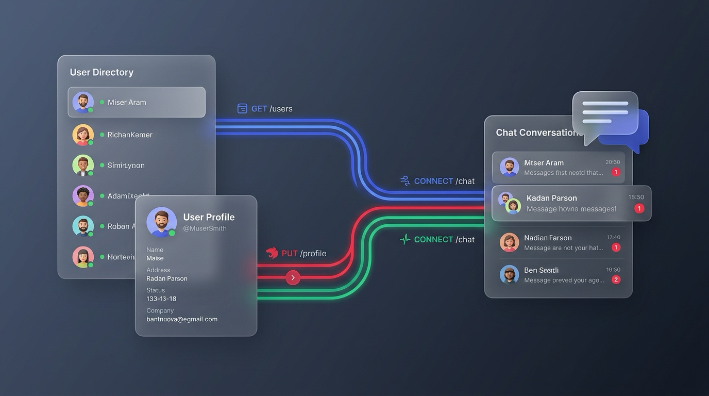
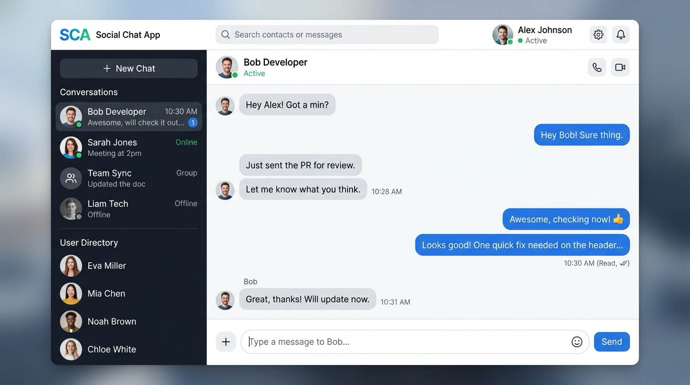
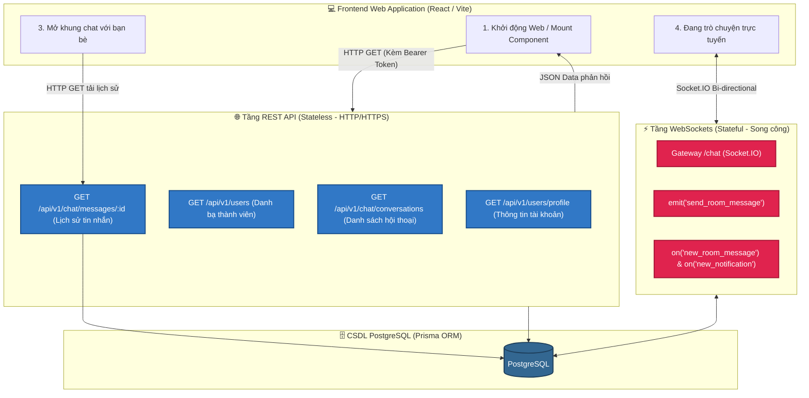

# Lesson 6.5: Hoàn Thiện Bộ REST API Full-Stack Cho Frontend — User Directory, Profile & Chat Conversations

<p align="center">
  
  
  
  
  
  
</p>

<p align="center">
  
</p>

---

> [!NOTE]
> ⏱️ **Thời lượng:** 25 – 30 phút thực hành chuyên sâu  
> 🎯 **Mục tiêu bài học:**
>
> - **Explain Architecture:** Giải thích tại sao một ứng dụng Real-time sản phẩm thực tế cần mô hình lai **Hybrid Architecture**: REST API phụ trách truy xuất dữ liệu ban đầu (Initial Fetching & CRUD) kết hợp WebSockets xử lý cập nhật tức thời (Live Push & Sync).
> - **Refactor Legacy Code:** Thay thế hoàn toàn dữ liệu giả (Mock Array) trong `UsersService` bằng các truy vấn Type-Safe với Prisma ORM và bảng `profiles`.
> - **Implement User Directory & Profile API:** Xây dựng trọn bộ API lấy danh bạ người dùng (`GET /users`), xem chi tiết hồ sơ cá nhân (`GET /users/profile`), cập nhật hồ sơ (`PATCH /users/profile`) và xem trang cá nhân công khai (`GET /users/:id`).
> - **Implement Chat REST APIs:** Bổ sung endpoint lấy danh sách cuộc trò chuyện gần đây (`GET /chat/conversations`), tải lịch sử tin nhắn (`GET /chat/messages/:receiverId`) và đánh dấu đã đọc (`PATCH /chat/messages/:senderId/read`).
> - **Normalize Social Feed:** Chuẩn hóa dữ liệu bài viết (bổ sung nội dung và avatar của tác giả) phục vụ render giao diện Newsfeed.
> - **Configure CORS:** Kích hoạt Cross-Origin Resource Sharing (CORS) toàn cục trong `main.ts` để trình duyệt cho phép Frontend (Vite/React) kết nối an toàn.
> - **Verify & Debug:** Kiểm thử toàn diện qua Swagger UI và cURL, đồng thời xử lý các lỗi thường gặp về CORS, JWT Bearer Header và quan hệ bảng 1-1.

> [!IMPORTANT]
> **Prerequisites:**
>
> - Đã hoàn thành các bài học WebSockets Gateway ([Lesson 6.1](../lesson-6.1/lesson-6.1.md) đến [Lesson 6.4](../lesson-6.4/lesson-6.4.md)).
> - Đã nắm vững quan hệ bảng `User` ↔ `Profile` và `User` ↔ `Message` trong Prisma ORM ([Lesson 2.3](../../module-02/lesson-2.3/lesson-2.3.md)).
> - Đã hiểu cơ chế trích xuất người dùng với Decorator `@CurrentUser()` ([Lesson 4.6](../../module-04/lesson-4.6/lesson-4.6.md)).

---

## 1. Vấn Đề Thực Tế: Tại Sao WebSockets Đơn Thuần Là Chưa Đủ? (Why?)

Ở các bài học trước, chúng ta đã xây dựng một Gateway Socket.IO cực kỳ mạnh mẽ: xác thực qua Handshake, quản lý Room chat 1-1, lưu tin nhắn vào CSDL PostgreSQL và đẩy thông báo tức thì khi có bình luận mới.

Tuy nhiên, khi chuẩn bị **ghép nối với một giao diện Frontend (React / Vue / Next.js)** để biến mã nguồn thành một website có thể chạy demo cho học viên, chúng ta vấp phải những rào cản thực tế:

```text
❌ KỊCH BẢN THỰC TẾ TRÊN GIAO DIỆN CLIENT:

1. Người dùng vừa đăng nhập vào trang Web:
   - Header cần hiển thị: Avatar và Tên hiển thị của người dùng.
   👉 NHƯNG: GET /api/v1/users/profile hiện tại chỉ trả về { userId, email, role } từ Token,
      hoàn toàn không có Avatar hay Tên từ CSDL!

2. Người dùng mở tab "Tin nhắn" (Chat):
   - Cột bên trái cần hiển thị: Danh sách các bạn bè hoặc các cuộc trò chuyện gần nhất.
   👉 NHƯNG: GET /api/v1/users đang trả về mảng cứng [{ id: 1, name: 'Alice' }] từ Module 1!
      Tài khoản mới đăng ký không bao giờ xuất hiện!
   👉 Đồng thời chưa có REST API nào trả về: "Tôi đã nhắn tin với ai? Tin nhắn cuối cùng là gì?".

3. Người dùng chuyển từ trang Bảng tin sang phòng Chat:
   - Nếu mỗi lần bấm vào một người bạn, Frontend đều phải phát một sự kiện Socket emit('get_history')
     kèm Callback chờ đợi, mã nguồn Frontend sẽ cực kỳ phức tạp và dễ phát sinh bất đồng bộ (Race Condition).
   👉 Chuẩn mực ngành: Tải lịch sử tin nhắn ban đầu qua HTTP REST API,
      sau đó lắng nghe tin nhắn mới phát sinh qua WebSockets!

4. Trình duyệt chặn kết nối (CORS Error):
   - Frontend chạy ở http://localhost:5173 (Vite) gọi tới Backend http://localhost:3000
     ngay lập tức bị trình duyệt ném lỗi CORS Policy!
```

👉 **Giải pháp:** Trong bài học này, chúng ta sẽ hoàn thiện 100% các mảnh ghép REST API còn thiếu, chuẩn hóa dữ liệu trả về và mở CORS để hệ thống sẵn sàng tuyệt đối cho việc tích hợp giao diện người dùng.

<p align="center">
  
</p>

---

## 2. Mô Hình Lai: Hybrid REST + WebSockets Architecture (What?)

Trong các ứng dụng giao tiếp hiện đại như Slack, Discord, Messenger hay Telegram, kiến trúc hệ thống luôn là sự phối hợp nhịp nhàng giữa hai giao thức:



### So sánh vai trò giữa REST và WebSockets trong trang Chat:

| Tiêu chí                     | REST API                                                                | WebSockets (Socket.IO)                                                             |
| :--------------------------- | :---------------------------------------------------------------------- | :--------------------------------------------------------------------------------- |
| **Giao thức**                | HTTP / HTTPS (Stateless)                                                | TCP qua Upgrade Handshake (Stateful)                                               |
| **Nhiệm vụ tối ưu**          | Tải danh bạ, lấy thông tin cá nhân, tải trang tin nhắn cũ (Pagination). | Nhận tin nhắn mới tức thì, chỉ báo đang nhập (Typing indicator), chuông thông báo. |
| **Hiệu năng & Caching**      | Dễ dàng cache bằng HTTP Cache / CDN / Memory.                           | Không cache được ở tầng proxy thông thường.                                        |
| **Mức độ phức tạp Frontend** | Dùng `fetch` / `axios` / `react-query` cực kỳ quen thuộc và ổn định.    | Cần quản lý state kết nối, reconnection và room lifecycle.                         |

---

## 3. Các Bước Triển Khai Chi Tiết (How?)

### Bước 1: Kích Hoạt CORS Toàn Cục Trong `src/main.ts`

Khi ứng dụng Frontend chạy trên một Origin khác (ví dụ `http://localhost:5173`), trình duyệt sẽ gửi các Preflight Request `OPTIONS` để kiểm tra quyền truy cập. Nếu Backend không phản hồi các header CORS hợp lệ, toàn bộ lệnh gọi API sẽ bị chặn đứng.

Mở file 📄 **`src/main.ts`** và bổ sung cấu hình `app.enableCors()`:

```typescript
// src/main.ts (Trích đoạn cấu hình)
app.setGlobalPrefix(globalPrefix);

// Kích hoạt CORS cho phép ứng dụng Frontend kết nối
app.enableCors({
  origin: true, // Cho phép mọi origin phát triển hoặc chỉ định danh sách cụ thể
  credentials: true,
  methods: 'GET,HEAD,PUT,PATCH,POST,DELETE,OPTIONS',
});

app.enableVersioning({
  type: VersioningType.URI,
  defaultVersion: versionApi,
  prefix: versionPrefix,
});
```

---

### Bước 2: Định Nghĩa DTO Cho Cập Nhật Hồ Sơ & Tìm Kiếm Danh Bạ

Để bảo vệ ứng dụng với `ValidationPipe`, chúng ta tạo DTO cho việc cập nhật thông tin cá nhân và tìm kiếm thành viên.

Tạo file 📄 **`src/users/dto/update-profile.dto.ts`**:

```typescript
import { ApiPropertyOptional } from '@nestjs/swagger';
import { IsOptional, IsString, MaxLength } from 'class-validator';

export class UpdateProfileDto {
  @ApiPropertyOptional({
    example: 'Nguyễn Văn A',
    description: 'Họ và tên hiển thị của người dùng',
  })
  @IsOptional()
  @IsString({ message: 'Tên phải là một chuỗi ký tự!' })
  @MaxLength(100, { message: 'Tên không được vượt quá 100 ký tự!' })
  name?: string;

  @ApiPropertyOptional({
    example: 'Lập trình viên Full-Stack đam mê NestJS và React',
    description: 'Tiểu sử cá nhân (Bio)',
  })
  @IsOptional()
  @IsString({ message: 'Tiểu sử phải là một chuỗi ký tự!' })
  @MaxLength(300, { message: 'Tiểu sử không được vượt quá 300 ký tự!' })
  bio?: string;

  @ApiPropertyOptional({
    example: 'Hà Nội, Việt Nam',
    description: 'Nơi sinh sống hoặc địa điểm làm việc',
  })
  @IsOptional()
  @IsString({ message: 'Địa điểm phải là một chuỗi ký tự!' })
  @MaxLength(100, { message: 'Địa điểm không được vượt quá 100 ký tự!' })
  location?: string;
}
```

Tạo file 📄 **`src/users/dto/query-user.dto.ts`**:

```typescript
import { ApiPropertyOptional } from '@nestjs/swagger';
import { Type } from 'class-transformer';
import { IsInt, IsOptional, IsString, Max, Min } from 'class-validator';

export class QueryUserDto {
  @ApiPropertyOptional({
    description: 'Từ khóa tìm kiếm theo tên hoặc email của người dùng',
    example: 'Alice',
  })
  @IsOptional()
  @IsString()
  search?: string;

  @ApiPropertyOptional({
    description: 'Số lượng kết quả tối đa cần lấy (Mặc định: 50, Tối đa: 100)',
    example: 20,
    default: 50,
  })
  @IsOptional()
  @Type(() => Number)
  @IsInt()
  @Min(1)
  @Max(100)
  limit?: number = 50;
}
```

---

### Bước 3: Nâng Cấp `UsersService` & `UsersController` Kết Nối CSDL Thực Tế

Chúng ta xóa bỏ hoàn toàn mảng `this.users` tĩnh từ Module 1, thay thế bằng các phương thức truy vấn thực tế với Prisma ORM.

Chỉnh sửa file 📄 **`src/users/users.service.ts`**:

```typescript
import {
  ConflictException,
  Injectable,
  NotFoundException,
} from '@nestjs/common';
import { CreateUserDto } from './dto/create-user.dto';
import { UpdateProfileDto } from './dto/update-profile.dto';
import { QueryUserDto } from './dto/query-user.dto';
import { PrismaService } from '@/prisma/prisma.service';
import { HashService } from '@/shared/services/hash.service';
import { deleteUploadedFile } from '@/shared/helpers/multer.helper';
import { Prisma } from '@/generated/prisma/client';

@Injectable()
export class UsersService {
  constructor(
    private readonly prisma: PrismaService,
    private readonly hashService: HashService,
  ) {}

  /**
   * Lấy danh sách thành viên trong hệ thống (hỗ trợ tìm kiếm và loại trừ bản thân)
   */
  async findAll(currentUserId?: number, query?: QueryUserDto) {
    const { search, limit = 50 } = query || {};

    const where: Prisma.UserWhereInput = {
      ...(currentUserId && {
        id: { not: currentUserId },
      }),
      ...(search && {
        OR: [
          { name: { contains: search, mode: 'insensitive' } },
          { email: { contains: search, mode: 'insensitive' } },
        ],
      }),
    };

    return this.prisma.user.findMany({
      where,
      take: limit,
      orderBy: { name: 'asc' },
      select: {
        id: true,
        name: true,
        email: true,
        role: true,
        createdAt: true,
        profile: {
          select: {
            avatarUrl: true,
            bio: true,
            location: true,
          },
        },
      },
    });
  }

  /**
   * Xem hồ sơ cá nhân đầy đủ của tài khoản đang đăng nhập
   */
  async getProfile(userId: number) {
    const user = await this.prisma.user.findUnique({
      where: { id: userId },
      select: {
        id: true,
        name: true,
        email: true,
        role: true,
        createdAt: true,
        updatedAt: true,
        profile: {
          select: {
            avatarUrl: true,
            bio: true,
            location: true,
          },
        },
      },
    });

    if (!user) {
      throw new NotFoundException(`Không tìm thấy người dùng #${userId}`);
    }

    return user;
  }

  /**
   * Cập nhật thông tin cá nhân (Họ tên, Bio, Location)
   */
  async updateProfile(userId: number, dto: UpdateProfileDto) {
    const { name, bio, location } = dto;

    await this.prisma.$transaction(async (tx) => {
      if (typeof name === 'string') {
        await tx.user.update({
          where: { id: userId },
          data: { name },
        });
      }

      if (bio !== undefined || location !== undefined) {
        await tx.profile.upsert({
          where: { userId },
          create: {
            userId,
            bio,
            location,
          },
          update: {
            ...(bio !== undefined && { bio }),
            ...(location !== undefined && { location }),
          },
        });
      }
    });

    return this.getProfile(userId);
  }

  /**
   * Xem hồ sơ công khai của một thành viên khác theo ID
   */
  async findOne(id: number) {
    const user = await this.prisma.user.findUnique({
      where: { id },
      select: {
        id: true,
        name: true,
        email: true,
        role: true,
        createdAt: true,
        profile: {
          select: {
            avatarUrl: true,
            bio: true,
            location: true,
          },
        },
        _count: {
          select: {
            posts: true,
          },
        },
      },
    });

    if (!user) {
      throw new NotFoundException(`Không tìm thấy người dùng #${id}`);
    }

    return user;
  }

  async create(dto: CreateUserDto) {
    const existingUser = await this.prisma.user.findUnique({
      where: { email: dto.email },
    });

    if (existingUser) {
      throw new ConflictException('Email này đã được sử dụng!');
    }

    const hashedPassword = await this.hashService.hashPassword(dto.password);

    const createdUser = await this.prisma.user.create({
      data: {
        email: dto.email,
        name: dto.name,
        password: hashedPassword,
      },
      omit: {
        password: true,
      },
    });

    return createdUser;
  }

  async updateAvatar(userId: number, newAvatarUrl: string) {
    const existingProfile = await this.prisma.profile.findUnique({
      where: { userId },
    });

    if (existingProfile?.avatarUrl) {
      deleteUploadedFile(existingProfile.avatarUrl);
    }

    const updatedProfile = await this.prisma.profile.upsert({
      where: { userId },
      create: {
        userId,
        avatarUrl: newAvatarUrl,
      },
      update: {
        avatarUrl: newAvatarUrl,
      },
    });

    return {
      userId,
      avatarUrl: updatedProfile.avatarUrl,
    };
  }
}
```

Chỉnh sửa file 📄 **`src/users/users.controller.ts`**:

```typescript
import {
  Body,
  Controller,
  Get,
  Param,
  ParseIntPipe,
  Patch,
  Post,
  Query,
  UploadedFile,
} from '@nestjs/common';
import { ApiOperation, ApiResponse, ApiTags } from '@nestjs/swagger';
import { UsersService } from './users.service';
import { CreateUserDto } from './dto/create-user.dto';
import { UpdateProfileDto } from './dto/update-profile.dto';
import { QueryUserDto } from './dto/query-user.dto';
import { CurrentUser } from '@/shared/decorators/current-user.decorator';
import { ApiImageUpload } from '@/shared/decorators/api-file.decorator';
import { ResponseMessage } from '@/shared/decorators/response-message.decorator';
import { createImageValidationPipe } from '@/shared/pipes/image-validation.pipe';
import { Public } from '@/shared/decorators/public.decorator';

@ApiTags('users')
@Controller('users')
export class UsersController {
  constructor(private readonly usersService: UsersService) {}

  @Get()
  @ApiOperation({
    summary: 'Lấy danh sách thành viên trong hệ thống (User Directory)',
    description:
      'Trả về danh sách người dùng kèm Avatar và Bio để hiển thị danh bạ hoặc tìm kiếm người nhắn tin. Tự động loại trừ tài khoản đang đăng nhập.',
  })
  @ApiResponse({
    status: 200,
    description: 'Lấy danh sách thành viên thành công',
  })
  @ResponseMessage('Lấy danh sách thành viên thành công!')
  findAll(
    @CurrentUser('userId') currentUserId?: number,
    @Query() query?: QueryUserDto,
  ) {
    return this.usersService.findAll(currentUserId, query);
  }

  @Get('profile')
  @ApiOperation({
    summary: 'Xem hồ sơ cá nhân đầy đủ của người dùng hiện tại',
    description:
      'Truy vấn CSDL lấy đầy đủ thông tin: họ tên, email, vai trò, avatar, bio, location.',
  })
  @ApiResponse({
    status: 200,
    description: 'Lấy thông tin hồ sơ tài khoản thành công',
  })
  @ResponseMessage('Lấy thông tin hồ sơ tài khoản thành công!')
  getProfile(@CurrentUser('userId') userId: number) {
    return this.usersService.getProfile(userId);
  }

  @Patch('profile')
  @ApiOperation({
    summary: 'Cập nhật thông tin hồ sơ cá nhân',
    description:
      'Cập nhật họ tên hiển thị, tiểu sử (bio) và địa điểm (location).',
  })
  @ApiResponse({ status: 200, description: 'Cập nhật hồ sơ thành công' })
  @ResponseMessage('Cập nhật thông tin hồ sơ thành công!')
  updateProfile(
    @CurrentUser('userId') userId: number,
    @Body() updateProfileDto: UpdateProfileDto,
  ) {
    return this.usersService.updateProfile(userId, updateProfileDto);
  }

  @Post('avatar')
  @ApiOperation({ summary: 'Upload và cập nhật ảnh đại diện cá nhân' })
  @ApiImageUpload('avatar', {
    folder: 'avatars',
    description: 'File ảnh đại diện (JPG, PNG, WEBP - Tối đa 2MB)',
  })
  @ResponseMessage('Cập nhật ảnh đại diện thành công!')
  async uploadAvatar(
    @CurrentUser('userId') userId: number,
    @UploadedFile(createImageValidationPipe({ maxSizeInMb: 2 }))
    file: Express.Multer.File,
  ) {
    const avatarUrl = `/uploads/avatars/${file.filename}`;
    const result = await this.usersService.updateAvatar(userId, avatarUrl);

    return {
      filename: file.filename,
      size: `${(file.size / 1024).toFixed(1)} KB`,
      mimetype: file.mimetype,
      url: result.avatarUrl,
    };
  }

  @Public()
  @Get(':id')
  @ApiOperation({
    summary: 'Xem hồ sơ công khai của một thành viên theo ID',
    description:
      'Bất kỳ ai cũng có thể xem hồ sơ công khai của thành viên khác.',
  })
  @ApiResponse({ status: 200, description: 'Lấy hồ sơ người dùng thành công' })
  @ApiResponse({ status: 404, description: 'Không tìm thấy người dùng' })
  @ResponseMessage('Lấy thông tin hồ sơ người dùng thành công!')
  findOne(@Param('id', ParseIntPipe) id: number) {
    return this.usersService.findOne(id);
  }

  @Post()
  @ApiOperation({ summary: 'Tạo người dùng mới (Dành cho Quản trị viên)' })
  @ApiResponse({ status: 201, description: 'Tạo người dùng thành công' })
  @ResponseMessage('Tạo người dùng thành công!')
  createUser(@Body() body: CreateUserDto) {
    return this.usersService.create(body);
  }
}
```

---

### Bước 4: Xây Dựng REST API Cho Phân Hệ Chat (`ChatController`)

Để Frontend hiển thị danh sách hội thoại gần đây (Recent Conversations List) và tải lịch sử tin nhắn ban đầu mà không cần phụ thuộc vào Socket.IO ack callback, chúng ta bổ sung các phương thức vào `ChatService` và tạo `ChatController`.

Cập nhật file 📄 **`src/chat/chat.service.ts`**:

```typescript
// src/chat/chat.service.ts (Trích đoạn các phương thức bổ sung)

/**
 * Lấy danh sách các cuộc trò chuyện gần đây của người dùng
 * (kèm tin nhắn cuối cùng và số tin chưa đọc)
 */
async getUserConversations(userId: number) {
  const messages = await this.prisma.message.findMany({
    where: {
      OR: [{ senderId: userId }, { receiverId: userId }],
    },
    orderBy: { createdAt: 'desc' },
    take: 200,
    include: {
      sender: {
        select: {
          id: true,
          name: true,
          email: true,
          profile: { select: { avatarUrl: true } },
        },
      },
      receiver: {
        select: {
          id: true,
          name: true,
          email: true,
          profile: { select: { avatarUrl: true } },
        },
      },
    },
  });

  const conversationMap = new Map<
    number,
    {
      partner: {
        id: number;
        name: string | null;
        email: string;
        avatarUrl: string | null;
      };
      roomId: string;
      lastMessage: {
        id: number;
        content: string;
        createdAt: string;
        senderId: number;
        isRead: boolean;
      };
      unreadCount: number;
    }
  >();

  for (const msg of messages) {
    const isSender = msg.senderId === userId;
    const partner = isSender ? msg.receiver : msg.sender;
    const partnerId = partner.id;

    if (!conversationMap.has(partnerId)) {
      conversationMap.set(partnerId, {
        partner: {
          id: partner.id,
          name: partner.name,
          email: partner.email,
          avatarUrl: partner.profile?.avatarUrl ?? null,
        },
        roomId: this.getConversationRoomId(userId, partnerId),
        lastMessage: {
          id: msg.id,
          content: msg.content,
          createdAt: msg.createdAt.toISOString(),
          senderId: msg.senderId,
          isRead: msg.isRead,
        },
        unreadCount: 0,
      });
    }

    if (msg.receiverId === userId && !msg.isRead) {
      const item = conversationMap.get(partnerId)!;
      item.unreadCount += 1;
    }
  }

  return Array.from(conversationMap.values());
}

/**
 * Đánh dấu toàn bộ tin nhắn từ người gửi cụ thể tới người dùng hiện tại là đã đọc
 */
async markMessagesAsRead(currentUserId: number, senderId: number) {
  const result = await this.prisma.message.updateMany({
    where: {
      senderId,
      receiverId: currentUserId,
      isRead: false,
    },
    data: {
      isRead: true,
    },
  });

  return {
    updatedCount: result.count,
  };
}
```

Tạo file 📄 **`src/chat/chat.controller.ts`**:

```typescript
import {
  Controller,
  Get,
  Param,
  ParseIntPipe,
  Patch,
  Query,
} from '@nestjs/common';
import { ApiOperation, ApiResponse, ApiTags } from '@nestjs/swagger';
import { ChatService } from './chat.service';
import { CurrentUser } from '@/shared/decorators/current-user.decorator';
import { ResponseMessage } from '@/shared/decorators/response-message.decorator';

@ApiTags('chat')
@Controller('chat')
export class ChatController {
  constructor(private readonly chatService: ChatService) {}

  @Get('conversations')
  @ApiOperation({
    summary:
      'Lấy danh sách các cuộc trò chuyện gần đây của người dùng hiện tại',
    description:
      'Trả về danh sách đối tác chat, tin nhắn gần nhất, thời gian và số lượng tin nhắn chưa đọc.',
  })
  @ApiResponse({
    status: 200,
    description: 'Lấy danh sách cuộc trò chuyện thành công',
  })
  @ResponseMessage('Lấy danh sách cuộc trò chuyện thành công!')
  getConversations(@CurrentUser('userId') userId: number) {
    return this.chatService.getUserConversations(userId);
  }

  @Get('messages/:receiverId')
  @ApiOperation({
    summary:
      'Lấy lịch sử tin nhắn trực tiếp giữa người dùng hiện tại và một người nhận',
    description:
      'REST API tải lịch sử tin nhắn ban đầu để render giao diện trước khi kết nối realtime Socket.IO.',
  })
  @ApiResponse({ status: 200, description: 'Lấy lịch sử tin nhắn thành công' })
  @ResponseMessage('Lấy lịch sử tin nhắn thành công!')
  getMessages(
    @CurrentUser('userId') userId: number,
    @Param('receiverId', ParseIntPipe) receiverId: number,
    @Query('limit') limit?: number,
  ) {
    return this.chatService.getConversationHistory(
      userId,
      receiverId,
      limit ? Number(limit) : 50,
    );
  }

  @Patch('messages/:senderId/read')
  @ApiOperation({
    summary: 'Đánh dấu đã đọc toàn bộ tin nhắn từ một người gửi cụ thể',
  })
  @ApiResponse({
    status: 200,
    description: 'Đánh dấu tin nhắn đã đọc thành công',
  })
  @ResponseMessage('Đánh dấu tin nhắn đã đọc thành công!')
  markAsRead(
    @CurrentUser('userId') userId: number,
    @Param('senderId', ParseIntPipe) senderId: number,
  ) {
    return this.chatService.markMessagesAsRead(userId, senderId);
  }
}
```

Đăng ký `ChatController` trong 📄 **`src/chat/chat.module.ts`**:

```typescript
import { Module } from '@nestjs/common';
import { ChatGateway } from './chat.gateway';
import { AuthModule } from '@/auth/auth.module';
import { ChatService } from './chat.service';
import { ChatController } from './chat.controller';

@Module({
  imports: [AuthModule],
  controllers: [ChatController],
  providers: [ChatGateway, ChatService],
  exports: [ChatGateway, ChatService],
})
export class ChatModule {}
```

---

### Bước 5: Bổ Sung Content & Avatar Vào Query Newsfeed Bài Viết

Mở file 📄 **`src/posts/posts.service.ts`**, cập nhật cả hai phương thức `findAllOffset` và `findAllCursor` để trả về `content` và `profile.avatarUrl`:

```typescript
// src/posts/posts.service.ts (Trích đoạn select trong findAllOffset & findAllCursor)
select: {
  id: true,
  title: true,
  content: true, // Bổ sung nội dung bài viết
  published: true,
  createdAt: true,
  author: {
    select: {
      id: true,
      email: true,
      name: true,
      profile: {
        select: { avatarUrl: true }, // Bổ sung avatar tác giả bài viết
      },
    },
  },
  _count: {
    select: { comments: true },
  },
},
```

---

## 4. Kiểm Thử & Xác Minh Hoạt Động (Verify)

Khởi động dự án và kiểm tra:

```bash
pnpm start:dev
```

Truy cập Swagger UI tại: **`http://localhost:3000/api/docs`**

### Kịch bản 1: Lấy Danh Sách Thành Viên (User Directory)

Gửi request HTTP GET có kèm Bearer Token:

```bash
curl -X GET "http://localhost:3000/api/v1/users?limit=10" \
  -H "Authorization: Bearer <ACCESS_TOKEN>"
```

**Kết quả kỳ vọng (200 OK):**

```json
{
  "statusCode": 200,
  "message": "Lấy danh sách thành viên thành công!",
  "data": [
    {
      "id": 2,
      "name": "Bob Developer",
      "email": "bob@example.com",
      "role": "USER",
      "createdAt": "2026-10-12T08:00:00.000Z",
      "profile": {
        "avatarUrl": "/uploads/avatars/bob-avatar.png",
        "bio": "Frontend Engineer đam mê UI/UX",
        "location": "TP. Hồ Chí Minh"
      }
    }
  ],
  "timestamp": "2026-10-12T11:00:00.000Z"
}
```

> [!NOTE]
> Người dùng đang thực hiện request tự động được loại trừ khỏi danh sách để tránh hiển thị chính mình trong danh bạ tìm kiếm bạn bè.

---

### Kịch bản 2: Cập Nhật Hồ Sơ Cá Nhân

Gửi request HTTP PATCH:

```bash
curl -X PATCH "http://localhost:3000/api/v1/users/profile" \
  -H "Authorization: Bearer <ACCESS_TOKEN>" \
  -H "Content-Type: application/json" \
  -d '{
    "name": "Nguyễn Văn A (Senior Fullstack)",
    "bio": "Chuyên gia NestJS & React, thích xây dựng hệ thống thời gian thực.",
    "location": "Đà Nẵng, Việt Nam"
  }'
```

**Kết quả kỳ vọng (200 OK):** Bản ghi được cập nhật đồng thời trên cả hai bảng `users` và `profiles` qua `$transaction`.

---

### Kịch bản 3: Lấy Danh Sách Cuộc Trò Chuyện Gần Đây

```bash
curl -X GET "http://localhost:3000/api/v1/chat/conversations" \
  -H "Authorization: Bearer <ACCESS_TOKEN>"
```

**Kết quả kỳ vọng (200 OK):**

```json
{
  "statusCode": 200,
  "message": "Lấy danh sách cuộc trò chuyện thành công!",
  "data": [
    {
      "partner": {
        "id": 2,
        "name": "Bob Developer",
        "email": "bob@example.com",
        "avatarUrl": "/uploads/avatars/bob-avatar.png"
      },
      "roomId": "conversation_1_2",
      "lastMessage": {
        "id": 15,
        "content": "Chào bạn, dự án NestJS chạy rất mượt!",
        "createdAt": "2026-10-12T10:45:00.000Z",
        "senderId": 2,
        "isRead": false
      },
      "unreadCount": 1
    }
  ],
  "timestamp": "2026-10-12T11:00:00.000Z"
}
```

---

## 5. Xử Lý Lỗi Phổ Biến & Kỹ Năng Debug (Debugging Guide)

| Lỗi gặp phải                                                          | Nguyên nhân gốc rễ                                                                      | Cách khắc phục                                                                                  |
| :-------------------------------------------------------------------- | :-------------------------------------------------------------------------------------- | :---------------------------------------------------------------------------------------------- |
| **`Access to XMLHttpRequest blocked by CORS policy`**                 | Chưa bật CORS trong `main.ts` hoặc cấu hình sai domain origin.                          | Gọi `app.enableCors({ origin: true, credentials: true })` trước khi lắng nghe cổng.             |
| **`Cannot read properties of null (reading 'profile')`**              | Tài khoản cũ tạo từ trước khi có bảng `profiles` nên chưa có bản ghi profile tương ứng. | Sử dụng toán tử an toàn `?.` (`partner.profile?.avatarUrl ?? null`) hoặc `upsert` khi cập nhật. |
| **`401 Unauthorized` khi gọi `/api/v1/users`**                        | Không đính kèm Header `Authorization: Bearer <token>`.                                  | Đăng nhập lấy JWT và cấu hình Authorize trong Swagger UI.                                       |
| **Không tìm thấy route `/api/v1/chat/conversations` (404 Not Found)** | Quên khai báo `ChatController` trong mảng `controllers` của `ChatModule`.               | Mở `chat.module.ts` và thêm `controllers: [ChatController]`.                                    |

---

## 6. Bài Tập Thực Hành (Exercises)

### 🧩 Exercise 1: Tìm kiếm thành viên có phân trang (Easy)

Thêm tham số `page` vào `QueryUserDto` và áp dụng `skip: (page - 1) * limit` trong `UsersService.findAll()` để hỗ trợ phân trang cho danh bạ khi số lượng thành viên lên tới hàng nghìn người.

### 🧩 Exercise 2: Đánh dấu tin nhắn đã đọc qua WebSockets (Medium)

Trong `ChatGateway`, lắng nghe sự kiện `@SubscribeMessage('mark_as_read')`, gọi hàm `chatService.markMessagesAsRead()` và phát ngược lại sự kiện `messages_read` tới phòng đối tác để giao diện hiển thị hai tích xanh "Đã xem".

### 🧩 Exercise 3: Trạng thái Online / Offline thời gian thực (Challenge)

Kết hợp `Map<number, string>` (UserId ↔ SocketId) trong `ChatGateway` để đính kèm trạng thái `isOnline: boolean` vào kết quả trả về của API `GET /api/v1/users` và `GET /api/v1/chat/conversations`.

---

## 7. Tổng Kết & Checklist (Summary & Checklist)

### 📌 Điểm nhấn kiến trúc trong bài học:

1. **Kiến trúc tích hợp Hybrid:** Kết hợp sức mạnh của REST API cho CRUD/Initial Load và WebSockets cho Real-time Sync.
2. **Loại bỏ Mock Data:** Toàn bộ dữ liệu người dùng, hồ sơ và tin nhắn đều được đồng bộ chặt chẽ với CSDL PostgreSQL thông qua Prisma ORM.
3. **Sẵn sàng 100% cho Frontend:** Toàn bộ API cần thiết cho một ứng dụng mạng xã hội và chat hoàn chỉnh đã được kiểm thử thành công và mở cổng CORS.

### ✅ Checklist Hoàn Thành:

- [x] Kích hoạt CORS toàn cục trong `main.ts`.
- [x] Tạo `UpdateProfileDto` và `QueryUserDto`.
- [x] Nâng cấp `UsersService` kết nối Prisma CSDL thực tế cho `findAll`, `getProfile`, `updateProfile`, `findOne`.
- [x] Xây dựng `ChatController` và các phương thức `getUserConversations`, `markMessagesAsRead`.
- [x] Bổ sung nội dung bài viết và avatar tác giả vào query Newsfeed `PostsService`.
- [x] Xác minh toàn bộ API hoạt động trơn tru trên Swagger UI.

---

👉 **Bài tiếp theo:** Lesson 6.6: Ghép Nối Backend Với Giao Diện Frontend (React UI Starter)
