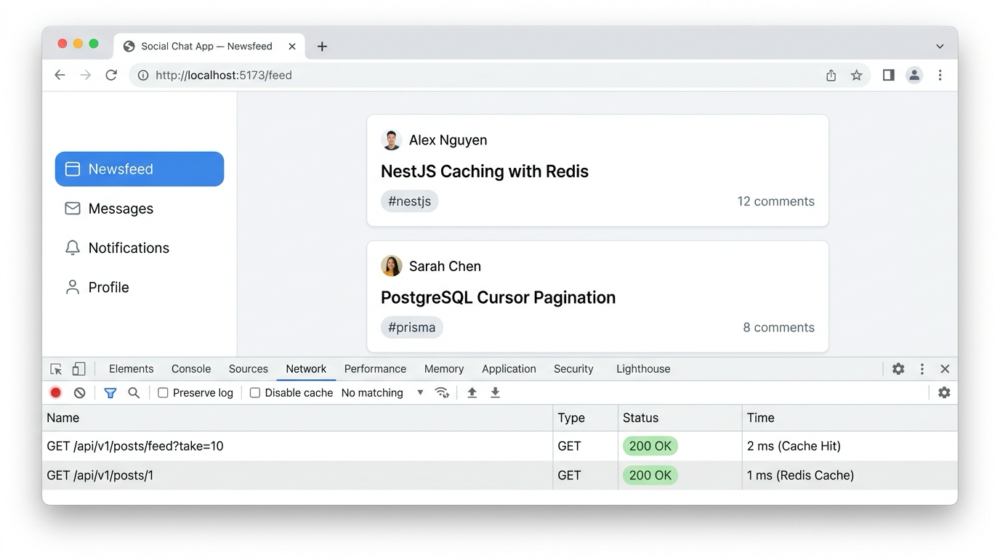
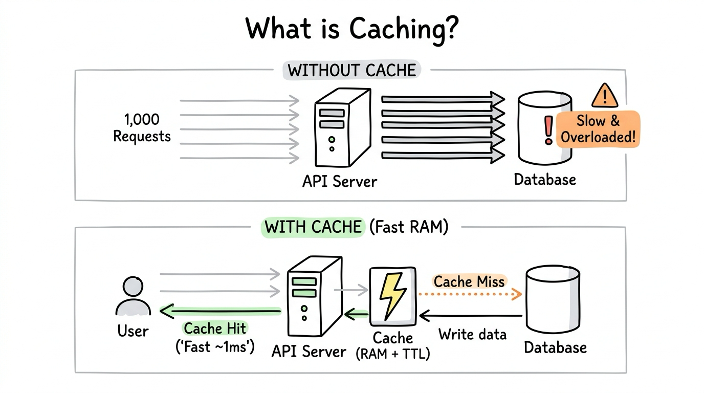
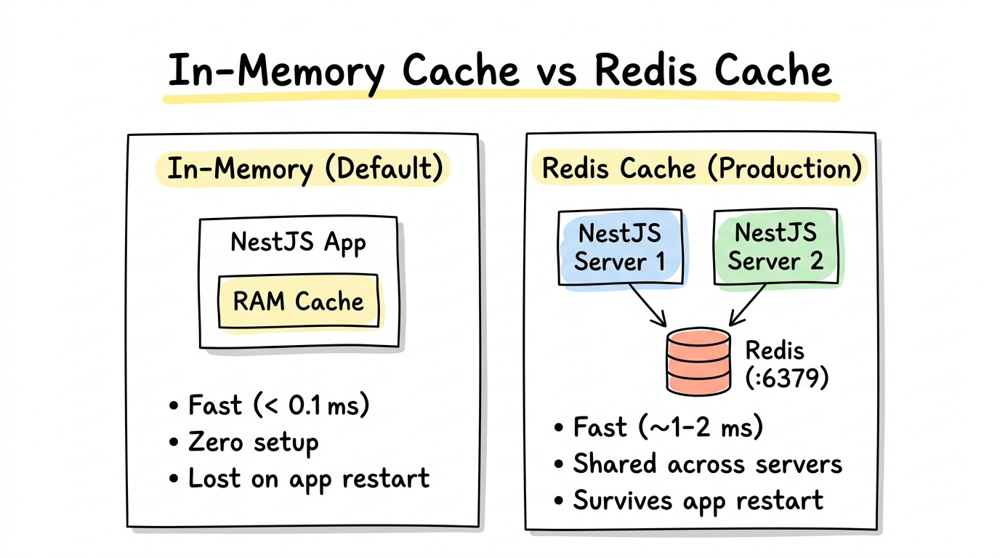
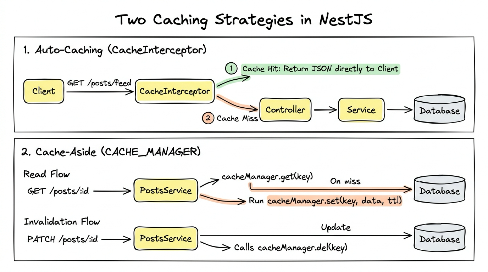
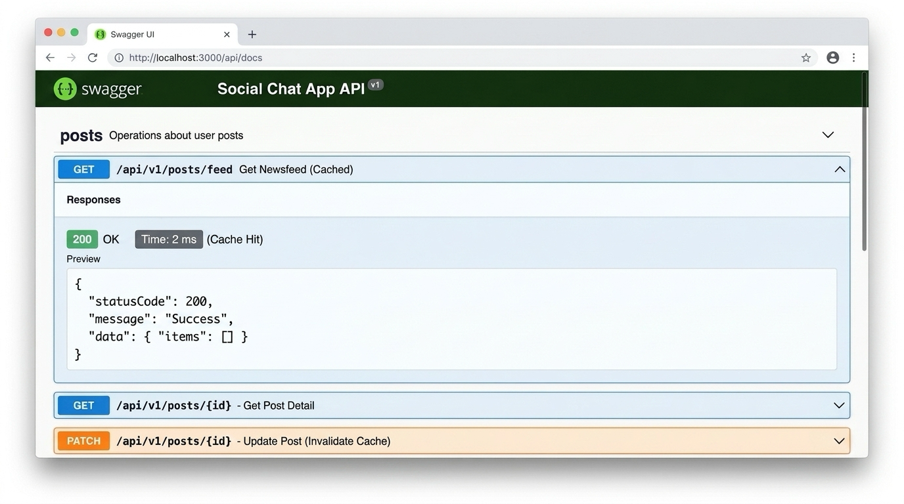
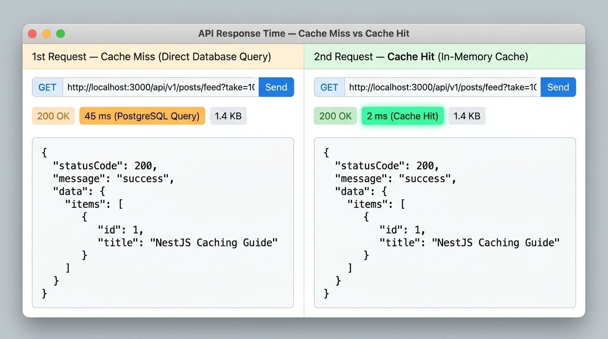
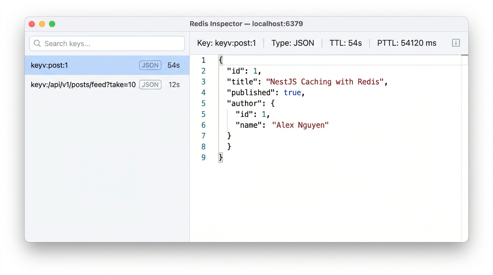

# Lesson 7.1: Performance Caching — Tăng Tốc API Với `@nestjs/cache-manager` (In-Memory & Redis)

<p align="center">
  
  
  
  
</p>

<p align="center">
  
</p>

---

> [!NOTE]
> ⏱️ **Thời lượng:** 15 phút  
> 🎯 **Mục tiêu bài học:**
>
> - **Hiểu:** Vì sao các API đọc nhiều (`GET /posts/feed`, `GET /posts/:id`) cần bộ nhớ đệm (Cache) để giảm tải PostgreSQL.
> - **Phân biệt:** Sự khác nhau giữa **In-Memory Cache** (mặc định) và **Redis Cache** (dùng cho Production).
> - **Áp dụng Auto-Caching:** Dùng `CacheInterceptor` và `@CacheTTL()` cho API Newsfeed (`GET /posts/feed`).
> - **Áp dụng Manual Caching:** Dùng `CACHE_MANAGER` (`get`, `set`, `del`) cho `GET /posts/:id` và tự động xóa cache khi sửa/xóa bài viết.
> - **Mở rộng:** Chuyển từ In-Memory sang Redis bằng `@keyv/redis` mà không cần sửa code Controller/Service.

> [!IMPORTANT]
> **Prerequisites:**
>
> - Đã hoàn thành [Lesson 5.2: Posts API & Phân trang Cursor](../../module-05/lesson-5.2/lesson-5.2.md).
> - Biết cách dùng `Interceptor` ([Lesson 3.6](../../module-03/lesson-3.6/lesson-3.6.md)) và `docker-compose.yml` ([Lesson 2.1](../../module-02/lesson-2.1/lesson-2.1.md)).

---

## 1. Caching Là Gì & Tại Sao Cần Caching? (Why?)

### 1.1 Caching Là Gì?

**Caching** là kỹ thuật lưu trữ tạm thời dữ liệu hay dùng vào **bộ nhớ tốc độ cao (RAM hoặc Redis)**. Thay vì mỗi lần nhận request lại phải chạy xuống Database truy vấn hay tính toán lại từ đầu, Server chỉ cần lấy bản sao có sẵn để trả về ngay.

<p align="center">
  
</p>

4 thuật ngữ cốt lõi cần nhớ:

- **Cache Hit:** Dữ liệu đã có trong Cache → trả về ngay (~1–2ms), không cần gọi Database.
- **Cache Miss:** Dữ liệu chưa có (hoặc đã hết hạn) → gọi Database lấy dữ liệu, rồi lưu vào Cache cho lần sau.
- **TTL (Time-To-Live):** Thời gian sống của dữ liệu trong Cache trước khi tự động hết hạn.
- **Cache Invalidation:** Chủ động xóa dữ liệu cũ trong Cache khi dữ liệu gốc ở Database bị sửa hoặc xóa.

**Ẩn dụ đơn giản:** Thay vì mỗi lần khách gọi món lại chạy vào bếp pha từ đầu (**Cache Miss**), ta pha sẵn một phần cất vào tủ mát ngay tại quầy kèm hạn dùng (**TTL**). Khách sau gọi đúng món đó sẽ nhận ngay tức thì (**Cache Hit**), và khi đổi công thức thì bỏ phần cũ trong tủ mát đi (**Cache Invalidation**).

---

### 1.2 Tại Sao Cần Caching?

Trong ứng dụng **Social Chat App**, số lượt đọc luôn áp đảo số lượt ghi:

- Tác giả chỉ đăng bài **1 lần** (`POST /api/v1/posts`).
- Nhưng có **hàng nghìn người dùng** liên tục tải Newsfeed (`GET /api/v1/posts/feed`) và xem bài viết (`GET /api/v1/posts/:id`).

Nhờ có Caching, ứng dụng đạt được 3 lợi ích rõ rệt:

- **Phản hồi siêu nhanh:** Đọc từ RAM/Redis nhanh hơn truy vấn PostgreSQL hàng chục lần (từ ~45ms xuống ~1–2ms).
- **Giảm tải cho Database:** Tránh hàng nghìn câu lệnh `SELECT` lặp đi lặp lại bắn thẳng vào PostgreSQL khi nhiều người xem cùng lúc.
- **Chịu tải cao hơn:** Hệ thống phục vụ được nhiều người dùng đồng thời mà chưa cần nâng cấp cấu hình Database.

---

## 2. Cách Hoạt Động Trong NestJS (What?)

### 2.1 In-Memory Cache vs Redis Cache

`@nestjs/cache-manager` dùng **[Keyv](https://keyv.org/docs/)** bên dưới nên bạn chỉ cần viết code nghiệp vụ một lần, còn nơi lưu trữ có thể đổi dễ dàng qua cấu hình:

<p align="center">
  
</p>

| Tiêu chí            | 🧠 In-Memory Cache (Mặc định)                     | 🟥 Redis Cache (`@keyv/redis`)                                            |
| :------------------ | :------------------------------------------------ | :------------------------------------------------------------------------ |
| **Cài đặt**         | Có sẵn, không cần cài thêm service ngoài.         | Chạy thêm Redis Server (qua Docker).                                      |
| **Lưu trữ & Scale** | Nằm trong RAM của app → mất khi restart.          | Nằm độc lập trên Redis → giữ nguyên khi restart, dùng chung nhiều server. |
| **Dữ liệu đọc ra**  | Giữ tham chiếu object gốc (nên coi là read-only). | Serialize dạng JSON (`Date` sẽ trở thành `string`).                       |

---

### 2.2 Hai Cách Áp Dụng Cache Trong Ứng Dụng

Khi tích hợp bộ nhớ đệm vào hệ thống backend, có 2 mô hình tiếp cận phổ biến tùy theo mức độ kiểm soát mong muốn:

<p align="center">
  
</p>

#### 🔹 Cách 1: Caching Tự Động Ở Tầng Tiếp Nhận (Auto-Caching)

- **Nguyên lý:** Đặt một lớp trung gian chặn ngay tại cổng tiếp nhận yêu cầu (trước khi đi vào xử lý nghiệp vụ), dùng chính địa chỉ yêu cầu (URL + tham số) làm khóa lưu trữ:
  - Nếu yêu cầu này đã từng được lưu → trả ngay kết quả sẵn có cho người dùng, **bỏ qua toàn bộ tầng xử lý phía sau**.
  - Nếu chưa có → cho chạy xuống Database như bình thường, rồi tự động lưu kết quả lại theo thời gian sống (TTL).
- **Ưu điểm:** Không can thiệp vào mã nguồn nghiệp vụ, áp dụng và gỡ bỏ rất nhanh.
- **Hạn chế:** Khó chủ động làm mới hoặc xóa từng bản ghi cache riêng lẻ khi dữ liệu gốc thay đổi (thường phải đợi hết hạn TTL).
- **Phù hợp với:** Các dữ liệu công khai, dùng chung cho nhiều người và chấp nhận độ trễ cập nhật vài giây (ví dụ: bảng tin Newsfeed).

#### 🔹 Cách 2: Caching Chủ Động Theo Mô Hình Cache-Aside (Manual Caching)

- **Nguyên lý:** Tầng xử lý nghiệp vụ tự chủ động điều phối việc đọc, ghi và xóa dữ liệu trong bộ nhớ đệm:
  - **Luồng đọc:** Tự kiểm tra trong Cache trước → nếu thấy thì trả về ngay (**Cache Hit**); nếu chưa có (**Cache Miss**) thì truy vấn Database rồi tự lưu bản sao vào Cache.
  - **Luồng ghi (tạo, sửa, xóa):** Ngay sau khi cập nhật thành công ở Database, chủ động xóa bỏ bản ghi cũ tương ứng trong Cache (**Cache Invalidation**).
- **Ưu điểm:** Toàn quyền kiểm soát tên khóa, phạm vi dữ liệu cần lưu và **ngăn chặn triệt để tình trạng hiển thị dữ liệu cũ (Stale Data)**.
- **Hạn chế:** Cần viết thêm bước kiểm tra và dọn dẹp cache song song với logic nghiệp vụ.
- **Phù hợp với:** Dữ liệu chi tiết thường xuyên bị chỉnh sửa/xóa (ví dụ: chi tiết một bài viết) hoặc dữ liệu riêng biệt theo từng người dùng.

| Tiêu chí                  | Cách 1: Auto-Caching (Tự động)          | Cách 2: Cache-Aside (Chủ động)            |
| :------------------------ | :-------------------------------------- | :---------------------------------------- |
| **Nơi xử lý**             | Tầng tiếp nhận yêu cầu bên ngoài        | Bên trong tầng xử lý nghiệp vụ            |
| **Tính tiện lợi**         | Rất gọn, không đụng vào logic nghiệp vụ | Cần tự quản lý thao tác đọc / ghi / xóa   |
| **Xóa cache khi sửa/xóa** | Khó xóa chính xác theo từng đối tượng   | Xóa tức thì ngay sau khi dữ liệu thay đổi |
| **Ví dụ trong bài**       | Danh sách Newsfeed công khai            | Chi tiết bài viết (đọc, chỉnh sửa, xóa)   |

> [!WARNING]
> **Không bật Auto-Caching toàn cục cho mọi yêu cầu một cách máy móc:** Vì cơ chế tự động mặc định phân biệt dữ liệu dựa trên đường dẫn URL chứ không tự tách theo danh tính người dùng. Nếu áp dụng chung cho các dữ liệu cá nhân (như hồ sơ tài khoản), người dùng sau có thể nhận nhầm dữ liệu của người dùng trước!

Trong NestJS (`@nestjs/cache-manager`), **Cách 1** được triển khai bằng `CacheInterceptor` và **Cách 2** được triển khai thông qua `CACHE_MANAGER` ở phần thực hành bên dưới.

---

## 3. Thực Hành Từng Bước (How?)

### Trạng Thái Dự Án (Project State)

```text
nestjs-basic-course/
├── docker-compose.yml               # Bước 5: Thêm service redis_cache (chuyển sang Redis)
└── src/
    ├── app.module.ts                # Bước 2 & 5: Đăng ký CacheModule
    └── posts/
        ├── posts.controller.ts      # Bước 3: Gắn CacheInterceptor cho GET /posts/feed
        └── posts.service.ts         # Bước 4: Dùng CACHE_MANAGER cho findOne, update, remove
```

---

### 📌 Bước 1: Cài Đặt Package

```bash
pnpm add @nestjs/cache-manager cache-manager
```

---

### 📌 Bước 2: Kích Hoạt In-Memory Cache Trong `AppModule`

Mở 📄 **`src/app.module.ts`**, import `CacheModule` và đăng ký toàn cục (`isGlobal: true`) để dùng được ở mọi module:

📄 **`src/app.module.ts`**

```typescript
import { Module } from '@nestjs/common';
import { CacheModule } from '@nestjs/cache-manager';
// ... giữ nguyên các import hiện có

@Module({
  imports: [
    // ... giữ nguyên ConfigModule, PrismaModule, PostsModule, ...

    // ⚡ Bật In-Memory Cache toàn cục (TTL tính bằng milliseconds: 15_000ms = 15 giây)
    CacheModule.register({
      isGlobal: true,
      ttl: 15_000,
    }),
  ],
  // ... giữ nguyên controllers, providers
})
export class AppModule {}
```

> [!NOTE]
> Trong `cache-manager` hiện tại (NestJS 11), `ttl` luôn tính bằng **milliseconds** (`15_000` = 15 giây). Nếu truyền `ttl: 0`, dữ liệu sẽ không bao giờ tự hết hạn.

---

### 📌 Bước 3: Auto-Caching Cho Newsfeed (`PostsController`)

Chỉ cần thêm `@UseInterceptors(CacheInterceptor)` và `@CacheTTL(15_000)` lên route `@Get('feed')`:

📄 **`src/posts/posts.controller.ts`**

```typescript
// Thêm CacheInterceptor và CacheTTL vào import từ '@nestjs/cache-manager'
import { CacheInterceptor, CacheTTL } from '@nestjs/cache-manager';
// ... giữ nguyên các import khác

@Controller('posts')
export class PostsController {
  constructor(private readonly postsService: PostsService) {}

  // ... giữ nguyên create()

  @Public()
  @UseInterceptors(CacheInterceptor) // 👈 Tự động cache response của route GET này
  @CacheTTL(15_000) // 👈 Thời gian sống 15 giây (ghi đè TTL mặc định)
  @ApiOperation({
    summary: 'Lấy Newsfeed bài viết (Cursor-based Pagination)',
  })
  @Get('feed')
  @ResponseMessage('Lấy newsfeed cuộn vô tận thành công!')
  findAllCursor(@Query() query: QueryPostDto) {
    return this.postsService.findAllCursor(query);
  }

  // ... giữ nguyên findOne(), update(), remove(), uploadPostImages()
}
```

**Lưu ý nhỏ về `CacheInterceptor`:**

- Mặc định chỉ cache phương thức `GET` và tự động dùng **toàn bộ URL + Query String** (ví dụ `/api/v1/posts/feed?cursor=10&take=10`) làm key, nên mỗi trang `cursor` sẽ được lưu tách biệt.
- Không dùng `@CacheKey('feed')` cố định cho API có Query Params (nếu gắn, mọi trang `?cursor=...` sẽ dùng chung 1 key). Chỉ dùng `@CacheKey('tên_key')` cho route tĩnh không phụ thuộc query.
- Route nào inject `@Res()` của Express sẽ không dùng được `CacheInterceptor`.

---

### 📌 Bước 4: Cache Thủ Công & Xóa Cache (`CACHE_MANAGER`) Trong `PostsService`

Với chi tiết bài viết (`GET /posts/:id`), ta inject `CACHE_MANAGER` vào `PostsService` để chủ động lưu cache khi đọc và **xóa cache (`del`)** ngay khi bài viết bị sửa hoặc xóa:

📄 **`src/posts/posts.service.ts`**

```typescript
import { PrismaService } from '@/prisma/prisma.service';
import { CACHE_MANAGER, Cache } from '@nestjs/cache-manager';
import {
  ForbiddenException,
  Inject,
  Injectable,
  Logger,
  NotFoundException,
} from '@nestjs/common';
import { CreatePostDto } from './dto/create-post.dto';
import { UpdatePostDto } from './dto/update-post.dto';
import { QueryPostDto } from './dto/query-post.dto';

@Injectable()
export class PostsService {
  private readonly logger = new Logger(PostsService.name);

  constructor(
    private readonly prisma: PrismaService,
    @Inject(CACHE_MANAGER) private readonly cacheManager: Cache,
  ) {}

  async create(authorId: number, body: CreatePostDto) {
    return this.prisma.post.create({
      data: {
        ...body,
        author: { connect: { id: authorId } },
      },
    });
  }

  async findOne(id: number) {
    const cacheKey = `post:${id}`;

    // 1. Đọc từ cache trước (trả về undefined nếu chưa có)
    const cached = await this.cacheManager.get(cacheKey);
    if (cached) {
      this.logger.log(`[CACHE HIT] ${cacheKey}`);
      return cached;
    }

    // 2. Cache Miss -> truy vấn PostgreSQL
    this.logger.log(`[CACHE MISS] ${cacheKey} -> Query DB`);
    const post = await this.prisma.post.findUnique({
      where: { id },
      include: {
        author: { select: { id: true, email: true, name: true } },
        comments: {
          select: { id: true, content: true, createdAt: true, authorId: true },
          orderBy: { createdAt: 'desc' },
        },
      },
    });

    if (!post) {
      throw new NotFoundException('Không tìm thấy bài viết');
    }

    // 3. Lưu vào cache với TTL = 60,000ms (60 giây)
    await this.cacheManager.set(cacheKey, post, 60_000);
    return post;
  }

  async update(id: number, userId: number, updatePostDto: UpdatePostDto) {
    const post = await this.prisma.post.findUnique({ where: { id } });
    if (!post) {
      throw new NotFoundException('Không tìm thấy bài viết');
    }
    if (post.authorId !== userId) {
      throw new ForbiddenException('Bạn không có quyền chỉnh sửa bài viết này');
    }

    const updated = await this.prisma.post.update({
      where: { id },
      data: updatePostDto,
    });

    // 4. Xóa cache cũ sau khi cập nhật DB
    await this.cacheManager.del(`post:${id}`);
    return updated;
  }

  async remove(id: number, userId: number) {
    const post = await this.prisma.post.findUnique({ where: { id } });
    if (!post) {
      throw new NotFoundException('Không tìm thấy bài viết');
    }
    if (post.authorId !== userId) {
      throw new ForbiddenException('Bạn không có quyền xóa bài viết này');
    }

    await this.prisma.post.delete({ where: { id } });

    // 5. Xóa cache sau khi xóa bài viết
    await this.cacheManager.del(`post:${id}`);
    return { id };
  }

  async findAllCursor(query: QueryPostDto) {
    const { cursor, search, take = 10 } = query;
    this.logger.log(
      `[DB QUERY] Newsfeed (cursor=${cursor ?? 'none'}, take=${take})`,
    );

    const items = await this.prisma.post.findMany({
      ...(cursor ? { cursor: { id: cursor }, skip: 1 } : {}),
      take: take + 1,
      orderBy: { id: 'desc' },
      where: {
        ...(search
          ? {
              OR: [
                { title: { contains: search, mode: 'insensitive' } },
                { content: { contains: search, mode: 'insensitive' } },
              ],
            }
          : {}),
      },
      select: {
        id: true,
        title: true,
        published: true,
        content: true,
        createdAt: true,
        author: {
          select: {
            id: true,
            email: true,
            name: true,
            profile: { select: { avatarUrl: true } },
          },
        },
        _count: { select: { comments: true } },
      },
    });

    let hasNextPage = false;
    if (items.length > take) {
      hasNextPage = true;
      items.pop();
    }

    const nextCursor = items.length > 0 ? items[items.length - 1].id : null;

    return {
      items,
      meta: { take, nextCursor, hasNextPage },
    };
  }
}
```

> [!TIP]
> Ngoài `get()`, `set()`, `del()`, đối tượng `cacheManager` còn có `await this.cacheManager.clear()` để xóa toàn bộ cache khi cần.

---

### 📌 Bước 5: Chuyển Sang Redis Cache (Không Sửa Code Service/Controller!)

Khi cần lưu cache bền vững trên Redis (không mất khi restart server), bạn chỉ cần làm 3 việc nhỏ sau:

#### 1. Cài gói adapter `@keyv/redis`

```bash
pnpm add @keyv/redis
```

#### 2. Thêm `redis_cache` vào `docker-compose.yml` & khởi chạy

📄 **`docker-compose.yml`**

```yaml
services:
  # ... giữ nguyên postgres_db và adminer

  redis_cache:
    image: redis:7-alpine
    container_name: nestjs_redis_cache
    restart: always
    ports:
      - '6379:6379'
    networks:
      - app_network
```

```bash
docker compose up -d
```

#### 3. Đổi `CacheModule.register()` thành `CacheModule.registerAsync()` trong `AppModule`

📄 **`src/app.module.ts`**

```typescript
import { Module } from '@nestjs/common';
import { ConfigModule, ConfigService } from '@nestjs/config';
import { CacheModule } from '@nestjs/cache-manager';
import { createKeyv } from '@keyv/redis';

@Module({
  imports: [
    // ... giữ nguyên các module khác

    CacheModule.registerAsync({
      isGlobal: true,
      imports: [ConfigModule],
      inject: [ConfigService],
      useFactory: (configService: ConfigService) => {
        const redisStore = createKeyv(
          configService.get<string>('REDIS_URL', 'redis://localhost:6379'),
        );

        // ⚠️ Bắt buộc: gắn listener 'error' để app không bị crash nếu Redis mất kết nối
        redisStore.on('error', (err) => {
          console.error('Redis error:', err);
        });

        return {
          ttl: 15_000,
          stores: [redisStore],
        };
      },
    }),
  ],
})
export class AppModule {}
```

👉 **Điểm hay nhất:** Toàn bộ code ở `PostsController` và `PostsService` giữ nguyên 100%, không cần sửa bất kỳ dòng nào!

---

## 4. Kiểm Thử Kết Quả (Verify)

Khởi chạy server:

```bash
pnpm start:dev
```

### 🟢 Kịch Bản 1: Kiểm Chứng `CacheInterceptor` Trên Swagger UI & `curl`

Bạn có thể mở Swagger UI tại **`http://localhost:3000/api/docs`** hoặc gọi liên tiếp 2 lần `GET /api/v1/posts/feed?take=10`:

<p align="center">
  
</p>

<p align="center">
  
</p>

```bash
curl -X GET "http://localhost:3000/api/v1/posts/feed?take=10"
```

Quan sát Terminal server:

```text
# Lần 1 (Cache Miss - chạy vào PostsService.findAllCursor):
[Nest] LOG [PostsService] [DB QUERY] Newsfeed (cursor=none, take=10)
[Nest] LOG [HTTP] GET /api/v1/posts/feed?take=10 200 - 45ms

# Lần 2 (Cache Hit - CacheInterceptor trả về ngay, KHÔNG thấy log [DB QUERY]):
[Nest] LOG [HTTP] GET /api/v1/posts/feed?take=10 200 - 2ms
```

---

### 🟢 Kịch Bản 2: Kiểm Chứng Đọc & Xóa Cache (`GET` & `PATCH /posts/:id`)

```bash
# 1. Xem bài #1 lần đầu -> Terminal in: [CACHE MISS] post:1 -> Query DB
curl -X GET "http://localhost:3000/api/v1/posts/1"

# 2. Xem bài #1 lần hai -> Terminal in: [CACHE HIT] post:1
curl -X GET "http://localhost:3000/api/v1/posts/1"

# 3. Tác giả sửa bài #1 -> Tự động chạy cacheManager.del('post:1')
curl -X PATCH "http://localhost:3000/api/v1/posts/1" \
  -H "Authorization: Bearer <YOUR_ACCESS_TOKEN>" \
  -H "Content-Type: application/json" \
  -d '{ "title": "Tiêu đề mới nhất" }'

# 4. Gọi lại GET /posts/1 -> Lấy ngay dữ liệu mới nhất từ DB!
curl -X GET "http://localhost:3000/api/v1/posts/1"
```

---

### 🟢 Kịch Bản 3: Xem Dữ Liệu Thực Tế Bên Trong Redis

Khi đã bật Redis ở Bước 5, bạn có thể xem các key thực tế qua GUI (như Redis Insight) hoặc chạy `redis-cli` trực tiếp trên Docker container:

<p align="center">
  
</p>

```bash
# Liệt kê toàn bộ key đang có trong Redis
docker exec -it nestjs_redis_cache redis-cli KEYS "*"

# Xem nội dung JSON & thời gian sống còn lại (ms) của bài viết #1
docker exec -it nestjs_redis_cache redis-cli GET "keyv:post:1"
docker exec -it nestjs_redis_cache redis-cli PTTL "keyv:post:1"
```

---

### 🔴 Kịch Bản 4: Quên Listener `'error'` Khi Redis Ngừng Chạy (Error Flow)

Nếu tắt container Redis (`docker stop nestjs_redis_cache`) mà **không** gắn `redisStore.on('error', ...)`:

- Khi có request đi qua cache, `Keyv` phát ra sự kiện `'error'` không được bắt → **tiến trình Node.js bị crash ngay lập tức**.
- Khi đã gắn `redisStore.on('error', ...)`, server chỉ ghi log lỗi và tiếp tục hoạt động bình thường.

---

## 5. Các Lỗi Thường Gặp (Common Mistakes)

| Lỗi gặp phải                                          | Nguyên nhân                                                   | Cách sửa                                                   |
| :---------------------------------------------------- | :------------------------------------------------------------ | :--------------------------------------------------------- |
| **Cache hết hạn ngay trong chớp mắt (`ttl: 60`)**     | Nhầm `ttl` là giây. Từ `cache-manager` v5+, đơn vị là **ms**. | Truyền `60_000` cho 60 giây.                               |
| **Mọi trang `?cursor=...` trả về y hệt trang 1**      | Gắn nhầm `@CacheKey('feed')` tĩnh lên route có query params.  | Xóa `@CacheKey()` để tự động cache theo toàn bộ URL.       |
| **Sửa bài viết xong vẫn thấy tiêu đề cũ**             | Quên xóa cache khi `update()` hoặc `remove()`.                | Gọi `await this.cacheManager.del(key)` sau khi ghi DB.     |
| **App sập khi Redis mất kết nối**                     | Quên `redisStore.on('error', ...)`.                           | Luôn gắn listener `'error'` khi tạo `createKeyv()`.        |
| **Cần cache riêng theo từng User (ví dụ `/profile`)** | Mặc định `CacheInterceptor` chỉ nhìn URL, không nhìn User.    | Kế thừa `CacheInterceptor` và override `trackBy(context)`. |

---

## 6. Bài Tập Thực Hành (Exercises)

1. **🧩 Exercise 1 (Easy):** Áp dụng `CACHE_MANAGER` cho `UsersService.findOne(id)` (`GET /api/v1/users/:id`) với khóa `user:${id}` và TTL `30_000`ms.
2. **🧩 Exercise 2 (Medium):** Trong `UsersService.updateProfile(userId, dto)`, gọi ``this.cacheManager.del(`user:${userId}`)`` sau khi cập nhật thành công để đảm bảo không trả dữ liệu cũ.
3. **🧩 Exercise 3 (Challenge):** Tạo `UserCacheInterceptor extends CacheInterceptor` và ghi đè hàm `trackBy(context)` để trả về key dạng `user:${userId}:${request.originalUrl}` cho route `GET /api/v1/users`.

---

## 7. Tổng Kết & Checklist (Summary)

- **`CacheModule.register({ isGlobal: true, ttl })`:** Bật In-Memory Cache nhanh gọn chỉ với 4 dòng.
- **`@UseInterceptors(CacheInterceptor)` + `@CacheTTL()`:** Tự động cache response cho API `GET`.
- **`@Inject(CACHE_MANAGER)`:** Chủ động đọc/ghi (`get`, `set`) và xóa cache (`del`) khi dữ liệu thay đổi.
- **`@keyv/redis` + `createKeyv()`:** Nâng cấp lên Redis trong `AppModule` mà giữ nguyên code Controller & Service.

### ✅ Checklist Hoàn Thành:

- [x] Cài đặt `@nestjs/cache-manager` và `cache-manager`.
- [x] Kích hoạt In-Memory Cache trong `AppModule` và gắn `CacheInterceptor` cho `GET /api/v1/posts/feed`.
- [x] Áp dụng `get`, `set`, `del` với `CACHE_MANAGER` trong `PostsService`.
- [x] Chuyển sang Redis với `@keyv/redis` và kiểm tra key thực tế bằng `redis-cli`.

---

👉 **Bài tiếp theo:** Lesson 7.2: Logging — Ghi Log Hệ Thống Dạng Structured JSON Cho Môi Trường Production
