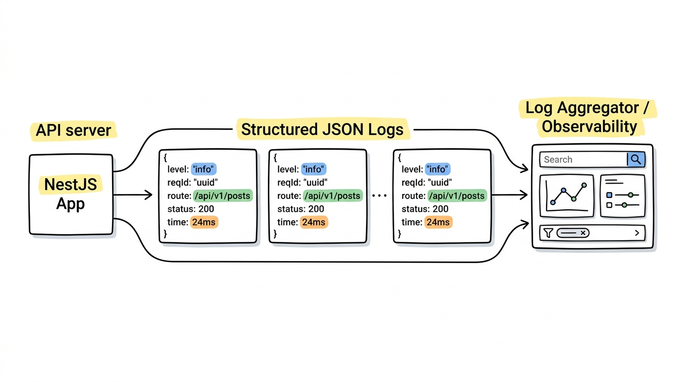
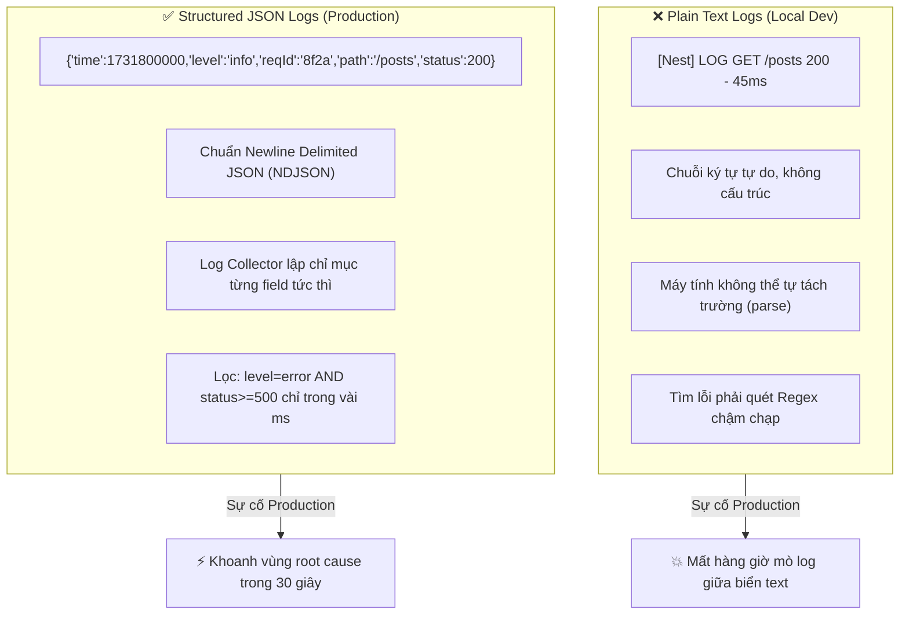
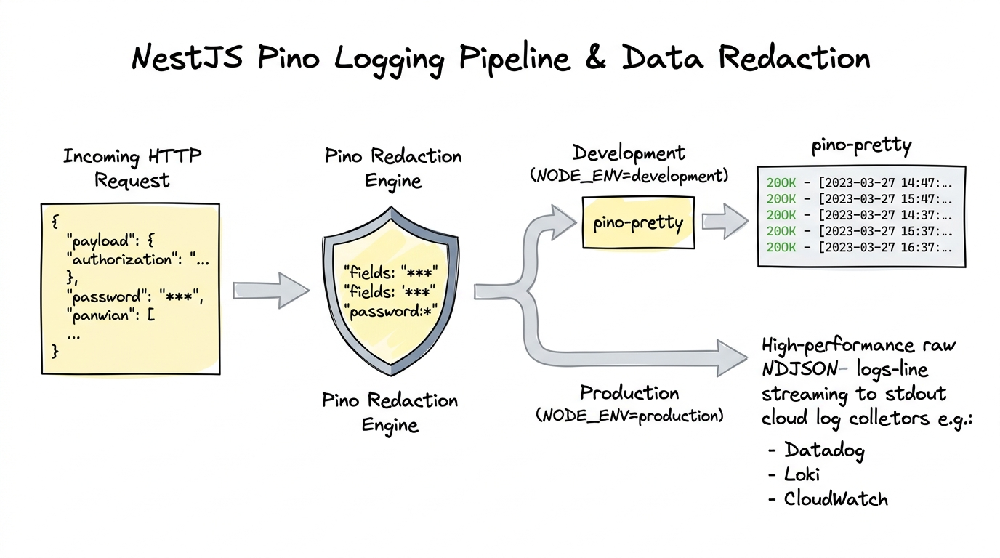
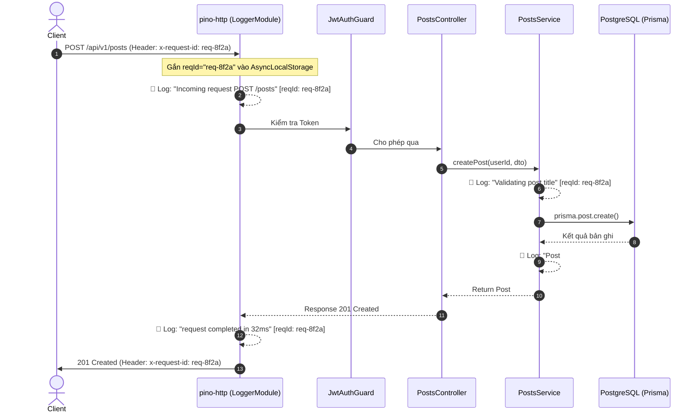

# Lesson 7.2: Structured JSON Logging — Ghi Log Hệ Thống Chuẩn Production Với `nestjs-pino`

<p align="center">
  
  
  
  
</p>

<p align="center">
  
</p>

---

> [!NOTE]
> ⏱️ **Thời lượng:** 15 phút thực chiến  
> 🎯 **Mục tiêu bài học:**
>
> - **Hiểu:** Vì sao ghi log dạng chuỗi thô (Plain Text) làm tê liệt khả năng điều tra sự cố trong Production, và tại sao **Structured JSON Logging** là tiêu chuẩn bắt buộc của các hệ thống Observability hiện đại (Datadog, Grafana Loki, AWS CloudWatch, ElasticSearch).
> - **Hiểu:** Lý do Pino dẫn đầu về hiệu năng trong hệ sinh thái Node.js (cơ chế serialize JSON tối ưu, non-blocking Event Loop) và cách thức vận hành của `nestjs-pino`.
> - **Cấu hình:** Tích hợp `LoggerModule` từ `nestjs-pino` hỗ trợ linh hoạt 2 chế độ: **Colored Pretty Print** khi phát triển (`development`) và **Single-line JSON (NDJSON)** khi triển khai (`production`).
> - **Truy vết (Request Tracing):** Tự động sinh và đính kèm **Correlation ID (`x-request-id`)** xuyên suốt mọi log lines của cùng một HTTP Request.
> - **Bảo mật:** Thiết lập **Data Redaction** để tự động che mờ dữ liệu nhạy cảm (mật khẩu, Authorization Bearer token, cookie), ngăn chặn rò rỉ thông tin người dùng ra log server.

> [!IMPORTANT]
> **Prerequisites:**
>
> - Đã hoàn thành [Lesson 3.3: Middleware — Viết LoggerMiddleware Tự Động Log HTTP Request](../../module-03/lesson-3.3/lesson-3.3.md).
> - Nắm vững cách quản lý biến môi trường với `ConfigService` ([Lesson 1.10](../../module-01/lesson-1.10/lesson-1.10.md)).
> - Nắm được cấu trúc Request Pipeline của dự án [Social Chat App Architecture](../../../04-project-architecture-and-codebase.md).

---

## 1. Tại Sao Cần Structured JSON Logging Trong Production? (Why?)

### 1.1 Hạn Chế Sống Còn Của Plain Text Logs

Ở [Lesson 3.3](../../module-03/lesson-3.3/lesson-3.3.md), chúng ta đã tạo `LoggerMiddleware` sử dụng `Logger` mặc định của NestJS để in các dòng log dạng văn bản ra Terminal:

```text
[Nest] 48215 - 11/17/2026, 8:30:15 AM   LOG [HTTP] GET /api/v1/posts/feed 200 1420b - +45ms [IP: 127.0.0.1]
[Nest] 48215 - 11/17/2026, 8:30:16 AM ERROR [ExceptionsHandler] Cannot read property 'id' of null
```

Định dạng chuỗi ký tự tự do này rất thân thiện với **mắt người lập trình viên** trên máy tính cá nhân. Nhưng khi đưa ứng dụng lên **môi trường Production** với hàng trăm nghìn người dùng đồng thời, định dạng này bộc lộ 4 điểm yếu nghiêm trọng:



1. **Máy tính không thể hiểu hoặc bóc tách dữ liệu tự động:** Mỗi lập trình viên log một kiểu (người dùng `[IP: ...]`, người viết `ip=...`, người bỏ qua IP). Muốn lọc ra tất cả request bị lỗi `500` mất hơn `1000ms`, công cụ giám sát phải chạy Regex quét từng dòng văn bản — cực kỳ tốn CPU và dễ gãy (brittle).
2. **Không thể truy vết khi các request chạy xen kẽ:** Node.js xử lý bất đồng bộ (Asynchronous). Nếu 50 người dùng cùng gửi request tại một thời điểm, các dòng log của 50 request này sẽ in xen kẽ lộn xộn. Bạn không thể biết dòng lỗi ở dòng 100 thuộc về request nào ở dòng 12!
3. **Hiệu năng chậm chạp:** Các hàm `console.log` hay logger chuỗi cơ bản trong Node.js là các lệnh **đồng bộ (synchronous blocking)** khi ghi ra `stdout`. Dưới tải cao, việc in chuỗi văn bản sẽ làm tắc nghẽn Node.js Event Loop.
4. **Nguy cơ rò rỉ thông tin cá nhân (PII):** Nếu vô tình log toàn bộ `req.body`, mật khẩu tài khoản hoặc mã Bearer Token sẽ bị phơi bày trần trụi trong file log, vi phạm nghiêm trọng các tiêu chuẩn bảo mật (GDPR, PCI-DSS).

---

### 1.2 Structured JSON Logging: Tiêu Chuẩn Vàng Của Cloud & Microservices

**Structured Logging** là kỹ thuật xuất bản mọi thông điệp log dưới dạng một đối tượng **JSON có cấu trúc chuẩn hóa (Newline Delimited JSON — NDJSON)** trên từng dòng độc lập:

```json
{
  "level": "info",
  "time": "2026-11-17T08:30:15.120Z",
  "pid": 48215,
  "reqId": "req-a8f2-43b1",
  "req": {
    "method": "GET",
    "url": "/api/v1/posts/feed",
    "remoteAddress": "192.168.1.10"
  },
  "res": { "statusCode": 200 },
  "responseTime": 45,
  "context": "PostsService",
  "msg": "Feed retrieved successfully"
}
```

**Hình dung trực quan:**

- **Plain Text Logs** giống như một cuốn sổ tay nháp: chữ viết hoa, viết thường, gạch chân lộn xộn, ai muốn tìm gì phải đọc từng trang từ đầu đến cuối.
- **Structured JSON Logs** giống như một **bảng cơ sở dữ liệu số hóa**: mỗi dòng là một bản ghi có các cột rõ ràng (`time`, `level`, `reqId`, `statusCode`, `latency`). Các hệ thống quản lý log tập trung (Centralized Log Aggregators) như **Datadog, Grafana Loki, AWS CloudWatch, ElasticSearch (ELK)** có thể lập chỉ mục (index) và thực thi các câu truy vấn phức tạp trong chớp mắt:

```text
# Lọc ngay tất cả request lỗi 5xx trên route /comments trong 15 phút qua:
level: "error" AND req.url: "/api/v1/posts/*/comments" AND res.statusCode: >=500
```

---

## 2. Bản Chất & Kiến Trúc `nestjs-pino` (What?)

### 2.1 Kiến Trúc Hoạt Động Của `nestjs-pino`

Dưới đây là luồng xử lý hoàn chỉnh của thư viện `nestjs-pino` trong ứng dụng NestJS:

<p align="center">
  
</p>

1. **Tiếp nhận Request & Sinh Correlation ID:** `pino-http` hoạt động ở tầng HTTP thấp nhất, tự động trích xuất header `x-request-id` từ Client gửi lên (hoặc tự động sinh UUID mới).
2. **Khiên chắn bảo vệ dữ liệu (Redaction Shield):** Trước khi dữ liệu được ghi, bộ lọc của Pino sẽ quét qua các đường dẫn được cấu hình (ví dụ: `req.headers.authorization`, `body.password`) và thay thế bằng chuỗi `[REDACTED]`.
3. **Phân nhánh theo môi trường (`NODE_ENV`):**
   - **Môi trường Development:** Chuyển qua `pino-pretty` để định dạng màu sắc trực quan, giúp lập trình viên đọc log trên Terminal dễ dàng.
   - **Môi trường Production:** Ghi thẳng JSON thô một dòng (NDJSON) với tốc độ ánh sáng ra `process.stdout`.

---

### 2.2 Cơ Chế Truy Vết Yêu Cầu Xuyên Suốt (Correlation ID / Request Tracing)

Một trong những tính năng giá trị nhất của `nestjs-pino` là khả năng gắn một mã định danh duy nhất (`reqId`) vào tất cả các dòng log phát sinh trong toàn bộ vòng đời của request:



👉 **Giá trị thực tế:** Khi học viên hoặc khách hàng báo lỗi: _"Em vừa gửi bài viết bị báo lỗi 500, mã lỗi trên màn hình là `req-8f2a`"_, DevOps chỉ cần gõ đúng chuỗi `req-8f2a` vào thanh tìm kiếm của Datadog/Loki là thấy **toàn bộ 4 dòng log từ Middleware → Service → Prisma**, không bị lẫn vào bất kỳ request nào khác!

---

## 3. Hướng Dẫn Triển Khai Step-by-Step (How?)

### Trạng Thái Dự Án (Project State)

```text
nestjs-basic-course/
└── src/
    ├── main.ts                         # Bước 3: Đăng ký app.useLogger(app.get(Logger)) & bufferLogs
    ├── app.module.ts                   # Bước 2 & 4: Đăng ký LoggerModule & loại bỏ LoggerMiddleware cũ
    ├── shared/
    │   └── middleware/
    │       └── logger.middleware.ts    # Đã hoàn thành nhiệm vụ ở Module 3, nay được thay bằng pino-http
    └── posts/
        └── posts.service.ts            # Bước 5: Sử dụng Pino Logger ghi structured logs theo ngữ cảnh
```

---

### 📌 Bước 1: Cài Đặt Thư Viện Cần Thiết

Cài đặt `nestjs-pino`, `pino-http` cho môi trường chạy chính và `pino-pretty` cho môi trường phát triển (Development):

```bash
pnpm add nestjs-pino pino-http
pnpm add -D pino-pretty
```

> [!TIP]
> `pino-pretty` chỉ nên nằm trong `devDependencies`. Trong môi trường Production trên Docker container, chúng ta không dùng `pino-pretty` để tiết kiệm tài nguyên CPU và bộ nhớ.

---

### 📌 Bước 2: Cấu Hình `LoggerModule` Trong `AppModule`

Mở file `src/app.module.ts`, import `LoggerModule` từ `nestjs-pino` và cấu hình động thông qua `ConfigService`:

📄 **`src/app.module.ts`**

```typescript
import { MiddlewareConsumer, Module, RequestMethod } from '@nestjs/common';
import { LoggerModule } from 'nestjs-pino';
import { ConfigModule, ConfigService } from '@nestjs/config';
import { randomUUID } from 'crypto';
// ... các imports khác giữ nguyên

@Module({
  imports: [
    ConfigModule.forRoot({
      validationSchema: envValidationSchema,
      isGlobal: true,
    }),
    // 🚀 Cấu hình Structured JSON Logger cho toàn bộ hệ thống
    LoggerModule.forRootAsync({
      imports: [ConfigModule],
      inject: [ConfigService],
      useFactory: (configService: ConfigService) => {
        const isProduction =
          configService.get<string>('NODE_ENV') === 'production';

        return {
          pinoHttp: {
            // Mức độ log: Production ghi từ 'info', Development ghi chi tiết từ 'debug'
            level: isProduction ? 'info' : 'debug',

            // Ở môi trường Dev: Dùng pino-pretty in màu đẹp mắt
            // Ở môi trường Prod: undefined để ghi raw NDJSON siêu tốc
            transport: isProduction
              ? undefined
              : {
                  target: 'pino-pretty',
                  options: {
                    colorize: true,
                    singleLine: true,
                    translateTime: 'yyyy-mm-dd HH:MM:ss.l',
                    ignore: 'pid,hostname',
                  },
                },

            // Tự động sinh hoặc kế thừa Correlation ID từ request header
            genReqId: (req) =>
              (req.headers['x-request-id'] as string) || randomUUID(),

            // Tự động bỏ qua việc log các route kiểm tra sức khỏe hệ thống định kỳ
            autoLogging: {
              ignore: (req) =>
                req.url === '/health' || req.url === '/api/health',
            },

            // 🛡️ Data Redaction: Tự động che mờ các trường nhạy cảm
            redact: {
              paths: [
                'req.headers.authorization',
                'req.headers.cookie',
                'req.body.password',
                'req.body.refreshToken',
              ],
              censor: '[REDACTED]',
            },
          },
        };
      },
    }),
    // ... các Modules khác (PrismaModule, UsersModule, PostsModule...)
  ],
  // ... controllers, providers
})
export class AppModule {
  // Cấu hình Middleware ở Bước 4 sẽ được cập nhật tại đây
}
```

---

### 📌 Bước 3: Thay Thế NestJS Default Logger Trong `main.ts`

Theo mặc định, NestJS sử dụng `ConsoleLogger` nội bộ để in các dòng khởi động (ví dụ: `RoutesResolver`, `InstanceLoader`). Để thống nhất 100% log hệ thống về một chuẩn duy nhất, ta gắn `Logger` của `nestjs-pino` vào `app.useLogger()`:

📄 **`src/main.ts`**

```typescript
import { NestFactory } from '@nestjs/core';
import { AppModule } from './app.module';
import { ConfigService } from '@nestjs/config';
import { ValidationPipe, VersioningType } from '@nestjs/common';
import { DocumentBuilder, SwaggerModule } from '@nestjs/swagger';
import { join } from 'path';
import { NestExpressApplication } from '@nestjs/platform-express';
import { Logger } from 'nestjs-pino'; // 👈 Import Logger từ nestjs-pino

async function bootstrap() {
  // 1. Kích hoạt bufferLogs: Giữ lại log khởi động cho đến khi Logger của Pino sẵn sàng
  const app = await NestFactory.create<NestExpressApplication>(AppModule, {
    bufferLogs: true,
  });

  // 2. Chuyển giao toàn quyền ghi log của NestJS sang Pino
  const appLogger = app.get(Logger);
  app.useLogger(appLogger);
}
```

---

### 📌 Bước 4: Refactor `LoggerMiddleware` Cũ

Ở [Lesson 3.3](../../module-03/lesson-3.3/lesson-3.3.md), `LoggerMiddleware` là một bài tập sư phạm xuất sắc để học viên hiểu khái niệm Middleware và sự kiện `res.on('finish')`.

Tuy nhiên, `pino-http` bên trong `LoggerModule` đã **tự động ghi log toàn bộ HTTP request và response** với hiệu năng cao hơn rất nhiều. Nếu vẫn giữ `LoggerMiddleware`, mỗi request gửi tới server sẽ bị ghi log thành **2 lần trùng lặp**!

Do đó, trong `src/app.module.ts`, chúng ta chỉ cần tinh chỉnh lại method `configure()`:

📄 **`src/app.module.ts`**

```typescript
export class AppModule {
  configure(consumer: MiddlewareConsumer) {
    // 💡 pino-http đã tự động log HTTP request với hiệu năng vượt trội.
    // Nếu bạn không còn middleware tùy biến nào khác, block này có thể để trống
    // hoặc chỉ áp dụng cho các middleware chức năng chuyên biệt khác.
  }
}
```

---

### 📌 Bước 5: Sử Dụng Pino Logger Trong Tầng Service Nghiệp Vụ

Làm sao để các dòng log nghiệp vụ bên trong Service (như tạo bài viết, thanh toán, gửi email) tự động gắn kèm `reqId` của request hiện tại?

Bạn có 2 cách thực hiện:

#### Cách 1: Sử dụng `@nestjs/common` `Logger` (Kế thừa tự động)

Do ta đã cấu hình `app.useLogger(app.get(Logger))` ở `main.ts`, mọi class khởi tạo `private readonly logger = new Logger(PostsService.name)` đều sẽ tự động chuyển hướng sang Pino!

#### Cách 2: Inject trực tiếp `PinoLogger` để gắn thuộc tính có cấu trúc (Recommended)

Mở `src/posts/posts.service.ts`:

📄 **`src/posts/posts.service.ts`**

```typescript
import { Injectable, NotFoundException } from '@nestjs/common';
import { PinoLogger, InjectPinoLogger } from 'nestjs-pino';
import { PrismaService } from '../prisma/prisma.service';
import { CreatePostDto } from './dto/create-post.dto';

@Injectable()
export class PostsService {
  constructor(
    private readonly prisma: PrismaService,
    // 💉 Inject PinoLogger với context là tên của Service
    @InjectPinoLogger(PostsService.name)
    private readonly logger: PinoLogger,
  ) {}

  async create(userId: number, dto: CreatePostDto) {
    // Ghi log kèm metadata có cấu trúc (structured object)
    this.logger.info(
      { authorId: userId, title: dto.title },
      'Creating new post...',
    );

    const post = await this.prisma.post.create({
      data: {
        title: dto.title,
        content: dto.content,
        authorId: userId,
      },
    });

    this.logger.info(
      { postId: post.id, authorId: userId },
      'Post created successfully in database',
    );

    return post;
  }

  async findOne(id: number) {
    const post = await this.prisma.post.findUnique({
      where: { id },
      include: { author: { select: { id: true, name: true } } },
    });

    if (!post) {
      // Ghi log cảnh báo mức WARN
      this.logger.warn({ postId: id }, 'Post not found');
      throw new NotFoundException(`Không tìm thấy bài viết có id = ${id}`);
    }

    return post;
  }
}
```

---

## 4. Kiểm Thử Kết Quả Thực Tế (Verify)

### 🟢 Kịch Bản 1: Kiểm Tra Log Trong Môi Trường Development (`pino-pretty`)

Chạy server ở chế độ phát triển:

```bash
pnpm start:dev
```

Mở một Terminal khác và thực hiện gọi API lấy bài viết:

```bash
curl -X GET "http://localhost:3000/api/v1/posts/feed?take=5"
```

Quan sát Terminal server. Bạn sẽ thấy log xuất hiện với định dạng màu sắc đẹp mắt, gọn gàng và dễ đọc:

```text
2026-11-17 08:35:10.412 [INFO] (Bootstrap): Application is running on: http://localhost:3000/api/v1
2026-11-17 08:35:10.415 [INFO] (Bootstrap): 📚 Cổng tài liệu Swagger UI: http://localhost:3000/api/docs
2026-11-17 08:35:22.105 [INFO] (HTTP): request completed {"req":{"id":"req-8f2a-b4c1","method":"GET","url":"/api/v1/posts/feed?take=5"},"res":{"statusCode":200},"responseTime":28}
```

---

### 🟢 Kịch Bản 2: Kiểm Tra Log Chuẩn Production (Newline Delimited JSON)

Thử nghiệm chạy server giả lập môi trường Production:

```bash
NODE_ENV=production pnpm start
```

Gọi lại request:

```bash
curl -X GET "http://localhost:3000/api/v1/posts/feed?take=5"
```

Toàn bộ log được xuất ra dưới dạng **đối tượng JSON nguyên bản một dòng (NDJSON)**:

```json
{
  "level": 30,
  "time": 1731800122105,
  "pid": 48900,
  "reqId": "8df1a921-50e3-4d7a-8b1a-b6e511422c54",
  "req": {
    "id": "8df1a921-50e3-4d7a-8b1a-b6e511422c54",
    "method": "GET",
    "url": "/api/v1/posts/feed?take=5",
    "headers": { "host": "localhost:3000", "user-agent": "curl/8.7.1" },
    "remoteAddress": "::1"
  },
  "res": { "statusCode": 200 },
  "responseTime": 24,
  "msg": "request completed"
}
```

> [!TIP]
> Bạn có thể kiểm tra khả năng bóc tách trường tức thì bằng tiện ích dòng lệnh `jq`:
>
> ```bash
> # Chỉ lọc lấy thời gian, mã phản hồi và thời gian xử lý:
> NODE_ENV=production pnpm start | jq '{time: .time, status: .res.statusCode, latency: .responseTime}'
> ```

---

### 🟢 Kịch Bản 3: Kiểm Chứng Tính Năng Correlation ID (`x-request-id`)

Client gửi một request có kèm mã định danh theo dõi:

```bash
curl -X GET "http://localhost:3000/api/v1/posts/1" \
  -H "x-request-id: trace-user-checkout-9999"
```

Quan sát log của server, bạn sẽ thấy mã `trace-user-checkout-9999` được tự động kế thừa vào tất cả các log:

```json
{"level":30,"time":1731800150210,"reqId":"trace-user-checkout-9999","context":"PostsService","postId":1,"msg":"Fetching post details"}
{"level":30,"time":1731800150225,"reqId":"trace-user-checkout-9999","res":{"statusCode":200},"responseTime":15,"msg":"request completed"}
```

---

### 🟢 Kịch Bản 4: Kiểm Chứng Khiên Chắn Bảo Mật (Data Redaction)

Gửi request đăng nhập chứa thông tin nhạy cảm:

```bash
curl -X POST "http://localhost:3000/api/v1/auth/login" \
  -H "Content-Type: application/json" \
  -H "Authorization: Bearer my-secret-jwt-token" \
  -d '{"email": "john@example.com", "password": "superSecretPassword123"}'
```

Kiểm tra nội dung log trên server:

```json
{
  "level": 30,
  "req": {
    "method": "POST",
    "url": "/api/v1/auth/login",
    "headers": {
      "authorization": "[REDACTED]"
    },
    "body": {
      "email": "john@example.com",
      "password": "[REDACTED]"
    }
  },
  "msg": "request completed"
}
```

👉 **Kết quả hoàn hảo:** Trường `authorization` và `password` đã được thay thế hoàn toàn bằng `[REDACTED]`, bảo vệ tuyệt đối thông tin bảo mật của học viên và khách hàng!

---

## 5. Các Lỗi Thường Gặp (Common Mistakes)

| Lỗi gặp phải                                              | Nguyên nhân                                                                                | Cách khắc phục                                                                                        |
| :-------------------------------------------------------- | :----------------------------------------------------------------------------------------- | :---------------------------------------------------------------------------------------------------- |
| **Log khởi động vẫn in ra dạng console cũ của NestJS**    | Quên cấu hình `app.useLogger(app.get(Logger))` và `bufferLogs: true` trong file `main.ts`. | Thêm `bufferLogs: true` vào `NestFactory.create` và gọi `app.useLogger(app.get(Logger))` ngay sau đó. |
| **Mỗi request bị in ra 2 dòng log giống nhau**            | Vẫn giữ `LoggerMiddleware` trong khi `pino-http` đã tự động ghi log request.               | Xóa hoặc vô hiệu hóa `LoggerMiddleware` trong `AppModule.configure()`.                                |
| **Lộ mật khẩu hoặc Token JWT lên hệ thống giám sát**      | Quên khai báo cấu hình `redact.paths` trong tùy chọn của `pinoHttp`.                       | Thêm danh sách các trường cần bảo vệ: `['req.headers.authorization', 'req.body.password']`.           |
| **Server bị sụt giảm hiệu năng nặng nề trong Production** | Vẫn bật `pino-pretty` khi triển khai thực tế trên máy chủ.                                 | Kiểm tra điều kiện `isProduction`: nếu là production thì đặt `transport: undefined`.                  |
| **Không đọc được `reqId` khi truy vết giữa các Service**  | Sử dụng `console.log` thuần túy thay vì inject `PinoLogger` hoặc `Logger`.                 | Luôn inject `@InjectPinoLogger()` hoặc dùng `Logger` từ `nestjs-pino`.                                |

---

## 6. Bài Tập Thực Hành (Exercises)

1. **🧩 Exercise 1 (Easy — Follow Along):** Inject `PinoLogger` vào `CommentsService` (`src/comments/comments.service.ts`). Thêm một dòng log `info` khi người dùng tạo bình luận mới với nội dung chứa `postId`, `authorId` và độ dài ký tự của bình luận.
2. **🧩 Exercise 2 (Medium — Debugging):** Khi người dùng gửi request không hợp lệ (ví dụ: `POST /api/v1/posts` thiếu tiêu đề `title`), `ValidationPipe` ném ra lỗi `400 Bad Request`. Hãy cấu hình để `pinoHttp` tự động ghi log các lỗi `4xx` này ở cấp độ `warn` thay vì `info`.
3. **🧩 Exercise 3 (Challenge):** Trong ứng dụng Social Chat App, khi người dùng gọi API đã đăng nhập thành công qua JWT (`JwtAuthGuard`), `req.user` sẽ chứa `userId`. Hãy cấu hình hàm `customProps` trong `LoggerModule` để tự động bổ sung trường `userId` vào mọi bản ghi log của request đó nếu có.

---

## 7. Tổng Kết & Checklist (Summary)

- **Structured JSON Logging** là chìa khóa then chốt để ứng dụng NestJS sẵn sàng vận hành trong môi trường Microservices, Docker và Kubernetes.
- **`nestjs-pino`** mang lại hiệu năng đỉnh cao, cơ chế non-blocking tối ưu cho Node.js Event Loop và được thiết kế chuẩn mực cho Newline Delimited JSON (NDJSON).
- **Correlation ID (`x-request-id`)** liên kết chặt chẽ mọi dòng log của cùng một request từ Middleware, Controller đến Prisma Database.
- **Data Redaction** bảo vệ dữ liệu nhạy cảm của người dùng một cách tự động và triệt để.

### ✅ Checklist Hoàn Thành Bài Học:

- [x] Cài đặt `nestjs-pino`, `pino-http` và `pino-pretty`.
- [x] Đăng ký `LoggerModule.forRootAsync()` trong `AppModule` kết hợp `ConfigService`.
- [x] Bật `bufferLogs: true` và `app.useLogger(app.get(Logger))` trong `main.ts`.
- [x] Cấu hình Correlation ID (`genReqId`) và che dữ liệu nhạy cảm (`redact`).
- [x] Phân biệt rõ ràng định dạng hiển thị: `pino-pretty` ở Local Dev và `NDJSON` ở Production.

---

👉 **Bài tiếp theo:** [Lesson 7.3: Healthchecks — Tạo API `/api/v1/health` Soi DB Postgres & RAM Bằng `@nestjs/terminus`](../lesson-7.3/lesson-7.3.md)
