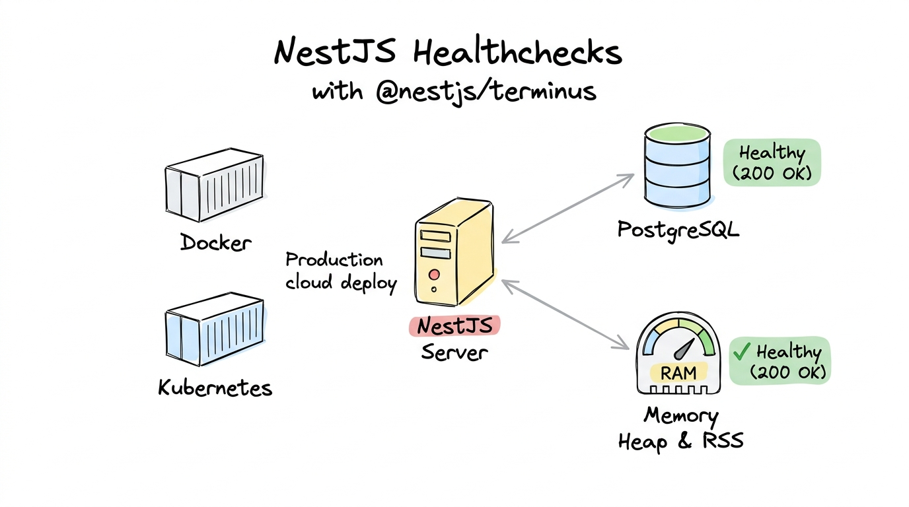
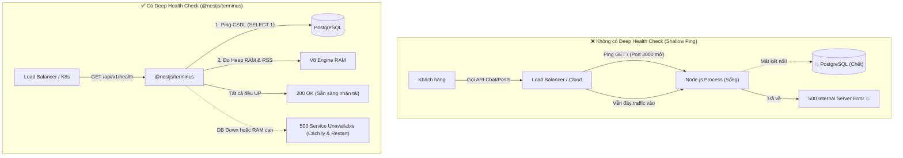
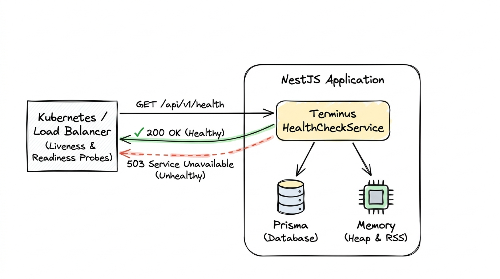
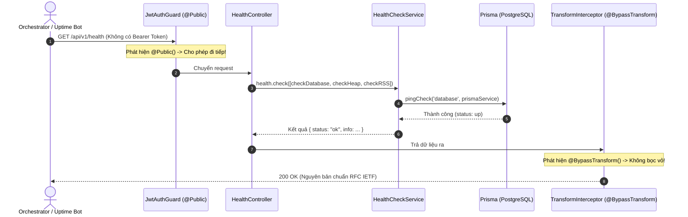

# Lesson 7.3: Healthchecks — Tạo API `/api/v1/health` Soi DB Postgres & RAM Bằng `@nestjs/terminus`

<p align="center">
  
  
  
  
  
</p>

<p align="center">
  
</p>

---

> [!NOTE]
> ⏱️ **Thời lượng:** 15 phút thực chiến  
> 🎯 **Mục tiêu bài học:**
>
> - **Hiểu sâu sắc (Why):** Tại sao ứng dụng vẫn sống ở tầng tiến trình (Process) nhưng lại "chết lâm sàng" ở tầng nghiệp vụ (Database ngắt kết nối, RAM quá tải dẫn đến crash OOM), và cách **Health Check API** giúp các bộ điều phối (Docker, Kubernetes, AWS ALB, Render, Railway) tự động phục hồi hệ thống.
> - **Phân biệt (Core Concepts):** Sự khác biệt cốt lõi giữa **Liveness Probe** (Kiểm tra container còn sống không để restart) và **Readiness Probe** (Kiểm tra ứng dụng đã sẵn sàng nhận traffic người dùng chưa để điều phối tải).
> - **Làm chủ `@nestjs/terminus`:** Tích hợp bộ thư viện tiêu chuẩn chính thức của NestJS, khai thác các Health Indicator tích hợp sẵn: `PrismaHealthIndicator` (soi CSDL) và `MemoryHealthIndicator` (soi V8 Heap & Process RSS).
> - **Chuẩn hóa Request Pipeline:** Kết hợp hoàn hảo với kiến trúc Social Chat App: mở cổng bằng route decorator `@Public()` vượt qua `JwtAuthGuard`, giữ nguyên định dạng chuẩn IETF bằng `@BypassTransform()`, và loại trừ log định kỳ bằng `LoggerMiddleware.exclude()`.
> - **Kiểm thử & Phòng chống sự cố:** Giả lập sự cố rớt CSDL PostgreSQL (`docker compose stop postgres`) và cạn kiệt RAM, quan sát phản hồi tự động chuẩn `503 Service Unavailable` và `200 OK`.

> [!IMPORTANT]
> **Prerequisites:**
>
> - Đã cấu hình `PrismaService` kết nối PostgreSQL ([Lesson 2.6](../../module-02/lesson-2.6/lesson-2.6.md)).
> - Đã hiểu cơ chế Route Metadata `@Public()` vượt qua `JwtAuthGuard` toàn cục ([Lesson 4.6](../../module-04/lesson-4.6/lesson-4.6.md)).
> - Đã nắm vững Route Decorator `@BypassTransform()` bỏ qua đóng gói dữ liệu ([Lesson 3.6](../../module-03/lesson-3.6/lesson-3.6.md)).
> - Nắm được cấu trúc Request Pipeline của dự án [Social Chat App Architecture](../../../04-project-architecture-and-codebase.md).

---

## 1. Tại Sao Cần Healthcheck API Trong Production? (Why?)

### 1.1 Vấn Nạn "Hồn Trương Ba, Da Hàng Thịt" Trong Môi Trường Cloud

Khi phát triển tại máy cá nhân (`localhost`), nếu server bị lỗi kết nối cơ sở dữ liệu hoặc cạn bộ nhớ RAM, lập trình viên sẽ lập tức nhìn thấy thông báo lỗi đỏ rực trên Terminal và nhấn `Ctrl + C` để khởi động lại.

Tuy nhiên, khi đưa ứng dụng lên **môi trường Production** (chạy bên trong Docker Containers trên Kubernetes, AWS ECS, Google Cloud Run, hoặc các nền tảng PaaS như Render/Railway), một kịch bản tồi tệ thường xuyên xảy ra:

```text
Tiến trình Node.js (PID 1) vẫn đang chạy và lắng nghe ở Port 3000...
NHƯNG:
1. PostgreSQL Connection Pool bị cạn kiệt hoặc Server DB bị khởi động lại.
2. V8 Memory Heap bị rò rỉ (Memory Leak) chạm ngưỡng OOM (Out Of Memory).
3. Ổ đĩa lưu trữ uploads/ bị đầy 100%.
```

Hậu quả là:

- **Load Balancer (Nginx, AWS ALB, Cloudflare)** chỉ kiểm tra nông (Shallow Check): nếu port 3000 mở hoặc gọi `GET /` trả về mã gì đó thì cho rằng container vẫn bình thường và tiếp tục điều phối hàng nghìn request từ người dùng vào container này.
- **Người dùng cuối:** Nhận hàng loạt lỗi trắng xóa `500 Internal Server Error`, không thể đăng nhập hay gửi tin nhắn chat.
- **Bộ điều phối (Kubernetes / Docker Swarm):** Không hề biết container đang "chết lâm sàng" nên không kích hoạt cơ chế tự phục hồi (Self-Healing / Auto-Restart)!



---

### 1.2 Phân Biệt Liveness Probe Và Readiness Probe

Trong kiến trúc điều phối container hiện đại (đặc biệt là Kubernetes và Docker Swarm), Healthcheck được chia làm hai vai trò thiết yếu:

| Tiêu chí                   | Liveness Probe (Sống/Chết)                                                              | Readiness Probe (Sẵn Sàng Phục Vụ)                                                                                   |
| :------------------------- | :-------------------------------------------------------------------------------------- | :------------------------------------------------------------------------------------------------------------------- |
| **Câu hỏi đặt ra**         | _Ứng dụng còn "thở" không, hay tiến trình đã bị treo cứng (Deadlock)?_                  | _Ứng dụng đã sẵn sàng tiếp nhận request của người dùng chưa?_                                                        |
| **Hành vi kiểm tra**       | Kiểm tra tiến trình Node.js còn phản hồi HTTP và Event Loop không bị tắc nghẽn.         | Kiểm tra toàn diện các phụ thuộc bắt buộc: CSDL PostgreSQL, Redis Cache, RAM an toàn.                                |
| **Hành động khi Thất Bại** | **Giết và Khởi động lại container (Kill & Restart Pod)** để thoát khỏi trạng thái treo. | **Tạm dừng điều phối traffic:** Gỡ container ra khỏi Service Pool để người dùng không nhận lỗi 500, chờ DB hồi phục. |
| **Endpoint thường dùng**   | `GET /api/v1/health/liveness`                                                           | `GET /api/v1/health/readiness` (hoặc chung `GET /api/v1/health`)                                                     |

---

## 2. Bản Chất & Kiến Trúc `@nestjs/terminus` (What?)

### 2.1 Kiến Trúc Hoạt Động Của `@nestjs/terminus`

`@nestjs/terminus` là gói thư viện chính thức của NestJS xây dựng dựa trên dự án mã nguồn mở danh tiếng `@godaddy/terminus`. Nó cung cấp một hệ sinh thái **Health Indicators** có thể lồng ghép linh hoạt:

<p align="center">
  
</p>

1. **`HealthCheckService`:** Đóng vai trò nhạc trưởng (Orchestrator), chịu trách nhiệm thực thi đồng thời một mảng các hàm kiểm tra con (`HealthIndicatorFunction[]`).
2. **`PrismaHealthIndicator`:** Kiểm tra đường truyền tới PostgreSQL thông qua `PrismaService` bằng lệnh truy vấn nhanh (`$queryRawUnsafe('SELECT 1')`).
3. **`MemoryHealthIndicator`:**
   - `checkHeap`: Đo lượng RAM cấp phát cho các Object JavaScript trên V8 Engine (Heap Space).
   - `checkRSS`: Đo **Resident Set Size** — tổng dung lượng RAM thực tế tiến trình Node.js đang chiếm dụng trên hệ điều hành (bao gồm Heap, Code Segment và các module C++ Native Bindings).
4. **Tự Động Chuẩn Hóa HTTP Status Code:**
   - Nếu **toàn bộ** các thành phần đều khỏe (`up`): Trả về mã **`200 OK`**.
   - Nếu **bất kỳ một** thành phần nào bị hỏng (`down`): Tự động ném lỗi và trả về mã **`503 Service Unavailable`**.

---

### 2.2 Định Dạng Phản Hồi Chuẩn Quốc Tế (IETF RFC Draft)

Response của Terminus tuân theo tiêu chuẩn chuẩn hóa dành cho Health Check APIs trong môi trường phân tán:

#### Khi Hệ Thống Khỏe Mạnh (HTTP 200 OK):

```json
{
  "status": "ok",
  "info": {
    "database": {
      "status": "up"
    },
    "memory_heap": {
      "status": "up"
    },
    "memory_rss": {
      "status": "up"
    }
  },
  "error": {},
  "details": {
    "database": {
      "status": "up"
    },
    "memory_heap": {
      "status": "up"
    },
    "memory_rss": {
      "status": "up"
    }
  }
}
```

#### Khi Có Sự Cố (Ví Dụ PostgreSQL Bị Tắt — HTTP 503 Service Unavailable):

```json
{
  "status": "error",
  "info": {
    "memory_heap": {
      "status": "up"
    },
    "memory_rss": {
      "status": "up"
    }
  },
  "error": {
    "database": {
      "status": "down",
      "message": "Can't reach database server at `localhost:5432`"
    }
  },
  "details": {
    "memory_heap": {
      "status": "up"
    },
    "memory_rss": {
      "status": "up"
    },
    "database": {
      "status": "down",
      "message": "Can't reach database server at `localhost:5432`"
    }
  }
}
```

---

### 2.3 Sự Phối Hợp Tuyệt Vời Với Request Pipeline Của Social Chat App

Để endpoint `/api/v1/health` vận hành mượt mà mà không làm xáo trộn các quy chuẩn đã xây dựng từ các Module trước, chúng ta phải giải quyết 3 bài toán kiến trúc đặc thù:



1. **Vượt qua cổng bảo vệ JWT (`@Public()`):** Ở [Lesson 4.6](../../module-04/lesson-4.6/lesson-4.6.md), chúng ta đặt `JwtAuthGuard` làm `APP_GUARD` toàn cục bảo vệ toàn bộ API. Nhưng các công cụ giám sát (Kubernetes Kubelet, Docker daemon, Uptime Kuma, AWS Target Group) **không hề có JWT Token**. Vì vậy, route `/health` bắt buộc phải được gắn decorator `@Public()`!
2. **Không bọc vỏ Envelope (`@BypassTransform()`):** Ở [Lesson 3.6](../../module-03/lesson-3.6/lesson-3.6.md), `TransformInterceptor` tự động bọc mọi response thành `{ statusCode, data, message, timestamp }`. Các công cụ giám sát của Cloud sẽ bị "lúng túng" khi phân tích nếu response bị bọc lồng. Decorator `@BypassTransform()` giúp giữ nguyên cấu trúc JSON chuẩn của Terminus.
3. **Loại trừ khỏi HTTP Logs (`LoggerMiddleware.exclude`):** Các bot kiểm tra sức khỏe gửi request đều đặn mỗi 5–10 giây. Nếu ghi log đầy đủ, file log Production sẽ bị "rác" ngập tràn bởi hàng trăm nghìn dòng `GET /api/v1/health 200`. Chúng ta sẽ loại trừ route này khỏi logger.

---

## 3. Triển Khai Thực Chiến Từng Bước (How?)

### Bước 1: Cài Đặt Gói `@nestjs/terminus`

Mở Terminal tại thư mục gốc của dự án và cài đặt gói thư viện chính thức bằng `pnpm`:

```bash
pnpm add @nestjs/terminus
```

Kiểm tra file `package.json`, bạn sẽ thấy phụ thuộc `@nestjs/terminus` đã được thêm vào:

📄 **`package.json`**

```json
{
  "dependencies": {
    "@nestjs/terminus": "^12.1.0"
  }
}
```

---

### Bước 2: Tạo `HealthController` Soi CSDL Và Bộ Nhớ RAM

Tạo thư mục `src/health/` và tạo file `src/health/health.controller.ts`:

📄 **`src/health/health.controller.ts`**

```typescript
import { Controller, Get } from '@nestjs/common';
import {
  HealthCheck,
  HealthCheckService,
  MemoryHealthIndicator,
  PrismaHealthIndicator,
} from '@nestjs/terminus';
import { ApiOperation, ApiResponse, ApiTags } from '@nestjs/swagger';
import { Public } from '@/shared/decorators/public.decorator';
import { BypassTransform } from '@/shared/decorators/bypass-transform.decorator';
import { PrismaService } from '@/prisma/prisma.service';

@ApiTags('Health')
@Controller('health')
export class HealthController {
  constructor(
    private readonly health: HealthCheckService,
    private readonly prismaHealth: PrismaHealthIndicator,
    private readonly memoryHealth: MemoryHealthIndicator,
    private readonly prisma: PrismaService,
  ) {}

  @Get()
  @Public()
  @BypassTransform()
  @HealthCheck()
  @ApiOperation({
    summary: 'Kiểm tra trạng thái sức khỏe hệ thống (Database & RAM)',
  })
  @ApiResponse({
    status: 200,
    description: 'Hệ thống hoạt động bình thường, sẵn sàng tiếp nhận yêu cầu.',
  })
  @ApiResponse({
    status: 503,
    description:
      'Hệ thống đang gặp sự cố (CSDL không phản hồi hoặc RAM vượt ngưỡng an toàn).',
  })
  check() {
    return this.health.check([
      // 1. Kiểm tra kết nối tới PostgreSQL qua Prisma Client
      () => this.prismaHealth.pingCheck('database', this.prisma),

      // 2. Giám sát V8 Heap Memory không vượt quá 200MB
      () => this.memoryHealth.checkHeap('memory_heap', 200 * 1024 * 1024),

      // 3. Giám sát tổng dung lượng Resident Set Size (RSS) không vượt quá 400MB
      () => this.memoryHealth.checkRSS('memory_rss', 400 * 1024 * 1024),
    ]);
  }
}
```

> [!TIP]
> **Giải thích thông số RAM:**
>
> - `200 * 1024 * 1024` byte tương đương **200 MB**. Nếu các biến và cấu trúc dữ liệu trên V8 Engine phình to vượt quá 200MB, chỉ báo `memory_heap` sẽ chuyển sang trạng thái `down`.
> - `400 * 1024 * 1024` byte tương đương **400 MB** RSS. Đây là ngưỡng an toàn rất phù hợp cho một ứng dụng Node.js chạy trong container có RAM cấp phát 512MB.

---

### Bước 3: Tạo `HealthModule`

Tạo file `src/health/health.module.ts` để kết nối `TerminusModule` với `HealthController`:

📄 **`src/health/health.module.ts`**

```typescript
import { Module } from '@nestjs/common';
import { TerminusModule } from '@nestjs/terminus';
import { HealthController } from './health.controller';

@Module({
  imports: [TerminusModule],
  controllers: [HealthController],
})
export class HealthModule {}
```

> [!NOTE]
> Nhờ `PrismaModule` đã được khai báo với decorator `@Global()` ở [Lesson 2.6](../../module-02/lesson-2.6/lesson-2.6.md), `PrismaService` tự động khả dụng để inject vào `HealthController` mà không cần import lại `PrismaModule` vào `HealthModule`.

---

### Bước 4: Đăng Ký `HealthModule` Vào `AppModule`

Mở file `src/app.module.ts`, import `HealthModule` và thêm vào danh sách `imports`:

📄 **`src/app.module.ts`**

```typescript
import { MiddlewareConsumer, Module, RequestMethod } from '@nestjs/common';
// ... các imports khác
import { ChatModule } from './chat/chat.module';
import { HealthModule } from './health/health.module'; // 👈 Thêm import này

@Module({
  imports: [
    // ... các Modules hiện có
    ChatModule,
    HealthModule, // 👈 Đăng ký HealthModule tại đây
  ],
  controllers: [AppController],
  providers: [
    // ... các Filters, Interceptors, Guards toàn cục
  ],
})
export class AppModule {
  configure(consumer: MiddlewareConsumer) {
    consumer
      .apply(LoggerMiddleware)
      .exclude({
        path: 'health', // 👈 Loại trừ route /health khỏi Middleware log HTTP
        method: RequestMethod.GET,
      })
      .forRoutes('{*path}');
  }
}
```

> [!IMPORTANT]
> Hãy quan sát khối `configure(consumer: MiddlewareConsumer)` ở cuối file `AppModule`: chúng ta đã cấu hình `.exclude({ path: 'health', method: RequestMethod.GET })`. Nhờ vậy, mỗi lần Kubelet hay Load Balancer "gõ cửa" kiểm tra sức khỏe thì server sẽ không in ra log HTTP, giữ cho log của dự án luôn gọn gàng và sạch sẽ!

---

## 4. Kiểm Chứng Thực Tế (Verification)

Khởi động server ở chế độ phát triển:

```bash
pnpm start:dev
```

---

### 🟢 Kịch Bản 1: Kiểm Tra Trạng Thái Bình Thường (Healthy — 200 OK)

Mở một cửa sổ Terminal mới và gửi request qua `curl`:

```bash
curl -i -X GET "http://localhost:3000/api/v1/health"
```

**Kết quả phản hồi trên Terminal:**

```http
HTTP/1.1 200 OK
X-Powered-By: Express
Content-Type: application/json; charset=utf-8
Content-Length: 172
Date: Tue, 17 Nov 2026 09:30:00 GMT
Connection: keep-alive

{
  "status": "ok",
  "info": {
    "database": {
      "status": "up"
    },
    "memory_heap": {
      "status": "up"
    },
    "memory_rss": {
      "status": "up"
    }
  },
  "error": {},
  "details": {
    "database": {
      "status": "up"
    },
    "memory_heap": {
      "status": "up"
    },
    "memory_rss": {
      "status": "up"
    }
  }
}
```

👉 **Nhận xét quan trọng:**

1. HTTP Status Code là **`200 OK`**.
2. Không cần gửi kèm Header `Authorization: Bearer <token>`, request vẫn được thông qua trơn tru nhờ có `@Public()`.
3. Dữ liệu JSON trả về nguyên bản theo chuẩn Terminus mà không bị bọc vỏ `{ statusCode, data: ... }` nhờ có `@BypassTransform()`.
4. Bạn cũng có thể mở trình duyệt truy cập tài liệu Swagger UI tại `http://localhost:3000/api/docs` để kiểm thử tương tác trực quan với nhóm tag **Health**.

---

### 🔴 Kịch Bản 2: Giả Lập Sự Cố Cơ Sở Dữ Liệu Bị Rớt (Unhealthy — 503)

Bây giờ hãy thử kiểm tra xem hệ thống phản ứng thế nào khi PostgreSQL gặp sự cố.

Tạm thời ngắt kết nối container PostgreSQL:

```bash
docker compose stop postgres
```

Gửi lại request kiểm tra sức khỏe:

```bash
curl -i -X GET "http://localhost:3000/api/v1/health"
```

**Kết quả phản hồi ngay lập tức:**

```http
HTTP/1.1 503 Service Unavailable
Content-Type: application/json; charset=utf-8
Connection: keep-alive

{
  "status": "error",
  "info": {
    "memory_heap": {
      "status": "up"
    },
    "memory_rss": {
      "status": "up"
    }
  },
  "error": {
    "database": {
      "status": "down",
      "message": "Can't reach database server at `localhost:5432`"
    }
  },
  "details": {
    "memory_heap": {
      "status": "up"
    },
    "memory_rss": {
      "status": "up"
    },
    "database": {
      "status": "down",
      "message": "Can't reach database server at `localhost:5432`"
    }
  }
}
```

👉 **Phân tích kết quả:**

- `@nestjs/terminus` phát hiện câu ping tới PostgreSQL không thành công.
- Thay vì trả về `200` gây hiểu lầm, Terminus đã chủ động đổi HTTP Status Code thành **`503 Service Unavailable`**.
- Load Balancer / Kubernetes nhận được mã `503` sẽ lập tức tạm dừng điều hướng khách hàng vào container này, bảo vệ người dùng khỏi việc trải nghiệm một ứng dụng lỗi!

Sau khi kiểm chứng xong, hãy bật lại PostgreSQL:

```bash
docker compose start postgres
```

Chờ 2 giây và gọi lại `curl`, endpoint sẽ tự động chuyển xanh trở lại thành `200 OK`!

---

### 🟢 Kịch Bản 3: Tích Hợp Healthcheck Vào `docker-compose.yml`

Để Docker tự động theo dõi sức khỏe của ứng dụng NestJS, chúng ta có thể cấu hình chỉ thị `healthcheck` trong file `docker-compose.yml`:

📄 **`docker-compose.yml`**

```yaml
services:
  api:
    build: .
    ports:
      - '3000:3000'
    depends_on:
      postgres:
        condition: service_healthy
    healthcheck:
      test: ['CMD', 'curl', '-f', 'http://localhost:3000/api/v1/health']
      interval: 10s # Kiểm tra mỗi 10 giây một lần
      timeout: 5s # Quá 5 giây không phản hồi xem như thất bại
      retries: 3 # Thất bại 3 lần liên tiếp thì đánh dấu UNHEALTHY
      start_period: 15s # Cho phép ứng dụng khởi động trong 15s đầu
```

Lệnh `curl -f` sẽ trả về exit code khác `0` nếu server trả về mã lỗi `503`, giúp Docker Engine đánh dấu container là `(unhealthy)`.

---

## 5. Các Lỗi Thường Gặp (Common Mistakes)

| Lỗi gặp phải                                                                | Nguyên nhân                                                                                                           | Cách khắc phục                                                                                           |
| :-------------------------------------------------------------------------- | :-------------------------------------------------------------------------------------------------------------------- | :------------------------------------------------------------------------------------------------------- |
| **Gọi API `/api/v1/health` bị trả về `401 Unauthorized`**                   | Quên gắn decorator `@Public()` trên method hoặc controller, khiến `JwtAuthGuard` toàn cục chặn lại.                   | Thêm `@Public()` từ `@/shared/decorators/public.decorator`.                                              |
| **Response bị bọc lồng dạng `{ statusCode: 200, data: { status: "ok" } }`** | Quên gắn `@BypassTransform()`, khiến `TransformInterceptor` bọc dữ liệu làm hỏng định dạng IETF.                      | Thêm `@BypassTransform()` từ `@/shared/decorators/bypass-transform.decorator`.                           |
| **Container bị Kubernetes restart liên tục (Flapping / CrashLoopBackOff)**  | Đặt ngưỡng `checkHeap` hoặc `checkRSS` quá thấp (ví dụ đặt 50MB trong khi Node.js vừa khởi động đã chiếm 60MB).       | Tăng ngưỡng kiểm tra RAM lên mức thực tế (Heap: 150MB–200MB, RSS: 300MB–400MB tùy dung lượng container). |
| **API Healthcheck chạy rất chậm (mất > 1000ms)**                            | Dùng câu truy vấn nặng (ví dụ: `prisma.user.findMany({ include: { posts: true } })`) để kiểm tra DB thay vì ping nhẹ. | Luôn dùng `prismaHealth.pingCheck('database', prisma)` hoặc `$queryRawUnsafe('SELECT 1')`.               |
| **Log Production bị phình to nhanh chóng**                                  | Chưa cấu hình `exclude` route `health` trong `LoggerMiddleware`.                                                      | Đảm bảo `AppModule.configure()` có exclude `{ path: 'health', method: RequestMethod.GET }`.              |

---

## 6. Bài Tập Thực Hành (Exercises)

### 🧩 Level 1 — Follow Along: Bổ Sung Disk Storage Health Indicator

Trong ứng dụng Social Chat App, người dùng thường xuyên upload hình ảnh đại diện và ảnh bài viết vào thư mục `uploads/`. Nếu ổ đĩa bị đầy 100%, server sẽ không thể ghi file mới.

- **Yêu cầu:** Inject `DiskHealthIndicator` vào `HealthController` và bổ sung lệnh kiểm tra dung lượng ổ đĩa không vượt quá 90% (`thresholdPercent: 0.9` trên đường dẫn `/`).

---

### 🧩 Level 2 — Debugging: Tách Biệt Liveness Probe & Readiness Probe

Hiện tại cả 3 bài kiểm tra (DB, Heap, RSS) đều gom chung vào một route `GET /api/v1/health`.

- **Yêu cầu:** Hãy tách thành 2 route độc lập:
  1. `GET /api/v1/health/liveness`: Chỉ kiểm tra `memoryHealth.checkHeap` để xác nhận tiến trình Node.js không bị treo.
  2. `GET /api/v1/health/readiness`: Kiểm tra kết nối CSDL PostgreSQL (`prismaHealth.pingCheck`) để báo cho Load Balancer biết ứng dụng đã sẵn sàng nhận kết nối mạng.

---

### 🧩 Level 3 — Challenge: Viết Custom Health Indicator Cho Redis Cache

Ở [Lesson 7.1](../lesson-7.1/lesson-7.1.md), chúng ta đã tích hợp Redis Cache để tăng tốc độ truy vấn bài viết.

- **Yêu cầu:** Tạo một class `RedisHealthIndicator extends HealthIndicator` riêng, inject `CACHE_MANAGER`, thực hiện lệnh `set('__health_ping__', 'pong', 1000)` rồi đọc lại. Nếu thành công thì trả về `this.getStatus('redis', true)`, ngược lại ném `HealthCheckError`!

---

## 7. Tổng Kết & Checklist (Summary)

- **Healthcheck API** là tiêu chuẩn bắt buộc giúp các hệ thống Cloud Orchestrator (Docker, Kubernetes, AWS, Render) tự động hóa việc theo dõi và tự chữa lành (Self-Healing).
- **`@nestjs/terminus`** cung cấp giải pháp toàn diện, tự động tổng hợp kết quả và trả về mã `200 OK` hoặc `503 Service Unavailable` theo chuẩn IETF RFC Draft.
- **`PrismaHealthIndicator`** giúp kiểm tra kết nối CSDL PostgreSQL với truy vấn siêu nhẹ mà không gây nghẽn kết nối.
- **`MemoryHealthIndicator`** giám sát cả V8 Heap và Process RSS, kịp thời cảnh báo trước khi xảy ra sự cố sập container do OOM.
- **Bộ 3 giải pháp tích hợp:** `@Public()` mở cổng cho bot, `@BypassTransform()` giữ nguyên định dạng chuẩn, và `LoggerMiddleware.exclude()` loại trừ rác log.

### ✅ Checklist Hoàn Thành Bài Học:

- [x] Cài đặt gói thư viện `@nestjs/terminus` bằng `pnpm`.
- [x] Xây dựng `HealthController` tích hợp `PrismaHealthIndicator` và `MemoryHealthIndicator`.
- [x] Áp dụng chuẩn xác bộ route decorators `@Public()` và `@BypassTransform()`.
- [x] Đăng ký `HealthModule` vào `AppModule`.
- [x] Xác minh thành công kịch bản bình thường `200 OK` và kịch bản ngắt kết nối CSDL `503 Service Unavailable`.

---

👈 **Bài trước:** [Lesson 7.2: Structured JSON Logging — Ghi Log Hệ Thống Chuẩn Production Với nestjs-pino](../lesson-7.2/lesson-7.2.md)  
👉 **Bài tiếp theo:** [Lesson 7.4: Testing — Viết Unit Test Cho Service & E2E Test Cho Auth API Với Jest](../lesson-7.4/lesson-7.4.md)
