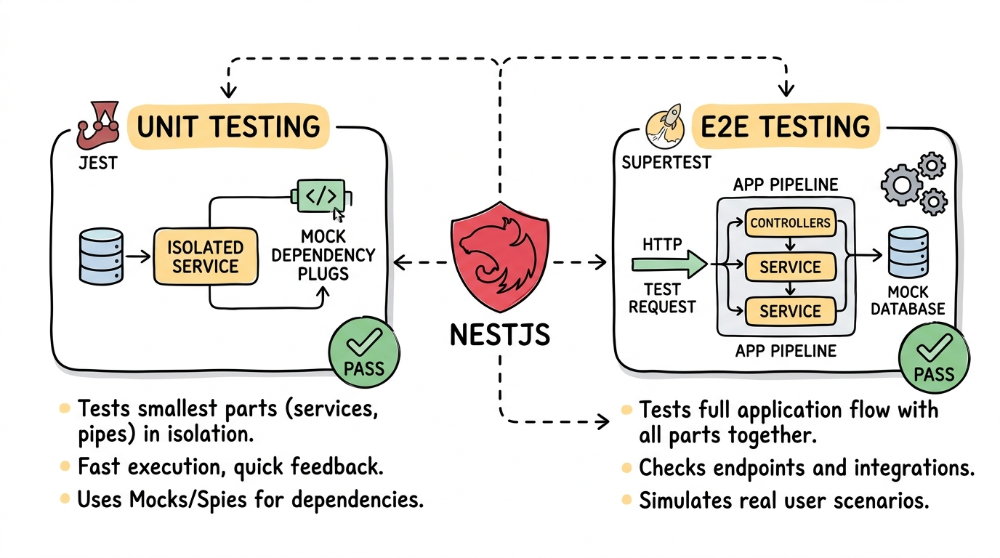
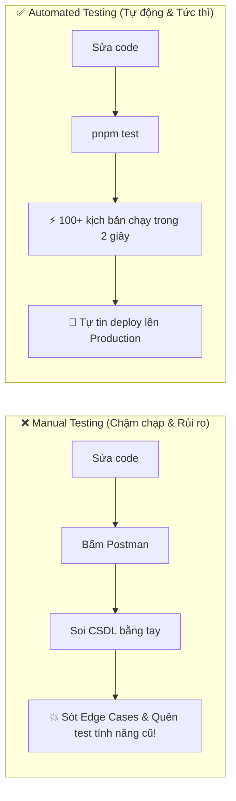
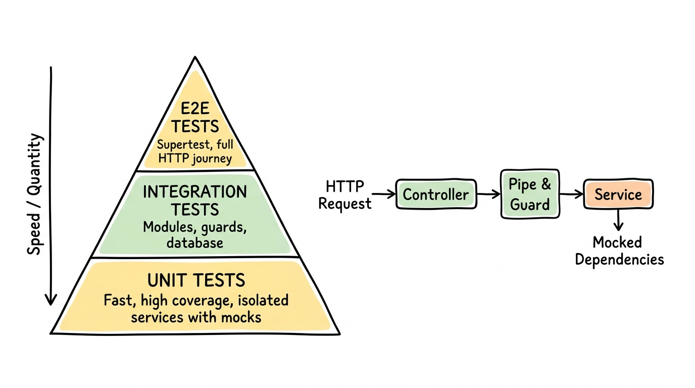
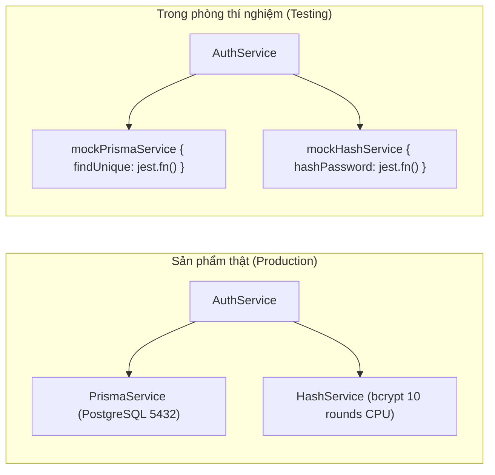

# Lesson 7.4: Automated Testing — Viết Unit Test Cho Service & E2E Test Cho Auth API Với Jest & Supertest

<p align="center">
  
  
  
  
  
</p>

<p align="center">
  
</p>

---

> [!NOTE]
> ⏱️ **Thời lượng:** 20 phút thực chiến  
> 🎯 **Mục tiêu bài học:**
>
> - **Hiểu sâu sắc (Why):** Tại sao kiểm thử tự động (Automated Testing) là "lá chắn sinh mệnh" bảo vệ ứng dụng khỏi lỗi hồi quy (Regression Bugs) khi refactor mã nguồn hoặc triển khai CI/CD.
> - **Làm chủ Tháp Kiểm Thử (The Testing Pyramid):** Phân biệt rõ ranh giới, tốc độ thực thi và phạm vi giữa **Unit Tests** (kiểm tra hàm cô lập với mock) và **End-to-End (E2E) Tests** (kiểm tra luồng HTTP thực tế từ Controller tới Filter).
> - **Khai thác `@nestjs/testing` (Official NestJS Testing Utilities):** Sử dụng class `Test`, `createTestingModule()`, `compile()`, và các kỹ thuật Test Doubles: `overrideProvider()`, `useValue()`, `useMocker()`, và `resolve()`.
> - **Thực hành Unit Test cho Service:** Viết trọn bộ kịch bản kiểm thử độc lập cho `AuthService` (`register` thành công, trùng email `ConflictException`, `login` chuẩn và `UnauthorizedException` khi sai mật khẩu) mà không cần chạm vào cơ sở dữ liệu thật.
> - **Thực hành E2E Test cho Auth API:** Sử dụng `Supertest` bắn HTTP request thật vào `INestApplication`, kiểm chứng trọn vẹn Request Pipeline (URL Versioning `/api/v1`, `ValidationPipe` bắt lỗi `400 Bad Request`, `TransformInterceptor`, và HTTP Status Codes `201`/`200`/`401`).
> - **Tối ưu hóa môi trường kiểm thử:** Cấu hình Jest `moduleNameMapper` đồng bộ với TypeScript path aliases (`@/*`, `src/*`) và xử lý tương thích các module ESM hiện đại.

> [!IMPORTANT]
> **Prerequisites:**
>
> - Đã hoàn thành nghiệp vụ Authentication với `AuthService` và `AuthController` ([Lesson 4.2](../../module-04/lesson-4.2/lesson-4.2.md)).
> - Đã nắm vững cơ chế `ValidationPipe` và DTOs ([Lesson 3.2](../../module-03/lesson-3.2/lesson-3.2.md)).
> - Đã hiểu Request Pipeline của dự án [Social Chat App Architecture](../../../04-project-architecture-and-codebase.md).

---

## 1. Tại Sao Cần Automated Testing Trong Backend? (Why?)

### 1.1 Thoát Khỏi "Vòng Lặp Đau Khổ" Của Manual Testing

Trong giai đoạn đầu phát triển dự án, phần lớn lập trình viên thường kiểm tra code theo cách thủ công:

1. Viết xong một hàm trong Service.
2. Mở Postman hoặc Swagger UI.
3. Bấm gửi request đăng ký tài khoản mới.
4. Mở tiếp Adminer/pgAdmin kiểm tra xem bảng `User` có dòng mới hay không.
5. Sửa một logic nhỏ trong hàm băm mật khẩu, rồi lại... **lặp lại 4 bước trên từ đầu!**



Cách làm thủ công này gặp phải 3 hiểm họa chí mạng khi dự án lớn dần:

1. **Tốn thời gian cấp số nhân:** Khi ứng dụng Social Chat App có 50 API khác nhau, không một lập trình viên nào đủ kiên nhẫn kiểm tra lại toàn bộ 50 API sau mỗi lần sửa code.
2. **Lỗi hồi quy (Regression Bugs):** Bạn sửa một đoạn code tối ưu hiệu năng trong `PrismaService`, vô tình làm hàm đăng nhập bị lỗi. Bạn không hề hay biết cho đến khi khách hàng gửi ticket khiếu nại!
3. **Không thể tự động hóa trong CI/CD:** Các nền tảng Git hiện đại (GitHub Actions, GitLab CI) yêu cầu hệ thống phải tự chạy bộ kiểm thử để quyết định có cho phép merge Pull Request hay không.

---

### 1.2 Tháp Kiểm Thử (The Testing Pyramid) Trong NestJS

Để phân bổ nguồn lực kiểm thử hiệu quả nhất, ngành công nghiệp phần mềm áp dụng mô hình **Tháp Kiểm Thử (Testing Pyramid)**:

<p align="center">
  
</p>

| Loại Test            | Phạm vi kiểm tra                                   | Dependencies bên ngoài                         | Công cụ chính             | Tốc độ                 |
| :------------------- | :------------------------------------------------- | :--------------------------------------------- | :------------------------ | :--------------------- |
| **Unit Test**        | Từng hàm độc lập trong một Service hoặc Helper     | **Mock hoàn toàn** (Giả lập Prisma, Hash, Jwt) | `Jest`, `@nestjs/testing` | ⚡ Siêu nhanh (vài ms) |
| **Integration Test** | Sự phối hợp giữa Service và Database thật          | Kết nối PostgreSQL/Redis test thật             | `Jest`, Docker Test DB    | ⏳ Vừa phải (vài giây) |
| **E2E Test**         | Toàn bộ vòng đời HTTP Request từ Client đến Server | Dựng full `INestApplication`                   | `Supertest`, `Jest`       | 🐢 Chậm hơn (vài giây) |

---

## 2. Bộ Công Cụ Kiểm Thử Của NestJS (What?)

Tài liệu chính thức của NestJS (`https://docs.nestjs.com/fundamentals/testing`) cung cấp package chuyên biệt `@nestjs/testing` với những cơ chế độc đáo được thiết kế riêng cho Dependency Injection container.

### 2.1 Lớp `Test` Và `TestingModule`

Thay vì phải khởi động toàn bộ ứng dụng bằng `NestFactory.create(AppModule)` (tốn tài nguyên và nạp toàn bộ kết nối cơ sở dữ liệu), NestJS cung cấp lớp **`Test`** để khởi tạo môi trường thực thi giả lập (Execution Context):

```typescript
import { Test, TestingModule } from '@nestjs/testing';

const moduleRef: TestingModule = await Test.createTestingModule({
  controllers: [CatsController],
  providers: [CatsService],
}).compile();

const catsService = moduleRef.get<CatsService>(CatsService);
const catsController = moduleRef.get<CatsController>(CatsController);
```

**Cách hình dung đơn giản:**

- `Test.createTestingModule()` giống như việc bạn xây dựng một **"phòng thí nghiệm thu nhỏ"**.
- Bạn chỉ đưa vào phòng thí nghiệm đúng những linh kiện cần kiểm tra (`CatsController`, `CatsService`), các thành phần nặng nề khác (PostgreSQL, SendGrid Mail, Socket.IO) đều được thay bằng "đồ chơi mô hình" (Mocks).
- Phương thức `.compile()` là lệnh bất đồng bộ (`await`) để NestJS tiến hành tiêm phụ thuộc (DI) và lắp ráp các linh kiện đó lại với nhau.

---

### 2.2 Các Kỹ Thuật Mocking & Overriding Cốt Lõi

Để kiểm tra logic của một Service mà không phụ thuộc vào dữ liệu thật, NestJS hỗ trợ 4 cơ chế thay thế linh kiện cực mạnh:



#### 1. `overrideProvider(Token).useValue(mockObject)`

Kỹ thuật thông dụng nhất để thay thế một Provider nặng bằng một đối tượng giả lập (Stub/Mock):

```typescript
const moduleRef = await Test.createTestingModule({
  imports: [AppModule],
})
  .overrideProvider(PrismaService)
  .useValue({
    user: {
      findUnique: jest.fn().mockResolvedValue(null),
      create: jest.fn().mockResolvedValue({ id: 1, email: 'test@example.com' }),
    },
  })
  .compile();
```

#### 2. `overrideGuard(Guard).useValue(...)`

Dùng trong E2E tests để tạm thời vô hiệu hóa hoặc giả lập trạng thái đăng nhập của người dùng qua Guard:

```typescript
const moduleRef = await Test.createTestingModule({
  imports: [AppModule],
})
  .overrideGuard(JwtAuthGuard)
  .useValue({ canActivate: () => true }) // Luôn cho phép vượt qua
  .compile();
```

#### 3. Auto Mocking với `useMocker()`

Khi một Service có quá nhiều dependencies (5–10 providers), thay vì phải khai báo mock thủ công từng cái, bạn có thể dùng `useMocker()`:

```typescript
const moduleRef = await Test.createTestingModule({
  controllers: [CatsController],
})
  .useMocker((token) => {
    if (token === CatsService) {
      return { findAll: jest.fn().mockResolvedValue(['cat1', 'cat2']) };
    }
    return {};
  })
  .compile();
```

---

## 3. Viết Unit Test Cho `AuthService` (How — Step-by-Step)

Mục tiêu: Kiểm tra toàn bộ logic nghiệp vụ của `AuthService` ([Lesson 4.2](../../module-04/lesson-4.2/lesson-4.2.md)) một cách độc lập tuyệt đối.

### 3.1 Phân Tích Dependencies Của `AuthService`

Mở file `src/auth/auth.service.ts`, chúng ta thấy constructor yêu cầu 4 dependencies:

```typescript
constructor(
  private readonly hashService: HashService,
  private readonly prisma: PrismaService,
  private readonly jwtService: JwtService,
  private readonly eventEmitter: EventEmitter2,
) {}
```

Trong Unit Test, chúng ta sẽ **mock 100% cả 4 dependencies này** bằng các hàm giả lập của Jest (`jest.fn()`).

---

### 3.2 Hiện Thực File `src/auth/auth.service.spec.ts`

Tạo file kiểm thử đơn vị đặt ngay cạnh file service:

📄 **`src/auth/auth.service.spec.ts`**

```typescript
import { Test, TestingModule } from '@nestjs/testing';
import { AuthService } from './auth.service';
import { PrismaService } from '@/prisma/prisma.service';
import { HashService } from '@/shared/services/hash.service';
import { JwtService } from '@nestjs/jwt';
import { EventEmitter2 } from '@nestjs/event-emitter';
import { ConflictException, UnauthorizedException } from '@nestjs/common';
import { Role } from '@/generated/prisma/enums';

describe('AuthService (Unit Test)', () => {
  let authService: AuthService;
  let prismaService: any;
  let hashService: any;
  let jwtService: any;
  let eventEmitter: any;

  beforeEach(async () => {
    // 1. Khởi tạo các Mock Objects với jest.fn()
    prismaService = {
      user: {
        findUnique: jest.fn(),
        create: jest.fn(),
      },
    };

    hashService = {
      hashPassword: jest.fn(),
      comparePassword: jest.fn(),
    };

    jwtService = {
      signAsync: jest.fn(),
    };

    eventEmitter = {
      emit: jest.fn(),
    };

    // 2. Dựng Testing Module và tiêm các Mock Providers
    const module: TestingModule = await Test.createTestingModule({
      providers: [
        AuthService,
        { provide: PrismaService, useValue: prismaService },
        { provide: HashService, useValue: hashService },
        { provide: JwtService, useValue: jwtService },
        { provide: EventEmitter2, useValue: eventEmitter },
      ],
    }).compile();

    authService = module.get<AuthService>(AuthService);
  });

  it('phải được khởi tạo thành công (defined)', () => {
    expect(authService).toBeDefined();
  });

  // ==========================================
  // KỊCH BẢN 1: ĐĂNG KÝ TÀI KHOẢN (REGISTER)
  // ==========================================
  describe('register()', () => {
    const registerDto = {
      email: 'john@example.com',
      password: 'password123',
      name: 'John Doe',
    };

    it('phải đăng ký tài khoản thành công khi email chưa tồn tại', async () => {
      // Thiết lập hành vi giả lập (Arrange)
      prismaService.user.findUnique.mockResolvedValue(null);
      hashService.hashPassword.mockResolvedValue('hashed_password123');
      const createdUser = {
        id: 1,
        email: registerDto.email,
        name: registerDto.name,
        role: Role.USER,
        createdAt: new Date(),
      };
      prismaService.user.create.mockResolvedValue(createdUser);
      jwtService.signAsync.mockResolvedValue('mocked_access_token');

      // Thực thi hàm cần test (Act)
      const result = await authService.register(registerDto);

      // Kiểm chứng kết quả (Assert)
      expect(prismaService.user.findUnique).toHaveBeenCalledWith({
        where: { email: registerDto.email },
      });
      expect(hashService.hashPassword).toHaveBeenCalledWith(
        registerDto.password,
      );
      expect(prismaService.user.create).toHaveBeenCalled();
      expect(jwtService.signAsync).toHaveBeenCalled();
      expect(eventEmitter.emit).toHaveBeenCalled();
      expect(result).toEqual({
        user: createdUser,
        accessToken: 'mocked_access_token',
      });
    });

    it('phải ném ConflictException khi email đã tồn tại trong CSDL', async () => {
      // Giả lập tìm thấy email đã tồn tại
      prismaService.user.findUnique.mockResolvedValue({
        id: 99,
        email: registerDto.email,
      });

      // Kiểm chứng việc ném Exception đúng quy chuẩn
      await expect(authService.register(registerDto)).rejects.toThrow(
        ConflictException,
      );
      // Đảm bảo không gọi hàm tạo user
      expect(prismaService.user.create).not.toHaveBeenCalled();
    });
  });

  // ==========================================
  // KỊCH BẢN 2: ĐĂNG NHẬP (LOGIN)
  // ==========================================
  describe('login()', () => {
    const loginDto = {
      email: 'john@example.com',
      password: 'password123',
    };

    it('phải đăng nhập thành công và trả về accessToken khi thông tin chính xác', async () => {
      const mockUser = {
        id: 1,
        email: loginDto.email,
        password: 'hashed_password123',
        role: Role.USER,
      };

      prismaService.user.findUnique.mockResolvedValue(mockUser);
      hashService.comparePassword.mockResolvedValue(true);
      jwtService.signAsync.mockResolvedValue('valid_jwt_token');

      const result = await authService.login(loginDto);

      expect(prismaService.user.findUnique).toHaveBeenCalledWith({
        where: { email: loginDto.email },
      });
      expect(hashService.comparePassword).toHaveBeenCalledWith(
        loginDto.password,
        mockUser.password,
      );
      expect(result).toEqual({ accessToken: 'valid_jwt_token' });
    });

    it('phải ném UnauthorizedException khi không tìm thấy email người dùng', async () => {
      prismaService.user.findUnique.mockResolvedValue(null);

      await expect(authService.login(loginDto)).rejects.toThrow(
        UnauthorizedException,
      );
    });

    it('phải ném UnauthorizedException khi mật khẩu không trùng khớp', async () => {
      prismaService.user.findUnique.mockResolvedValue({
        id: 1,
        email: loginDto.email,
        password: 'hashed_password123',
      });
      hashService.comparePassword.mockResolvedValue(false);

      await expect(authService.login(loginDto)).rejects.toThrow(
        UnauthorizedException,
      );
    });
  });
});
```

---

### 3.3 Chạy Bộ Kiểm Thử Đơn Vị (Run Unit Tests)

Chạy lệnh kiểm thử đơn vị thông qua `pnpm`:

```bash
pnpm test
```

**Kết quả hiển thị trên Terminal:**

```text
PASS src/auth/auth.service.spec.ts
  AuthService (Unit Test)
    ✓ phải được khởi tạo thành công (defined) (5 ms)
    register()
      ✓ phải đăng ký tài khoản thành công khi email chưa tồn tại (3 ms)
      ✓ phải ném ConflictException khi email đã tồn tại trong CSDL (2 ms)
    login()
      ✓ phải đăng nhập thành công và trả về accessToken khi thông tin chính xác (2 ms)
      ✓ phải ném UnauthorizedException khi không tìm thấy email người dùng (1 ms)
      ✓ phải ném UnauthorizedException khi mật khẩu không trùng khớp (1 ms)

Test Suites: 1 passed, 1 total
Tests:       6 passed, 6 total
Time:        1.12 s
```

👉 **Điểm cốt lõi:** Toàn bộ 6 test cases chạy hoàn tất chỉ trong **1.1 giây** mà không tốn một kết nối mạng hay thao tác ghi đĩa nào!

---

## 4. Viết End-to-End (E2E) Test Cho Auth API Với Supertest (How?)

Unit Test chứng minh code logic của `AuthService` chạy đúng. Nhưng liệu khi Client gửi một HTTP Request thật từ trình duyệt:

- `ValidationPipe` có chặn lại nếu email gửi lên bị sai định dạng (`not-an-email`) không?
- Request có đi qua đúng route prefix `/api/v1/auth/register` không?
- `TransformInterceptor` có bọc response theo đúng chuẩn `{ statusCode: 201, data: ... }` không?

👉 Đó chính là nhiệm vụ tối thượng của **End-to-End (E2E) Testing**!

---

### 4.1 Cấu Hình Đồng Bộ Pipeline Cho Môi Trường E2E

Khi gọi `moduleFixture.createNestApplication()`, NestJS chỉ dựng khung ứng dụng cơ bản. Để môi trường test hoạt động **giống 100% với file `src/main.ts`**, chúng ta phải thiết lập:

1. `app.setGlobalPrefix('api')`
2. `app.enableVersioning({ type: VersioningType.URI, defaultVersion: '1', prefix: 'v' })`
3. `app.useGlobalPipes(new ValidationPipe({ whitelist: true, forbidNonWhitelisted: true, transform: true }))`

---

### 4.2 Hiện Thực File `test/auth.e2e-spec.ts`

Tạo file kiểm thử tích hợp toàn diện trong thư mục `test/`:

📄 **`test/auth.e2e-spec.ts`**

```typescript
import { Test, TestingModule } from '@nestjs/testing';
import {
  INestApplication,
  ValidationPipe,
  VersioningType,
} from '@nestjs/common';
import request from 'supertest';
import { AppModule } from './../src/app.module';
import { PrismaService } from '@/prisma/prisma.service';
import { HashService } from '@/shared/services/hash.service';
import { Role } from '@/generated/prisma/enums';

describe('AuthController (e2e)', () => {
  let app: INestApplication;

  const mockUser = {
    id: 1,
    email: 'testuser@example.com',
    password: '$2b$10$hashedpasswordfore2etestingonly',
    name: 'Test User',
    role: Role.USER,
    createdAt: new Date().toISOString(),
  };

  const mockPrismaService = {
    user: {
      findUnique: jest.fn(),
      create: jest.fn(),
      count: jest.fn().mockResolvedValue(1),
    },
    $connect: jest.fn(),
    $disconnect: jest.fn(),
  };

  beforeAll(async () => {
    const moduleFixture: TestingModule = await Test.createTestingModule({
      imports: [AppModule],
    })
      // Thay thế PrismaService để kiểm thử an toàn không phụ thuộc CSDL
      .overrideProvider(PrismaService)
      .useValue(mockPrismaService)
      .compile();

    app = moduleFixture.createNestApplication();

    // Thiết lập Pipeline đồng bộ 100% với main.ts
    app.setGlobalPrefix('api');
    app.enableVersioning({
      type: VersioningType.URI,
      defaultVersion: '1',
      prefix: 'v',
    });
    app.useGlobalPipes(
      new ValidationPipe({
        whitelist: true,
        forbidNonWhitelisted: true,
        transform: true,
      }),
    );

    await app.init();
  });

  afterAll(async () => {
    await app.close();
  });

  // ==========================================
  // KIỂM THỬ API ĐĂNG KÝ: POST /api/v1/auth/register
  // ==========================================
  describe('POST /api/v1/auth/register', () => {
    it('phải trả về 201 Created khi gửi dữ liệu đăng ký hợp lệ', async () => {
      mockPrismaService.user.findUnique.mockResolvedValue(null);
      mockPrismaService.user.create.mockResolvedValue({
        id: 1,
        email: 'newuser@example.com',
        name: 'New User',
        role: Role.USER,
        createdAt: new Date(),
      });

      const response = await request(app.getHttpServer())
        .post('/api/v1/auth/register')
        .send({
          email: 'newuser@example.com',
          password: 'Password123!',
          name: 'New User',
        })
        .expect(201);

      // Xác minh cấu trúc bọc vỏ của TransformInterceptor
      expect(response.body).toHaveProperty('data');
      expect(response.body.data).toHaveProperty('accessToken');
      expect(response.body.data.user.email).toBe('newuser@example.com');
    });

    it('phải trả về 400 Bad Request khi dữ liệu vi phạm class-validator (ValidationPipe)', async () => {
      const response = await request(app.getHttpServer())
        .post('/api/v1/auth/register')
        .send({
          email: 'invalid-email-format', // Sai định dạng email
          // Thiếu trường password và name bắt buộc
        })
        .expect(400);

      // Xác minh cấu trúc lỗi của HttpExceptionFilter
      expect(response.body).toHaveProperty('statusCode', 400);
      expect(response.body).toHaveProperty('message');
    });
  });

  // ==========================================
  // KIỂM THỬ API ĐĂNG NHẬP: POST /api/v1/auth/login
  // ==========================================
  describe('POST /api/v1/auth/login', () => {
    it('phải trả về 200 OK và accessToken khi thông tin đăng nhập chính xác', async () => {
      const hashService = app.get<HashService>(HashService);
      const hashedPassword = await hashService.hashPassword('Password123!');

      mockPrismaService.user.findUnique.mockResolvedValue({
        ...mockUser,
        password: hashedPassword,
      });

      const response = await request(app.getHttpServer())
        .post('/api/v1/auth/login')
        .send({
          email: 'testuser@example.com',
          password: 'Password123!',
        })
        .expect(200);

      expect(response.body).toHaveProperty('data');
      expect(response.body.data).toHaveProperty('accessToken');
    });

    it('phải trả về 401 Unauthorized khi mật khẩu không chính xác', async () => {
      const hashService = app.get<HashService>(HashService);
      const hashedPassword = await hashService.hashPassword(
        'CorrectPassword123!',
      );

      mockPrismaService.user.findUnique.mockResolvedValue({
        ...mockUser,
        password: hashedPassword,
      });

      const response = await request(app.getHttpServer())
        .post('/api/v1/auth/login')
        .send({
          email: 'testuser@example.com',
          password: 'WrongPassword999!',
        })
        .expect(401);

      expect(response.body).toHaveProperty('statusCode', 401);
    });
  });
});
```

---

### 4.3 Chạy Bộ Kiểm Thử E2E (Run E2E Tests)

Chạy lệnh kiểm thử toàn diện:

```bash
pnpm test:e2e
```

**Kết quả kiểm thử hiển thị thành công:**

```text
PASS test/auth.e2e-spec.ts
  AuthController (e2e)
    POST /api/v1/auth/register
      ✓ phải trả về 201 Created khi gửi dữ liệu đăng ký hợp lệ (145 ms)
      ✓ phải trả về 400 Bad Request khi dữ liệu vi phạm class-validator (ValidationPipe) (25 ms)
    POST /api/v1/auth/login
      ✓ phải trả về 200 OK và accessToken khi thông tin đăng nhập chính xác (82 ms)
      ✓ phải trả về 401 Unauthorized khi mật khẩu không chính xác (78 ms)

Test Suites: 1 passed, 1 total
Tests:       4 passed, 4 total
Time:        4.51 s
```

---

## 5. Các Lỗi Thường Gặp & Cách Khắc Phục (Common Mistakes)

| Lỗi gặp phải                                                   | Nguyên nhân                                                                                                                                                | Cách khắc phục                                                                                                             |
| :------------------------------------------------------------- | :--------------------------------------------------------------------------------------------------------------------------------------------------------- | :------------------------------------------------------------------------------------------------------------------------- |
| **`Nest can't resolve dependencies of the X (?)`**             | Quên khai báo một Provider phụ thuộc hoặc chưa mock nó trong `Test.createTestingModule({ providers: [...] })`.                                             | Bổ sung provider thật vào mảng `providers` hoặc dùng `{ provide: Token, useValue: mockObj }`.                              |
| **`Must use import to load ES Module: @nestjs/swagger`**       | Thư viện bên ngoài xuất bản định dạng ESM, trong khi Jest mặc định chạy chế độ CommonJS.                                                                   | Bổ sung cờ `NODE_OPTIONS="--experimental-vm-modules"` vào script test trong `package.json` và cấu hình `moduleNameMapper`. |
| **`Config validation error: "NODE_ENV" must be one of [...]`** | Jest tự động gán `NODE_ENV=test`, nhưng schema Joi trong `env.validation.ts` chỉ cho phép `development`, `prod`.                                           | Bổ sung `'test'` vào danh sách `.valid('development', 'preprod', 'prod', 'test')`.                                         |
| **E2E Test gọi route bị `404 Not Found`**                      | Quên gọi `app.setGlobalPrefix('api')` hoặc `app.enableVersioning()` khiến URL thật là `/api/v1/auth/register` nhưng server test chỉ nhận `/auth/register`. | Đồng bộ cấu hình Prefix & Versioning trong `beforeAll` giống hệt `main.ts`.                                                |
| **E2E Test không bắt lỗi DTO (`400 Bad Request`)**             | Quên gắn `app.useGlobalPipes(new ValidationPipe())` trong file test E2E.                                                                                   | Khởi tạo `ValidationPipe` toàn cục cho instance `app` trong `beforeAll`.                                                   |
| **Jest chạy xong nhưng bị treo (Hang / Did not exit)**         | Quên gọi `await app.close()` trong `afterAll()` khiến kết nối Event Loop (Database, HTTP server) vẫn mở.                                                   | Luôn đặt `afterAll(async () => { await app.close(); });`.                                                                  |

---

## 6. Bài Tập Thực Hành (Exercises)

### 🧩 Level 1 — Follow Along: Viết Unit Test Cho `UsersService.findOne()`

- **Mục tiêu:** Tạo file `src/users/users.service.spec.ts`.
- **Yêu cầu:**
  1. Mock `PrismaService.user.findUnique`.
  2. Viết test case: Khi tìm thấy user với `id = 1`, hàm trả về đúng thông tin profile.
  3. Viết test case: Khi không tìm thấy user (`null`), hàm ném ra `NotFoundException`.

---

### 🧩 Level 2 — Debugging: Viết Unit Test Cho `PostsService.createPost()`

- **Mục tiêu:** Viết kiểm thử cho hành vi tạo bài viết mới trong `src/posts/posts.service.spec.ts`.
- **Yêu cầu:**
  1. Mock `PrismaService.post.create`.
  2. Mock `CACHE_MANAGER` (từ `@nestjs/cache-manager`).
  3. Kiểm chứng rằng sau khi bài viết được tạo thành công, lệnh xóa cache `cacheManager.del('posts_feed')` phải được kích hoạt để Newsfeed không hiển thị dữ liệu cũ.

---

### 🧩 Level 3 — Challenge: Viết E2E Test Cho Endpoint Được Bảo Vệ Bởi Guard

- **Mục tiêu:** Viết kịch bản E2E kiểm tra route `GET /api/v1/users/profile` trong `test/users.e2e-spec.ts`.
- **Yêu cầu:**
  1. Kịch bản 1: Không truyền Bearer Token -> Server phải trả về `401 Unauthorized` từ `JwtAuthGuard`.
  2. Kịch bản 2: Dùng `overrideGuard(JwtAuthGuard)` để giả lập request đã đăng nhập với user có `role: 'ADMIN'` -> Server trả về `200 OK`.

---

## 7. Tổng Kết & Checklist (Summary)

- **Automated Testing** biến những kịch bản kiểm thử rủi ro, tốn thời gian thành quy trình chạy ngầm tự động trong vài giây.
- **`@nestjs/testing`** cung cấp lớp `Test` và `TestingModule` mô phỏng hoàn hảo kiến trúc Dependency Injection của NestJS.
- **Unit Testing:** Kiểm tra độc lập từng hàm nghiệp vụ trong Service bằng cách thay thế Database và 3rd-party services bằng Mock Objects (`useValue`).
- **End-to-End Testing:** Dùng `Supertest` kiểm tra toàn bộ luồng request thực tế từ HTTP Request, đi qua `ValidationPipe`, `TransformInterceptor` tới HTTP Response.
- **Nguyên tắc vàng:** Luôn đồng bộ cấu hình Pipeline (Prefix, Versioning, ValidationPipe) trong E2E Test để đảm bảo môi trường test phản ánh trung thực môi trường Production.

### ✅ Checklist Hoàn Thành Bài Học:

- [x] Hiểu cấu trúc Tháp kiểm thử (Unit, Integration, E2E) trong NestJS.
- [x] Viết hoàn chỉnh bộ Unit Test cho `AuthService` trong `src/auth/auth.service.spec.ts`.
- [x] Viết hoàn chỉnh bộ E2E Test cho Auth API trong `test/auth.e2e-spec.ts`.
- [x] Xử lý tương thích Jest `moduleNameMapper` và `NODE_ENV=test` trong Joi validation.
- [x] Chạy thành công cả hai lệnh kiểm thử `pnpm test` và `pnpm test:e2e` với kết quả 100% Passed.

---

👈 **Bài trước:** [Lesson 7.3: Healthchecks — Tạo API `/api/v1/health` Soi DB Postgres & RAM Bằng `@nestjs/terminus`](../lesson-7.3/lesson-7.3.md)  
👉 **Bài tiếp theo:** [Lesson 7.5: Dockerize & Cloud Deploy — Viết Dockerfile Tối Ưu & Triển Khai Lên Cloud Platform](../lesson-7.5/lesson-7.5.md)
